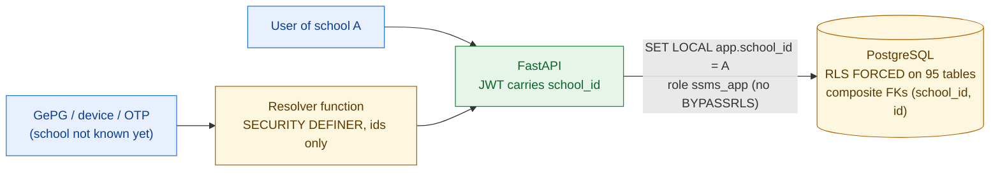

# 1. Introduction

## 1.1 Problem

Tanzanian schools still run on paper registers, mark spreadsheets and fee books. As a result:

- records get lost or damaged;
- teachers spend days compiling marks;
- fee instalments leak;
- parents hear about absences and results late;
- year-end reports to the authorities take weeks;
- anyone with access to the office can change a record without trace.

## 1.2 Solution

**Smart School Management System (SSMS)** is an API-first, mobile-friendly Progressive Web App that many schools share as one platform (multi-tenant SaaS). It:

- **Attendance:** takes attendance through a teacher register that works offline, plus RFID/QR gate taps, and sends parents an SMS by 08:30 when a child is absent.
- **Results:** captures continuous assessment and exam marks offline, blocks publication until every mark is present and valid, then freezes results on the NECTA scale and issues report cards.
- **Fees:** bills fees with GePG control numbers, accepts M-Pesa, Mixx by Yas (Tigo Pesa), Airtel Money, HaloPesa, bank and cash, and keeps a double-entry ledger.
- **School operations:** runs enrolment, timetables (clash-free), exams, staff, hostels, transport, venues, discipline, clubs and the library.
- **Reporting:** produces dashboards and statutory exports, in Kiswahili first with English as an option.

## 1.3 Scope by build phase

| Phase | Content | Status |
|---|---|---|
| 0 | Design documentation (this folder), schema, seed, database tests | **this deliverable** |
| 1 | Foundation: repo, Docker, config, auth (JWT + OTP), RBAC, tenancy + RLS, audit, schools, users, students, guardians, staff, departments, bulk import | next |
| 2 | Academics: configuration, classes, subjects, rooms, enrolment workflow, timetable, exams, offline mark entry, validation firewall, publishing, report-card PDFs | |
| 3 | Finance: fee structures, invoices, GePG, mobile money, bank confirmation, allocations, receipts, reconciliation, reminders | |
| 4 | Attendance and communication: registers, RFID/QR devices, absence alerts, SMS adapters, templates, parent and student portals | |
| 5 | Facilities and student life: hostel, transport, venues, discipline, clubs, library | |
| 6 | Analytics, dashboards, compliance exports, performance tuning, load test, deployment | |

**Out of scope for version 2.** Payroll processing (salary is stored, not paid), e-learning content, NECTA candidate registration (export file only), native apps (the PWA covers Android), and school-to-school transfers of records (exported as PDF).

## 1.4 Actors and roles

| Role | Kiswahili | Who | Main use |
|---|---|---|---|
| `super_admin` | Msimamizi wa jukwaa | Platform operator (table `platform_admins`, not a school user) | Onboard and suspend schools, support |
| `school_admin` | Mkuu wa shule / Mwalimu wa taaluma / Msajili | Head teacher, academic master, registrar | Everything in the school, publish results, approve amendments and reversals |
| `bursar` | Mhasibu | Finance officer | Fees, invoices, payments, reconciliation |
| `teacher` | Mwalimu | Class and subject teachers | Registers, mark entry, document validation, discipline |
| `department_head` | Mkuu wa idara | Head of a department | Teacher rights plus department staff and exams |
| `parent` | Mzazi / Mlezi | Guardian (phone + OTP) | Children's attendance, results, invoices, payments |
| `registrar` | Msajili | Registrar | Students, guardians, enrolment, academic set-up, timetable |
| `student` | Mwanafunzi | Learner (older pupils) | Timetable, results, fee balance, hostel request |
| `gatekeeper` | Mlinzi wa geti | Operates gate devices | Card taps, manual gate entry |
| `bank_officer` | Afisa wa benki | Partner bank staff | Confirm deposits |
| `hostel_master`, `transport_officer`, `librarian` | Mlezi wa bweni, Afisa usafiri, Mkutubi | Optional roles | Their module |

External systems: **GePG**, **mobile-money operators/aggregators**, **banks**, **SMS gateway** (Beem Africa, NextSMS), **NECTA** (export files only).

## 1.5 Multi-tenancy model

- **One database, shared schema, `school_id` on every business row** (the "pool" model). It is cheapest to run for hundreds of small schools. A very large tenant can later be moved to its own database without code changes, because every query is already tenant-scoped.
- **Three independent locks:**
  1. the API's tenant dependency adds `school_id` to every repository query;
  2. PostgreSQL **Row-Level Security**, forced on every tenant table, filters by `app.school_id`, which the API sets with `SET LOCAL` per transaction;
  3. **composite foreign keys** `(school_id, x_id) → x (school_id, id)` make a cross-school reference impossible even for code that bypasses the API.
- **No context means no rows.** Without `app.school_id`, every tenant table returns nothing, so the system fails closed.
- **Lookups before login.** A few lookups happen before the school is known: school code in the URL, device API key, GePG callback, refresh-token cookie, and parent phone for OTP. These go through five **resolver functions** that return ids only (see [15-security.md](15-security.md#153-row-level-security-and-resolvers)).
- **Tested.** Isolation is checked as the runtime role by tests I01–I16 ([16-test-plan.md](16-test-plan.md)).

## 1.6 Assumptions

One line each. A change to any of them changes the design where noted.

1. One PostgreSQL 16 cluster with a shared schema; tenants are rows, not schemas.
2. A person active in two schools has one account per school. Parent OTP login lists the matching schools to choose from.
3. Parents who share one phone number in a school share one parent account there (phone is unique per school).
4. `super_admin` is a platform operator in `platform_admins`; schools never see platform users.
5. The academic year runs January–December. Terms are configurable (two are seeded); public holidays are seeded per school each year.
6. School days are Monday–Friday. Saturday is a school day only in a term whose timetable has Saturday lessons; Sunday is always closed. The generator places lessons Monday–Friday; Saturday lessons are added by hand.
7. Grading schemes, grade bands and division rules are data, per school, level and year. The seeded values follow published NECTA scales — **VERIFY**.
8. Final subject score = Σ (score ÷ component maximum × component weight). Weights must total 100. A student marked absent scores 0 for that component — **VERIFY** with pilot schools.
9. The grade band uses the final score rounded to a whole number, because NECTA bands are whole numbers — **VERIFY**.
10. Positions use RANK: ties share a position and the next one is skipped. Class position is by average, subject position by final score.
11. An approved amendment creates a new frozen version of the result and summary. Positions are not re-ranked, and the report card marks the amended subject.
12. A student's "type" (primary/secondary) is derived from the class level of the enrolment, not stored.
13. GePG bill references (which carry the school code) and control numbers are globally unique. Every other external reference is unique per school.
14. Phone, NIDA, birth-certificate number and health notes are encrypted by the application (AES-256-GCM, key from the secret store), with a keyed HMAC-SHA256 blind index for exact lookups.
15. Mobile-money collections go through GePG for government schools and through a licensed aggregator or direct operator APIs for private schools — **VERIFY** per contract.
16. SMS goes through Beem Africa or NextSMS behind one adapter. The sender ID must be registered — **VERIFY** with the provider.
17. Target devices: Android 8+ with Chrome 90+ on 2G/3G, at 360 px width.
18. Data is hosted in Tanzania where possible; any cross-border transfer follows the Personal Data Protection Act, 2022.
19. Fee amounts in the seed are illustrative. Fee-free government schools use the same model for contributions.
20. Timestamps are stored in UTC and shown in Africa/Dar_es_Salaam (EAT, UTC+3, no daylight saving).

## 1.7 Items to VERIFY before launch

| # | Item | Where it is used |
|---|---|---|
| V1 | NECTA grade bands and points for PSLE, CSEE, ACSEE, and division bands | seed `grade_bands`, `division_rules` |
| V2 | NECTA subject codes (e.g. 041 Basic Mathematics, 142 Advanced Mathematics) | seed `subjects.necta_code` |
| V3 | Absent = 0 and whole-number rounding for bands | `publish_results()` |
| V4 | GePG message element names, signature algorithm, acknowledgement codes (e.g. 7101), control-number format | GePG adapter (Phase 3), `gepg_bills` |
| V5 | GFS revenue codes for each fee item | `fee_items.gfs_code` |
| V6 | Mobile-money and aggregator callback formats and IP ranges | Phase 3 adapters |
| V7 | SMS provider APIs, delivery reports, sender-ID registration | Phase 4 adapters |
| V8 | PReM number and RITA birth-certificate formats | `students.prem_number`, input specs |
| V9 | PDPA 2022 regulations: breach-notification period, data-subject response time (30 days assumed) | `data_subject_requests.due_at`, [15-security.md](15-security.md) |
| V10 | Brand names: Tigo Pesa is now **Mixx by Yas**; channel code stays `TIGOPESA` | payments, UI labels |

## 1.8 Document map

| § | File | Content |
|---|---|---|
| 1 | this file | Introduction, scope, actors, tenancy, assumptions |
| 2 | [02-requirements.md](02-requirements.md) | Functional and non-functional requirements |
| 3 | [03-context-dfd.md](03-context-dfd.md) | Context diagram, DFD Level 1 and Level 2 |
| 4 | [04-use-cases.md](04-use-cases.md) | Use cases with «include»/«extend» |
| 5 | [05-erd.md](05-erd.md) | Crow's Foot ERD by area |
| 6 | [06-data-model.md](06-data-model.md) | DDL notes, tenancy, encryption, 3NF, triggers |
| 7 | [07-data-dictionary.md](07-data-dictionary.md) | Every column (generated from the live schema) |
| 8 | [08-class-diagram.md](08-class-diagram.md) | Domain classes |
| 9 | [09-sequence-diagrams.md](09-sequence-diagrams.md) | Six workflows with endpoints and tables |
| 10 | [10-activity-diagrams.md](10-activity-diagrams.md) | Swimlanes: enrolment, fee payment, scheduling, publishing |
| 11 | [11-architecture.md](11-architecture.md) | Architecture, deployment, offline sync, scaling |
| 12 | [12-api-design.md](12-api-design.md) | Every endpoint |
| 13 | [13-io-specifications.md](13-io-specifications.md) | Every form and output |
| 14 | [14-wireframes.md](14-wireframes.md) | Every portal screen |
| 15 | [15-security.md](15-security.md) | RBAC, JWT/OTP, RLS, resolvers, PDPA |
| 16 | [16-test-plan.md](16-test-plan.md) | Test cases, database tests, UAT |
| 17 | [17-corrections.md](17-corrections.md) | Corrections to earlier designs |
| — | [sql/schema.sql](sql/schema.sql), [sql/seed.sql](sql/seed.sql), [sql/tests/](sql/tests/) | Executable design |

## 1.9 Notation

- Diagrams are Mermaid.
- ERDs use Crow's Foot notation.
- DFDs follow Yourdon/DeMarco: rectangles are entities, rounded boxes are processes, double-edged boxes are data stores.
- UML 2.x is used for the other diagrams. Mermaid has no use-case or swimlane diagram, so actors are drawn as «actor» boxes and swimlanes as subgraphs.
