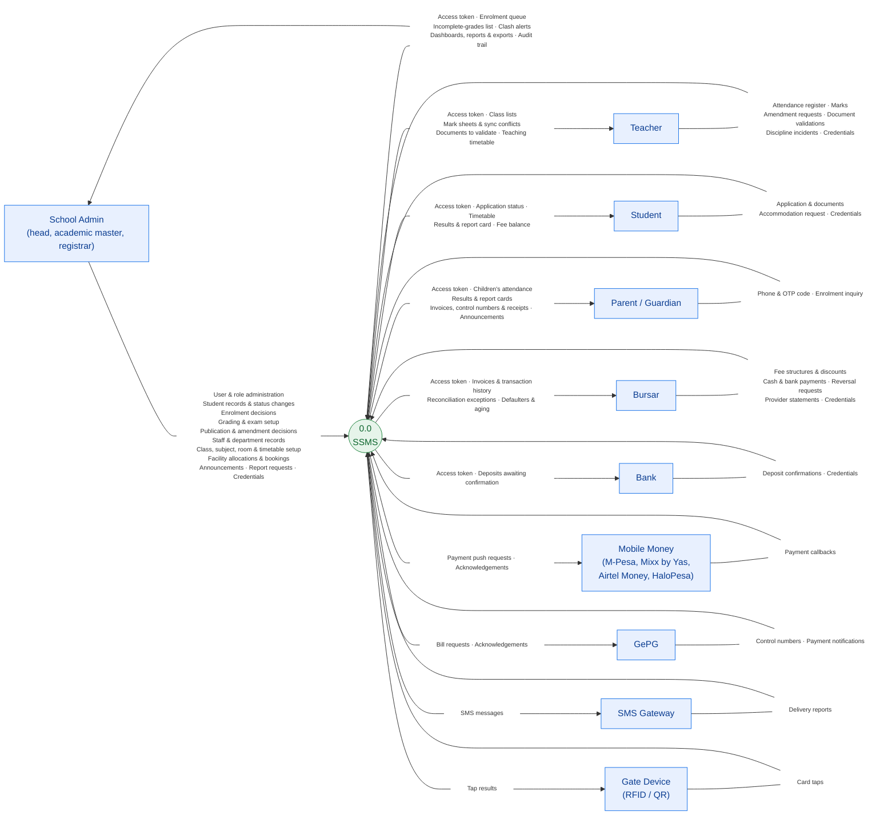
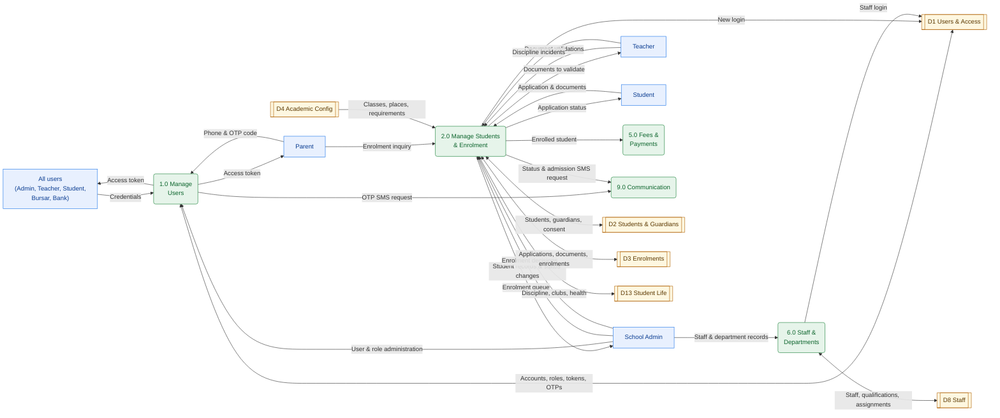
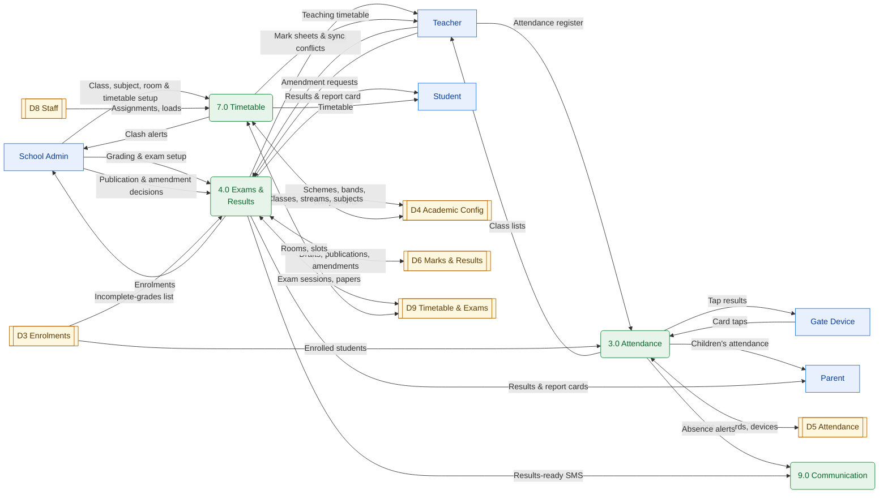
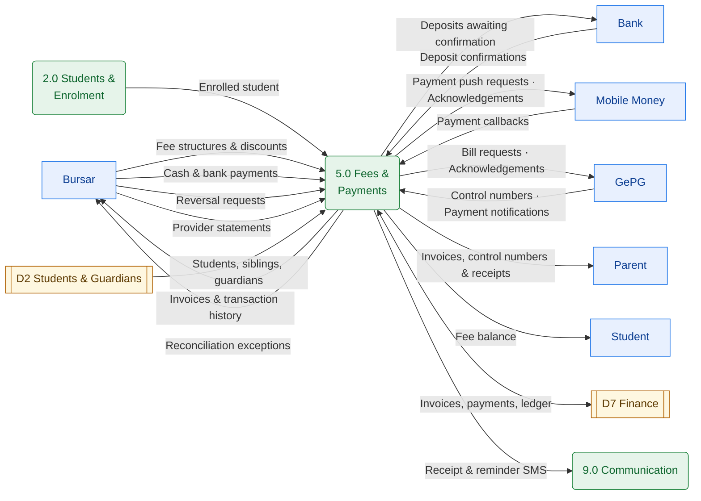
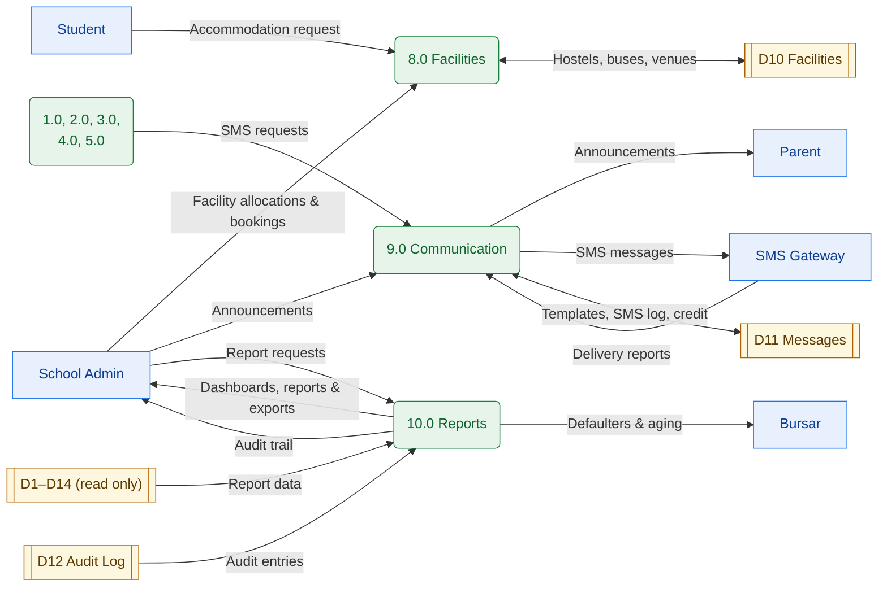
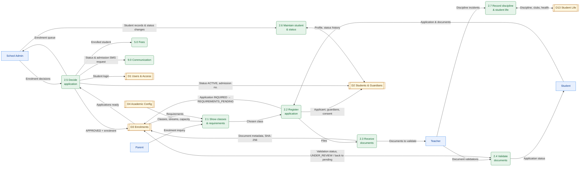
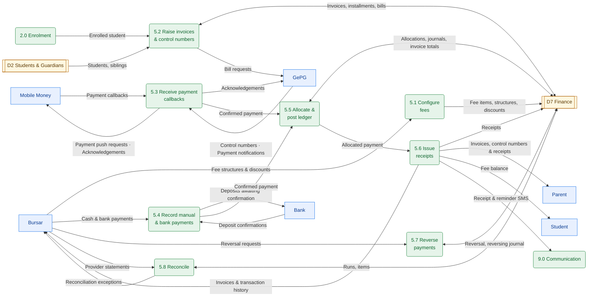

# 3. Context Diagram and Data Flow Diagrams

Notation (Yourdon/DeMarco):

- external entities are rectangles;
- processes are rounded boxes, numbered `n.0` at Level 1 and `n.m` at Level 2;
- data stores are double-edged boxes `Dn`;
- arrows carry data only.

Long Level 0 labels are drawn as text nodes so they do not overlap the boxes.

## 3.1 Data stores

| Store | Tables |
|---|---|
| D1 Users & Access | `users`, `user_roles`, `roles`, `permissions`, `refresh_tokens`, `otp_codes` |
| D2 Students & Guardians | `students`, `guardians`, `student_guardians`, `student_status_history`, `consent_records`, `data_subject_requests` |
| D3 Enrolments | `enrolment_requirements`, `enrolment_applications`, `enrolment_documents`, `enrolments` |
| D4 Academic Configuration | `education_levels`, `academic_years`, `terms`, `public_holidays`, `classes`, `streams`, `stream_class_teachers`, `subjects`, `class_subjects`, `combinations`, `combination_subjects`, `grading_schemes`, `grade_bands`, `division_rules`, `assessment_components` |
| D5 Attendance | `attendance_sessions`, `attendance_records`, `absence_alerts`, `devices`, `rfid_cards` |
| D6 Marks & Results | `mark_entries`, `result_publications`, `published_results`, `student_term_summaries`, `result_amendments`, `report_card_comments` |
| D7 Finance | `fee_items`, `fee_structures`, `fee_structure_lines`, `discount_rules`, `student_discounts`, `invoices`, `invoice_lines`, `invoice_installments`, `gepg_bills`, `payments`, `payment_allocations`, `payment_reversals`, `receipts`, `ledger_accounts`, `journals`, `ledger_entries`, `bank_deposit_confirmations`, `reconciliation_runs`, `reconciliation_items` |
| D8 Staff | `staff`, `staff_qualifications`, `departments`, `designations`, `teaching_assignments` |
| D9 Timetable & Exams | `rooms`, `timetable_slots`, `exam_sessions`, `exams` |
| D10 Facilities | `hostels`, `hostel_rooms`, `accommodation_requests`, `hostel_allocations`, `buses`, `routes`, `route_stops`, `transport_assignments`, `venues`, `venue_events` |
| D11 Messages | `message_templates`, `sms_messages`, `sms_credit_transactions`, `announcements`, `notifications` |
| D12 Audit Log | `audit_logs` (written by triggers from every process) |
| D13 Student Life | `discipline_records`, `extracurricular_activities`, `student_activities`, `library_books`, `library_loans`, `health_records` |
| D14 Jobs | `background_jobs`, `idempotency_keys`, `document_sequences` |

## 3.2 Level 0 — Context diagram

SMS to parents leaves the system through the SMS Gateway. The gateway, not SSMS, delivers it to the phone, so it is drawn as *SMS messages → SMS Gateway*.

## 3.3 Level 1

Level 1 is one diagram with ten processes. It is drawn as **four views** so that it stays readable. Each flow appears in exactly one view, and the balancing table in 3.4 covers all four. Entities and stores may repeat between views.

### View A — 1.0 Manage Users, 2.0 Manage Students & Enrolment, 6.0 Staff & Departments

### View B — 3.0 Attendance, 4.0 Exams & Results, 7.0 Timetable

### View C — 5.0 Fees & Payments

### View D — 8.0 Facilities, 9.0 Communication, 10.0 Reports

Every process writes its changes to **D12 Audit Log** through the database trigger `fn_audit_row`. Those arrows are not drawn.

## 3.4 Balancing table — Level 0 ↔ Level 1

| Level 0 flow | Direction | Level 1 |
|---|---|---|
| Credentials | Admin, Teacher, Student, Bursar, Bank → SSMS | 1.0 |
| Phone & OTP code | Parent → SSMS | 1.0 |
| Access token | SSMS → every user entity | 1.0 |
| User & role administration | Admin → SSMS | 1.0 |
| Student records & status changes · Enrolment decisions | Admin → SSMS | 2.0 |
| Enrolment queue | SSMS → Admin | 2.0 |
| Grading & exam setup · Publication & amendment decisions | Admin → SSMS | 4.0 |
| Incomplete-grades list | SSMS → Admin | 4.0 |
| Staff & department records | Admin → SSMS | 6.0 |
| Class, subject, room & timetable setup | Admin → SSMS | 7.0 |
| Clash alerts | SSMS → Admin | 7.0 |
| Facility allocations & bookings | Admin → SSMS | 8.0 |
| Announcements | Admin → SSMS | 9.0 |
| Report requests | Admin → SSMS | 10.0 |
| Dashboards, reports & exports · Audit trail | SSMS → Admin | 10.0 |
| Attendance register | Teacher → SSMS | 3.0 |
| Marks · Amendment requests | Teacher → SSMS | 4.0 |
| Document validations · Discipline incidents | Teacher → SSMS | 2.0 |
| Class lists | SSMS → Teacher | 3.0 |
| Mark sheets & sync conflicts | SSMS → Teacher | 4.0 |
| Documents to validate | SSMS → Teacher | 2.0 |
| Teaching timetable | SSMS → Teacher | 7.0 |
| Application & documents | Student → SSMS | 2.0 |
| Accommodation request | Student → SSMS | 8.0 |
| Application status | SSMS → Student | 2.0 |
| Timetable | SSMS → Student | 7.0 |
| Results & report card | SSMS → Student | 4.0 |
| Fee balance | SSMS → Student | 5.0 |
| Enrolment inquiry | Parent → SSMS | 2.0 |
| Children's attendance | SSMS → Parent | 3.0 |
| Results & report cards | SSMS → Parent | 4.0 |
| Invoices, control numbers & receipts | SSMS → Parent | 5.0 |
| Announcements | SSMS → Parent | 9.0 |
| Fee structures & discounts · Cash & bank payments · Reversal requests · Provider statements | Bursar → SSMS | 5.0 |
| Invoices & transaction history · Reconciliation exceptions | SSMS → Bursar | 5.0 |
| Defaulters & aging | SSMS → Bursar | 10.0 |
| Deposit confirmations | Bank → SSMS | 5.0 |
| Deposits awaiting confirmation | SSMS → Bank | 5.0 |
| Payment callbacks | Mobile Money → SSMS | 5.0 |
| Payment push requests · Acknowledgements | SSMS → Mobile Money | 5.0 |
| Control numbers · Payment notifications | GePG → SSMS | 5.0 |
| Bill requests · Acknowledgements | SSMS → GePG | 5.0 |
| SMS messages | SSMS → SMS Gateway | 9.0 |
| Delivery reports | SMS Gateway → SSMS | 9.0 |
| Card taps | Gate Device → SSMS | 3.0 |
| Tap results | SSMS → Gate Device | 3.0 |

Internal flows that do not cross the boundary, so they do not appear at Level 0:

- Enrolled student (2.0 → 5.0);
- SMS requests from 1.0, 2.0, 3.0, 4.0 and 5.0 to 9.0;
- all data-store flows.

## 3.5 Level 2 — 2.0 Manage Students & Enrolment

Balance against 2.0:

- **Inputs:** Enrolment inquiry, Application & documents, Document validations, Discipline incidents, Student records & status changes, Enrolment decisions.
- **Outputs:** Documents to validate, Application status, Enrolment queue, Enrolled student (to 5.0), SMS request (to 9.0), New login (D1).
- **Stores:** D1, D2, D3, D4, D13.

All of these match View A.

## 3.6 Level 2 — 4.0 Exams & Results

```mermaid
flowchart LR
    classDef ext fill:#e8f0fe,stroke:#1a73e8,color:#0b3d91
    classDef proc fill:#e6f4ea,stroke:#188038,color:#0d652d
    classDef store fill:#fef7e0,stroke:#b06000,color:#5c3900

    Admin["School Admin"]:::ext
    Teacher["Teacher"]:::ext
    Student["Student"]:::ext
    Parent["Parent"]:::ext
    P9("9.0 Communication"):::proc

    P41("4.1 Configure grading<br/>& components"):::proc
    P42("4.2 Set exams"):::proc
    P43("4.3 Enter & sync<br/>marks"):::proc
    P44("4.4 Validation<br/>firewall"):::proc
    P45("4.5 Publish<br/>results"):::proc
    P46("4.6 Generate<br/>report cards"):::proc
    P47("4.7 Handle<br/>amendments"):::proc

    D3[["D3 Enrolments"]]:::store
    D4[["D4 Academic Config"]]:::store
    D6[["D6 Marks & Results"]]:::store
    D9[["D9 Timetable & Exams"]]:::store

    Admin -->|"Grading & exam setup"| P41
    P41 -->|"Schemes, bands, divisions, components"| D4
    Admin -->|"Grading & exam setup"| P42
    P42 <-->|"Sessions, papers (no clash)"| D9
    Teacher -->|Marks| P43
    D3 -->|Class lists| P43
    D4 -->|"Components, max scores"| P43
    P43 <-->|"Draft marks, versions"| D6
    P43 -->|"Mark sheets & sync conflicts"| Teacher
    Admin -->|"Publication & amendment decisions"| P44
    D6 -->|Draft marks| P44
    D4 -->|"Weights, scheme"| P44
    P44 -->|Incomplete-grades list| Admin
    P44 -->|Clean class| P45
    P45 -->|"Frozen results, summaries, locked drafts"| D6
    P45 -->|Publication| P46
    P46 -->|"Results & report card"| Student
    P46 -->|"Results & report cards"| Parent
    P46 -->|Results-ready SMS| P9
    Teacher -->|Amendment requests| P47
    Admin -->|"Publication & amendment decisions"| P47
    P47 <-->|"Amendment, new frozen version"| D6
```

Balance against 4.0:

- **Inputs:** Grading & exam setup, Publication & amendment decisions, Marks, Amendment requests.
- **Outputs:** Mark sheets & sync conflicts, Incomplete-grades list, Results & report card(s), Results-ready SMS.
- **Stores:** D3, D4, D6, D9.

All of these match View B.

## 3.7 Level 2 — 5.0 Fees & Payments

The control-number SMS to the parent is part of *Invoices, control numbers & receipts*. Balance against 5.0: every input, output and store matches View C.
