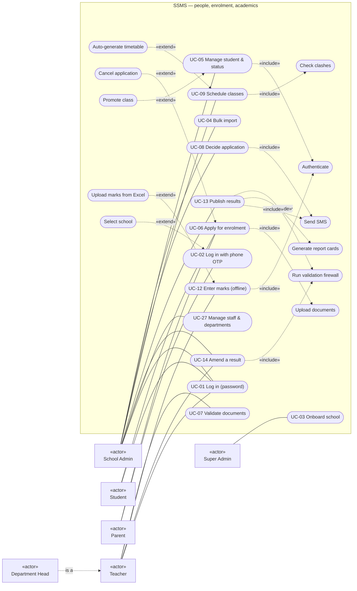
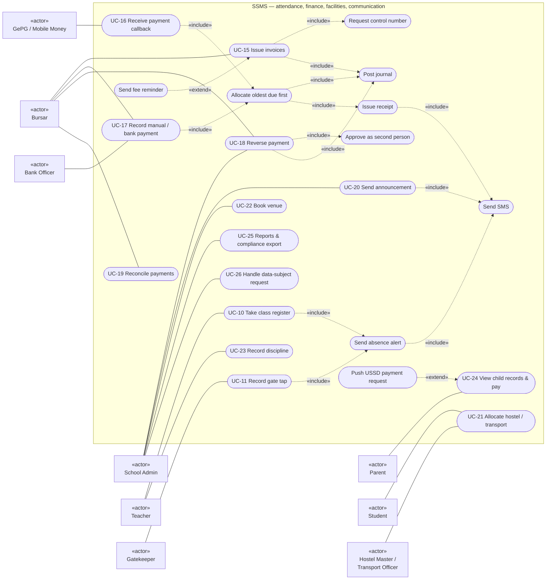

# 4. Use Cases

Mermaid has no UML use-case diagram, so it is drawn as a flowchart:

- actors are «actor» boxes;
- use cases are stadium shapes inside the system boundary;
- «include» arrows point from the base use case to the included one;
- «extend» arrows point from the extension to the base.

Every use case except UC-01/UC-02 «include»s *Authenticate*; only a few of those arrows are drawn. Every change «include»s *Write audit log* (a database trigger).

## 4.1 Use case diagram — people, enrolment, academics

## 4.2 Use case diagram — attendance, finance, facilities, communication

## 4.3 Detailed use case descriptions

Common precondition **P0**: the actor is authenticated (UC-01 or UC-02) and holds the listed permission. Every change writes an audit row.

### UC-01 Log in with password

| Item | Description |
|---|---|
| Actors | School Admin, Bursar, Teacher, Student, Gatekeeper, Bank Officer |
| Precondition | Account ACTIVE in the school; school ACTIVE |
| Main flow | 1. User opens `https://<school-code>.ssms.co.tz` (or chooses the school). 2. Enters username and password. 3. API resolves the school with `resolve_school_by_code`, sets the tenant context, checks lock and Argon2id hash. 4. Issues a 15-min access JWT (claims: `sub`, `sch`, `roles`; permissions are loaded per request, ADR 0011) and a rotating refresh token in an httpOnly cookie. 5. Audit `LOGIN`. 6. PWA shows the role menu. |
| Alternates | A1 wrong credentials → 401 generic, counter + 1, audit `LOGIN_FAILED`. A2 5th failure → locked 15 min → 423. A3 `must_change_password` → change screen first. A4 refresh-token reuse → family revoked, 401, audit `TOKEN_REUSE`. |
| Rules | Same message for unknown user and wrong password; dummy hash for unknown users (constant time). |
| Endpoints / tables | `POST /api/v1/auth/login`, `/auth/refresh`, `/auth/logout`, `/auth/me` · `users`, `refresh_tokens`, `audit_logs` |
| FRs | FR-01, FR-03, FR-04, FR-05 |

### UC-02 Log in with phone OTP (parents)

| Item | Description |
|---|---|
| Actors | Parent |
| Main flow | 1. Parent enters phone `07XX XXX XXX`. 2. API normalises it to `255XXXXXXXXX`, computes the HMAC blind index and calls `resolve_users_by_phone`. 3. For each matching account, a hashed OTP row is stored and one SMS with a 6-digit code is sent. 4. Parent enters the code. 5. If accounts exist in several schools, the parent chooses one (**extend: Select school**). 6. Tokens issued as in UC-01. |
| Alternates | A1 unknown phone → the same "code sent" message (no enumeration), no SMS. A2 wrong code → attempts + 1; 5 → OTP invalid. A3 more than 3 OTP requests in 15 min → 429. |
| Endpoints / tables | `POST /auth/otp/request`, `POST /auth/otp/verify`, `POST /auth/select-school` · `otp_codes`, `users`, `guardians`, `sms_messages` |
| FRs | FR-02 |

### UC-03 Onboard a school

| Item | Description |
|---|---|
| Actors | Super Admin |
| Main flow | 1. Super admin enters code, name, registration no., ownership, region, district. 2. Platform service (role `ssms_platform`) creates `schools`, `school_settings` and the first `school_admin` account. 3. Seeds defaults: education levels, NECTA grading schemes (**VERIFY**), ledger accounts, fee items, message templates, national holidays. 4. Sends the admin an SMS with a one-time setup link. |
| Alternates | Duplicate code → 409. |
| Endpoints / tables | `POST /api/v1/platform/schools` · `schools`, `school_settings`, `users`, `user_roles`, defaults |
| FRs | FR-08 |

### UC-04 Bulk import students, guardians or staff

| Item | Description |
|---|---|
| Actors | School Admin |
| Main flow | 1. Download the template (sw/en headers). 2. Upload the file with an `Idempotency-Key`. 3. API stores the file and creates `background_jobs` (QUEUED) → 202. 4. Celery validates every row (formats, duplicates within the file and against the database, guardians, class/stream). 5. No errors → one transaction inserts all rows with admission numbers. 6. The job shows SUCCEEDED and counts. |
| Alternates | A1 any error → nothing saved; job FAILED with an error-report file (row, column, value, message sw/en). A2 same key again → the original job is returned. |
| Endpoints / tables | `GET /imports/templates/{kind}`, `POST /imports/{kind}`, `GET /jobs/{id}` · `background_jobs`, `idempotency_keys`, `users`, `students`, `guardians`, `student_guardians`, `staff` |
| FRs | FR-12 – FR-14 |

### UC-05 Manage student and status

| Item | Description |
|---|---|
| Actors | School Admin |
| Main flow | 1. Search or open a student. 2. Edit details (Update → Confirm). 3. To change status, choose the new status, reason and effective date → Confirm. 4. Service checks allowed transitions; updates `students.status`; inserts `student_status_history`; closes the active enrolment for TRANSFERRED/GRADUATED/DROPPED_OUT; disables the login; SMS to the guardian. |
| Transitions | APPLICANT→ACTIVE (enrolment approval only); ACTIVE→SUSPENDED/TRANSFERRED/GRADUATED/DROPPED_OUT; SUSPENDED→ACTIVE/DROPPED_OUT; TRANSFERRED/DROPPED_OUT→ACTIVE (re-admission); GRADUATED final. |
| Extension | **Promote class:** a year-end job creates next-year enrolments to `next_class_id`; repeaters are marked REPEATED. |
| Endpoints / tables | `GET/PATCH /students/{id}`, `POST /students/{id}/status`, `POST /promotions` · `students`, `student_status_history`, `enrolments`, `users` |
| FRs | FR-15 – FR-19 |

### UC-06 Apply for enrolment

| Item | Description |
|---|---|
| Actors | Parent or Student (applicant) |
| Main flow | 1. Inquire: list of classes/combinations open, with places left. 2. Choose one → "Endelea na darasa hili? / Pursue this class?" 3. Yes → application `INQUIRED` → `REQUIREMENTS_PENDING`; the requirements list is shown. 4. Upload each document (**include: Upload documents**: type checked from bytes, ≤ 5 MB, SHA-256). 5. When all required documents are uploaded → `UNDER_REVIEW`; teachers are notified. |
| Alternates | A1 No at step 2 → back to the list ("Jaribu madarasa mengine / Try other classes"). A2 already applied this year → 409. A3 **extend: Cancel application** with a reason → `CANCELLED`. |
| Endpoints / tables | `GET /enrolment/offerings`, `POST /enrolment/applications`, `POST /enrolment/applications/{id}/documents`, `POST .../submit`, `POST .../cancel` · `enrolment_applications`, `enrolment_documents`, `enrolment_requirements` |
| FRs | FR-20 – FR-22 |

### UC-07 Validate enrolment documents

| Item | Description |
|---|---|
| Actors | Teacher (`enrolment.validate`) |
| Main flow | 1. Open the queue of `UNDER_REVIEW` applications. 2. View each document (signed URL, 5 min). 3. Mark VALID, or INVALID with a comment. 4. When no document is PENDING: all required VALID → "Mahitaji yamekamilika / Requirements completed" (stays UNDER_REVIEW for the decision); otherwise back to `REQUIREMENTS_PENDING` → "Baadhi ya mahitaji si sahihi / Some requirements are invalid", with comments, by SMS and in the portal. |
| Endpoints / tables | `GET /enrolment/documents?status=PENDING`, `PATCH /enrolment/documents/{id}` · `enrolment_documents`, `enrolment_applications` |
| FRs | FR-23, FR-24 |

### UC-08 Decide an application

| Item | Description |
|---|---|
| Actors | School Admin (`enrolment.decide`) |
| Main flow | 1. Open a complete application. 2. "Thibitisha usajili? / Confirm enrolment?" 3. Approve: choose a stream → one transaction: admission no. (`next_document_no`), student ACTIVE, status history, enrolment (stream capacity checked by DB), student login, term invoice (UC-15). 4. SMS "Usajili umekamilika, namba ya usajili MF-2026-0010". |
| Alternates | Reject or Cancel with a reason → SMS. Stream full → 409 "Mkondo umejaa / Stream full". |
| Endpoints / tables | `POST /enrolment/applications/{id}/approve`, `.../reject` · `enrolment_applications`, `students`, `enrolments`, `users`, `invoices` |
| FRs | FR-25 |

### UC-09 Schedule classes

| Item | Description |
|---|---|
| Actors | School Admin (`timetable.manage`) |
| Main flow | 1. Choose term and stream. 2. Add a slot: subject, teacher (from teaching assignments), room, day, start, end. 3. **include: Check clashes**: teacher, room and stream (DB EXCLUDE), teacher weekly load, room type for lab subjects. 4. Save. |
| Alternates | Clash → 409 with the conflicting slot and suggested free periods. **extend: Auto-generate**: greedy, most-constrained-first placement with one-step repair produces a draft and an unplaced list; the admin publishes the draft in one transaction. |
| Endpoints / tables | `POST /timetable/slots`, `POST /timetable/check`, `POST /timetable/generate`, `GET /timetable?stream=` · `timetable_slots`, `teaching_assignments`, `rooms`, `staff` |
| FRs | FR-30 – FR-33 |

### UC-10 Take the class register (offline-first)

| Item | Description |
|---|---|
| Actors | Teacher (`attendance.take`) |
| Main flow | 1. Open today's register for the stream (the class list is cached in IndexedDB). 2. Everyone defaults to Present; tap to mark Absent/Late/Excused. 3. Save: each record gets a `client_record_id` and goes into the Dexie outbox ("Imehifadhiwa nje ya mtandao / Saved offline"). 4. Sync: `POST /attendance/sync` (batch) → upsert by `client_record_id` → badge "Synced". |
| Alternates | The same record edited on two phones → last `captured_at` wins, and the other phone shows "Conflict" with the server value. |
| Endpoints / tables | `GET /attendance/sessions/today`, `POST /attendance/sync` · `attendance_sessions`, `attendance_records` |
| FRs | FR-34, FR-38 |

### UC-11 Gate tap and absence alert

| Item | Description |
|---|---|
| Actors | Gatekeeper / Gate Device; Celery beat |
| Main flow | 1. Device posts `{token, captured_at}` with `X-Device-Key`. 2. `resolve_device` → school + device; context set; the card hash finds the student → `GATE` record (source RFID/QR). 3. At the school cut-off (default 08:30 EAT) on school days, beat fans out per school (`list_active_school_ids`). Students with no gate tap and no register present/late, and no `absence_alerts` row yet, get one SMS to guardians with SMS consent. |
| Rules | No SMS on weekends or `public_holidays`. `absence_alerts` and the SMS idempotency key are unique per student per day (test T06). |
| Endpoints / tables | `POST /devices/taps` · `devices`, `rfid_cards`, `attendance_records`, `absence_alerts`, `sms_messages` |
| FRs | FR-35, FR-36 |

### UC-12 Enter marks (offline)

| Item | Description |
|---|---|
| Actors | Teacher (`marks.enter`, own teaching assignments only) |
| Main flow | 1. Open the mark sheet for stream × subject × component (cached). 2. Type scores; each cell autosaves to Dexie with its `version`. 3. Sync: `PUT /marks/batch` with `[{id or key, score, version, client_updated_at}]`. 4. Server updates `WHERE version = :v`; the DB trigger checks the maximum and increments the version. |
| Alternates | Version mismatch → 409 per cell with the server value; the cell shows "Conflict" and the teacher keeps one value. Score > maximum → 422 (DB). Locked (published) → 409 "Matokeo yameshatolewa / Results already published". **extend: Upload from Excel**. |
| Endpoints / tables | `GET /marks/sheet`, `PUT /marks/batch`, `POST /marks/upload` · `mark_entries` |
| FRs | FR-41 – FR-43 |

### UC-13 Publish results

| Item | Description |
|---|---|
| Actors | School Admin (`results.publish`) |
| Main flow | 1. Choose term and class → Publish. 2. **include: Validation firewall** (`results_firewall`). 3. If clean, `publish_results()` in one transaction: weighted totals, grade bands, points, subject positions, best-n division, class positions; freezes `published_results` and `student_term_summaries`; locks drafts; audit `PUBLISH`. 4. Celery: report-card PDFs (**include**) and "Matokeo yametoka" SMS (**include**). |
| Alternates | Problems → 422 `INCOMPLETE_GRADES_BLOCK` with every missing or out-of-range mark (admission no., name, subject, component, teacher) and every subject whose weights ≠ 100, in sw and en. Already published → 422. |
| Endpoints / tables | `POST /results/publish`, `GET /results/firewall`, `GET /jobs/{id}` · `mark_entries`, `result_publications`, `published_results`, `student_term_summaries` |
| FRs | FR-44 – FR-47 |

### UC-14 Amend a published result

| Item | Description |
|---|---|
| Actors | Teacher (requester), School Admin (approver) |
| Main flow | 1. Teacher requests an amendment: result, new score, reason. 2. A different user with `results.amend_approve` approves → `amend_result()` freezes a new version of the result and summary (`supersedes_id`, `amendment_id`). 3. Report card regenerated with "Imerekebishwa / Amended" next to the subject; guardian SMS. |
| Alternates | Requester tries to approve → 403 (DB maker-checker). Reject with a note. Amending an old version → 409. |
| Endpoints / tables | `POST /results/{id}/amendments`, `POST /amendments/{id}/approve`, `.../reject` · `result_amendments`, `published_results`, `student_term_summaries` |
| FRs | FR-46 |

### UC-15 Issue invoices and control numbers

| Item | Description |
|---|---|
| Actors | Bursar (`invoices.manage`); Celery |
| Main flow | 1. Choose term and class(es) → Generate. 2. Job per school: for each ACTIVE enrolment, lines from the APPROVED fee structure (term lines + annual lines in term 1) minus discounts; installments; invoice number from `next_document_no`; journal Dr 1300 / Cr income (Dr 4900 for discounts). 3. **include: Request control number**: GePG bill (`bill_ref = <school>-<year>-<seq>`) → control number by callback. 4. SMS with amount, control number and due date. **extend: reminders** 7 days before and 3 days after the due date. |
| Endpoints / tables | `POST /invoices/generate`, `POST /invoices/{id}/control-number`, `POST /webhooks/gepg/bill` · `invoices`, `invoice_lines`, `invoice_installments`, `gepg_bills`, `journals`, `ledger_entries` |
| FRs | FR-49, FR-50, FR-57 |

### UC-16 Receive a payment callback

| Item | Description |
|---|---|
| Actors | GePG / Mobile Money |
| Main flow | 1. Callback arrives (`/webhooks/{provider}`). 2. Verify signature/HMAC and source IP allow-list. 3. `resolve_gepg_bill` (GePG) or the account reference (mobile money) → school; context set. 4. `INSERT payments ... ON CONFLICT (school_id, channel, external_ref) DO NOTHING` → duplicate = acknowledge only. 5. Respond (< 2 s). 6. Celery: lock the invoice rows `FOR UPDATE`, allocate oldest due first (**include**), post the journal (**include**), receipt + SMS (**include**). |
| Alternates | Bad signature → 401 + alert. Unknown bill → stored as an exception for reconciliation. Amount > balance → the excess becomes student credit (2100). |
| Endpoints / tables | `POST /webhooks/gepg/payment`, `/webhooks/mpesa`, `/webhooks/tigopesa`, `/webhooks/airtel`, `/webhooks/halopesa` · `payments`, `payment_allocations`, `journals`, `ledger_entries`, `receipts`, `sms_messages` |
| FRs | FR-51, FR-53, FR-55 |

### UC-17 Record a manual or bank payment

| Item | Description |
|---|---|
| Actors | Bursar; Bank Officer |
| Main flow | Cash: the bursar enters student, amount and receipt-book number → payment CONFIRMED → allocation, journal, receipt. Bank: the bursar or parent submits a deposit reference → the bank officer confirms → payment created and matched. |
| Endpoints / tables | `POST /payments`, `POST /bank-deposits`, `POST /bank-deposits/{id}/confirm` · `payments`, `bank_deposit_confirmations` |
| FRs | FR-52 |

### UC-18 Reverse a payment

| Item | Description |
|---|---|
| Actors | Bursar (requester), School Admin (approver) |
| Main flow | 1. Bursar requests with a reason. 2. A different user approves (**include: Approve as second person**; DB `reversed_by <> approved_by`). 3. `payment_reversals` insert → the payment becomes REVERSED (trigger) → invoices re-derived → reversing journal. |
| FRs | FR-54 |

### UC-19 Reconcile payments

| Item | Description |
|---|---|
| Actors | Bursar; Celery beat (06:00 EAT) |
| Main flow | Fetch or upload the provider statement → match by `external_ref` → BALANCED, or EXCEPTIONS (missing in system, missing in statement, amount mismatch) → the bursar resolves each with a note. |
| FRs | FR-56 |

### Other use cases (summary)

| ID | Name | Actors | Summary | FRs |
|---|---|---|---|---|
| UC-20 | Send announcement | School Admin | Audience school/staff/parents/class/stream/one person; optional SMS (consent and credit checked). | FR-65, FR-66 |
| UC-21 | Allocate hostel / transport | Student, Hostel Master, Transport Officer | Accommodation request → allocation (room capacity); route, stop and bus assignment (bus capacity); transport fee line. | FR-58, FR-59 |
| UC-22 | Book venue | School Admin | Event, date, time, seats; no overlap. | FR-60 |
| UC-23 | Record discipline | Teacher | Incident, action, resolution; parent notified. | FR-61 |
| UC-24 | View child records and pay | Parent | Attendance, results, report cards, invoices, control numbers, receipts; **extend: push USSD request** to the parent's phone (mobile money). | FR-10 (portal) |
| UC-25 | Reports and compliance export | School Admin, Bursar | Reports per role; year-end exports as background jobs; audit `EXPORT`. | FR-67, FR-68 |
| UC-26 | Handle data-subject request | School Admin (`privacy.manage`) | Export, correct or anonymise within 30 days (**VERIFY**). | FR-70 |
| UC-27 | Manage staff and departments | School Admin | Staff, qualifications, designations, assignments, class teachers. | FR-27 – FR-29 |
