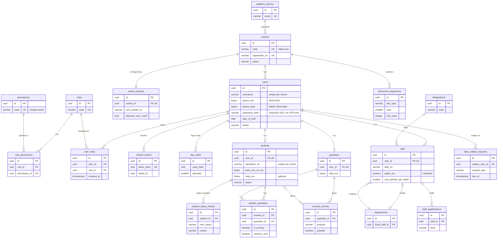
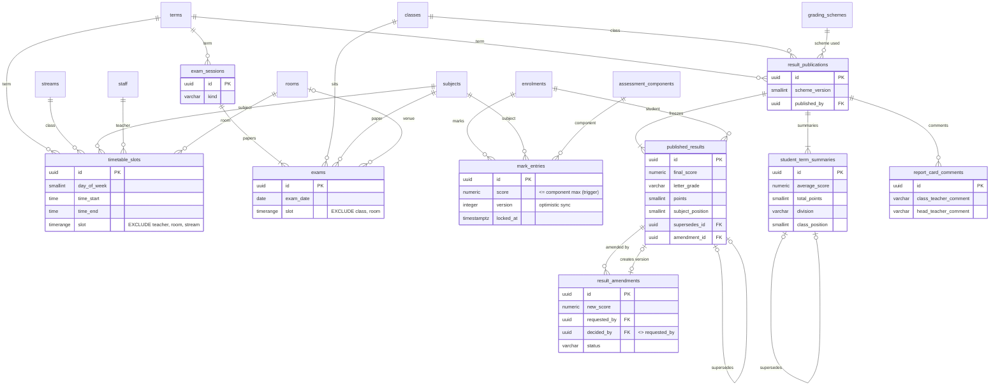
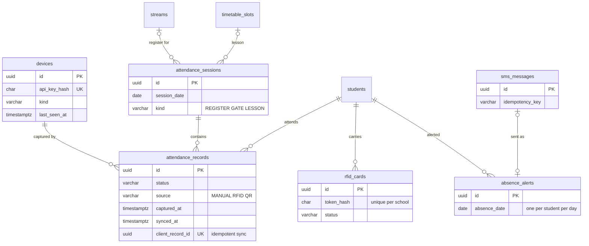
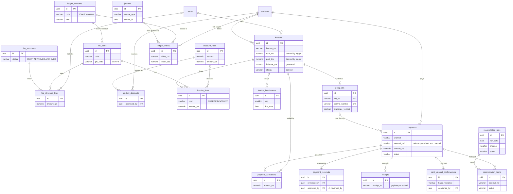
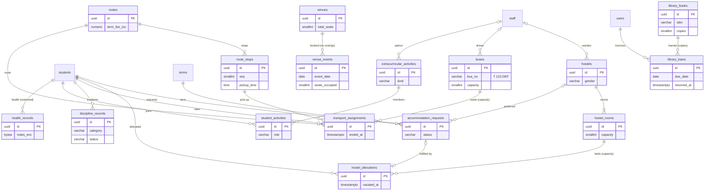
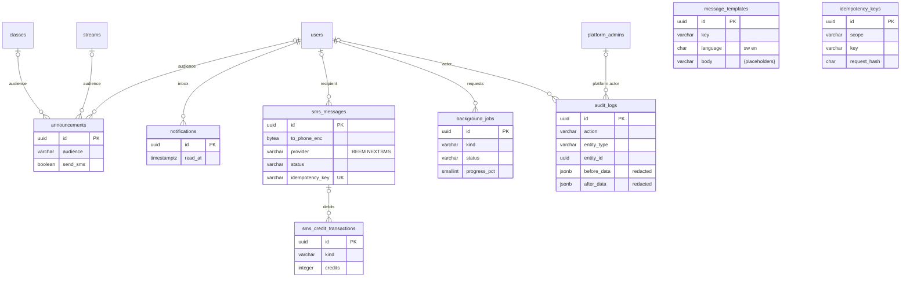

# 5. Entity Relationship Diagrams (Crow's Foot)

The schema has **99 tables**: 94 tenant tables, `schools` and 4 global platform tables. Each diagram covers one area and shows keys and the attributes that explain the relationship. Every column is listed in [07-data-dictionary.md](07-data-dictionary.md), and the DDL is [sql/schema.sql](sql/schema.sql).

**Conventions in every diagram:**

- **Common columns are omitted.** Every tenant table also has `school_id` (FK → `schools`), `created_at`, `updated_at` and `created_by` (FK → `users`). Most also have `deleted_at`.
- **Foreign keys are composite.** Every FK drawn is really `(school_id, x_id) → x (school_id, id)`, so a relationship can never cross schools.
- **Notation.** `||--o{` = one to zero-or-many; `||--|{` = one to one-or-many; `|o--o{` = optional parent.

## 5.1 Platform, people and access

## 5.2 Academic configuration and enrolment

```mermaid
erDiagram
    education_levels ||--o{ classes : "groups"
    education_levels ||--o{ combinations : "offers"
    classes |o--o| classes : "promotes to"
    classes ||--o{ streams : "divided into"
    rooms |o--o{ streams : "home room"
    classes ||--o{ class_subjects : "curriculum"
    subjects ||--o{ class_subjects : "taught in"
    combinations ||--o{ combination_subjects : "includes"
    subjects ||--o{ combination_subjects : "part of"
    departments |o--o{ subjects : "owns"
    academic_years ||--|{ terms : "divided into"
    academic_years ||--o{ stream_class_teachers : "year"
    streams ||--o{ stream_class_teachers : "class teacher"
    staff ||--o{ stream_class_teachers : "is"
    academic_years ||--o{ teaching_assignments : "year"
    streams ||--o{ teaching_assignments : "taught"
    subjects ||--o{ teaching_assignments : "subject"
    staff ||--o{ teaching_assignments : "teacher"
    education_levels ||--o{ grading_schemes : "graded by"
    academic_years ||--o{ grading_schemes : "valid in"
    grading_schemes ||--|{ grade_bands : "bands"
    grading_schemes ||--o{ division_rules : "divisions"
    terms ||--o{ assessment_components : "assessed by"
    education_levels ||--o{ assessment_components : "for level"
    subjects |o--o{ assessment_components : "subject-specific"
    education_levels |o--o{ enrolment_requirements : "requires"
    students ||--o{ enrolment_applications : "applies"
    classes ||--o{ enrolment_applications : "for class"
    academic_years ||--o{ enrolment_applications : "for year"
    enrolment_applications ||--o{ enrolment_documents : "uploads"
    enrolment_requirements ||--o{ enrolment_documents : "satisfies"
    students ||--o{ enrolments : "enrolled"
    streams ||--o{ enrolments : "holds"
    academic_years ||--o{ enrolments : "year"
    combinations |o--o{ enrolments : "A-Level"
    enrolment_applications |o--o| enrolments : "results in"

    education_levels {
        uuid id PK
        varchar code "PRIMARY O_LEVEL A_LEVEL"
    }
    classes {
        uuid id PK
        varchar code "F2 STD7"
        uuid next_class_id FK
    }
    streams {
        uuid id PK
        uuid class_id FK
        varchar name "A B PCM"
        smallint capacity
    }
    subjects {
        uuid id PK
        varchar code
        varchar necta_code
        varchar room_type
    }
    combinations {
        uuid id PK
        varchar code "PCM"
    }
    class_subjects {
        uuid id PK
        uuid class_id FK
        uuid subject_id FK
        boolean is_compulsory
    }
    combination_subjects {
        uuid id PK
        uuid combination_id FK
        uuid subject_id FK
    }
    rooms {
        uuid id PK
        varchar room_type
        smallint capacity
    }
    academic_years {
        uuid id PK
        varchar name "2026"
        boolean is_current
    }
    terms {
        uuid id PK
        uuid academic_year_id FK
        smallint term_no
    }
    stream_class_teachers {
        uuid id PK
        uuid stream_id FK
        uuid academic_year_id FK
        uuid staff_id FK
    }
    teaching_assignments {
        uuid id PK
        uuid stream_id FK
        uuid subject_id FK
        uuid staff_id FK
    }
    grading_schemes {
        uuid id PK
        smallint version
        smallint best_n_subjects
    }
    grade_bands {
        uuid id PK
        varchar letter
        smallint min_score
        smallint max_score
        smallint points
    }
    division_rules {
        uuid id PK
        varchar division
        smallint min_points
        smallint max_points
    }
    assessment_components {
        uuid id PK
        varchar code "CA MIDTERM TERMINAL"
        numeric max_score
        numeric weight "totals 100"
    }
    enrolment_requirements {
        uuid id PK
        varchar name_sw
        boolean is_required
    }
    enrolment_applications {
        uuid id PK
        varchar application_no
        varchar status
    }
    enrolment_documents {
        uuid id PK
        char sha256
        varchar validation_status
    }
    enrolments {
        uuid id PK
        uuid student_id FK
        uuid stream_id FK
        uuid academic_year_id FK "one per student per year"
        varchar status
    }
```

## 5.3 Timetable, exams, marks and results

## 5.4 Attendance

## 5.5 Finance

## 5.6 Facilities and student life

## 5.7 Communication and system

