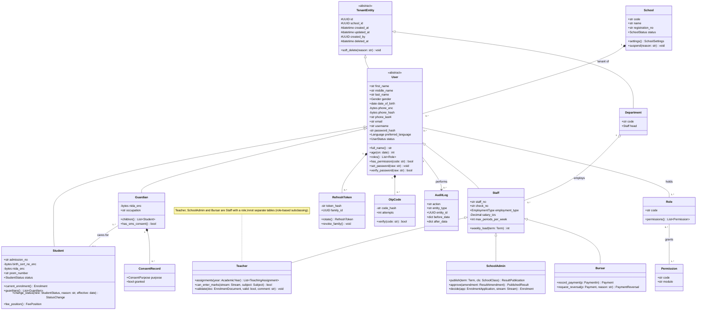
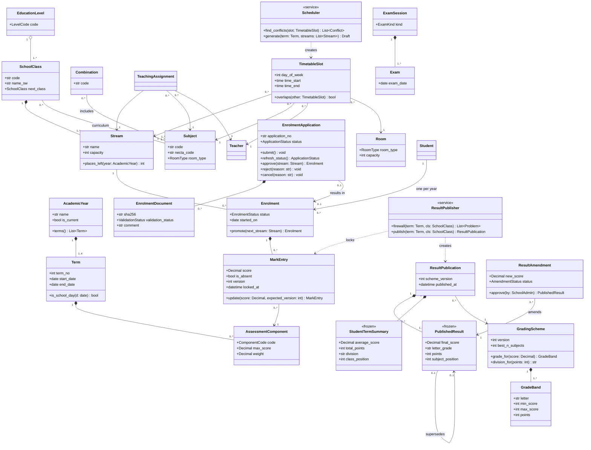

# 8. Class Diagrams

UML 2.x class diagrams of the domain model that Phase 1+ implements as SQLAlchemy 2 (async) models and services.

- **Visibility:** `+` public, `-` private, `#` protected.
- **Static:** `$` marks a class method.
- **Persistence:** every persistent class also has `id: UUID`, `school_id: UUID`, `created_at`, `updated_at`, `created_by` and, where soft-deleted, `deleted_at`. These are inherited from the abstract `TenantEntity` and not repeated.
- **Diagrams:** split into three for readability.

## 8.1 People, access and tenancy

## 8.2 Academics: enrolment, timetable, exams, results

## 8.3 Finance, attendance, facilities, communication

```mermaid
classDiagram
    direction TB
    class FeeStructure {
        +FeeStructureStatus status
        +approve(by: SchoolAdmin) void
        +lines_for(term: Term) List~FeeStructureLine~
    }
    class FeeStructureLine {
        +Decimal amount_tzs
    }
    class FeeItem {
        +FeeCode code
        +str gfs_code
    }
    class DiscountRule {
        +Decimal percent
        +Decimal amount_tzs
        +apply(charge: Decimal) Decimal
    }
    class Invoice {
        +str invoice_no
        +date due_date
        +Decimal total_tzs
        +Decimal paid_tzs
        +Decimal balance_tzs
        +InvoiceStatus status
        +cancel(reason: str) void
    }
    class InvoiceLine {
        +LineKind kind
        +Decimal amount_tzs
    }
    class Installment {
        +int seq
        +date due_date
        +Decimal amount_tzs
    }
    class GepgBill {
        +str bill_ref
        +str control_number
        +bool signature_verified
    }
    class Payment {
        +Channel channel
        +str external_ref
        +Decimal amount_tzs
        +PaymentStatus status
        +unallocated() Decimal
    }
    class PaymentAllocator {
        <<service>>
        +allocate(p: Payment) List~Allocation~
    }
    class Allocation {
        +Decimal amount_tzs
    }
    class PaymentReversal {
        +str reason
    }
    class Receipt {
        +str receipt_no
    }
    class Journal {
        <<append-only>>
        +SourceType source_type
        +is_balanced() bool
    }
    class LedgerEntry {
        +Decimal debit_tzs
        +Decimal credit_tzs
    }
    class LedgerAccount {
        +str code
        +AccountKind kind
    }
    class PaymentGateway {
        <<interface>>
        +verify(request: Request) bool
        +parse(request: Request) PaymentNotice
        +acknowledge(notice: PaymentNotice) Response
    }
    class GepgAdapter
    class MpesaAdapter
    class AirtelAdapter
    class AttendanceSession {
        +date session_date
        +SessionKind kind
    }
    class AttendanceRecord {
        +AttendanceStatus status
        +Source source
        +datetime captured_at
        +UUID client_record_id
    }
    class Device {
        -str api_key_hash
        +DeviceKind kind
    }
    class AbsenceAlertJob {
        <<celery task>>
        +run(school: School, day: date) int
    }
    class SmsGateway {
        <<interface>>
        +send(to: str, body: str) ProviderRef
        +delivery_status(ref: str) SmsStatus
    }
    class BeemAdapter
    class NextSmsAdapter
    class SmsMessage {
        +str idempotency_key
        +SmsStatus status
    }
    class HostelRoom {
        +int capacity
    }
    class HostelAllocation
    class Bus {
        +int capacity
    }
    class TransportAssignment
    class VenueEvent {
        +int seats_occupied
    }

    FeeStructure "1" *-- "1..*" FeeStructureLine
    FeeStructureLine "0..*" --> "1" FeeItem
    Student "1" --> "0..*" Invoice : billed
    Invoice "1" *-- "1..*" InvoiceLine
    Invoice "1" *-- "0..*" Installment
    InvoiceLine "0..*" --> "0..1" DiscountRule
    Invoice "1" -- "0..*" GepgBill
    Student "1" --> "0..*" Payment : pays
    PaymentAllocator ..> Allocation : creates
    Payment "1" *-- "0..*" Allocation
    Allocation "0..*" --> "1" Invoice
    Payment "1" -- "0..1" PaymentReversal
    Payment "1" -- "0..1" Receipt
    Journal "1" *-- "2..*" LedgerEntry
    LedgerEntry "0..*" --> "1" LedgerAccount
    PaymentGateway <|.. GepgAdapter
    PaymentGateway <|.. MpesaAdapter
    PaymentGateway <|.. AirtelAdapter
    AttendanceSession "1" *-- "0..*" AttendanceRecord
    AttendanceRecord "0..*" --> "0..1" Device
    AbsenceAlertJob ..> SmsMessage : queues
    SmsGateway <|.. BeemAdapter
    SmsGateway <|.. NextSmsAdapter
    HostelRoom "1" -- "0..capacity" HostelAllocation
    Bus "1" -- "0..capacity" TransportAssignment
```

## 8.4 Design notes

- **No inheritance from Registrar.** The baseline made Students and Instructors inherit from Registrar. Here `User` is abstract (Person + login) and `Student`, `Guardian` and `Staff` specialise it. Teacher, SchoolAdmin and Bursar are **roles** of Staff (RBAC), because one person can be a teacher and a head of department at once.
- **Frozen classes.** `PublishedResult`, `StudentTermSummary`, `Journal`, `LedgerEntry`, `Allocation` and `PaymentReversal` have no update methods. Change means a new row: an amendment, a reversal or a reversing journal.
- **Interfaces for providers.** `PaymentGateway` and `SmsGateway` keep provider details (GePG XML signatures, M-Pesa, Airtel, Beem, NextSMS) in adapters. Switching provider is a configuration change; new providers are new adapters.
- **Services coordinate aggregates.** `Scheduler`, `ResultPublisher` and `PaymentAllocator` are services. Their database-side counterparts are the EXCLUDE constraints, `publish_results()` and `fn_allocation_guard`.
