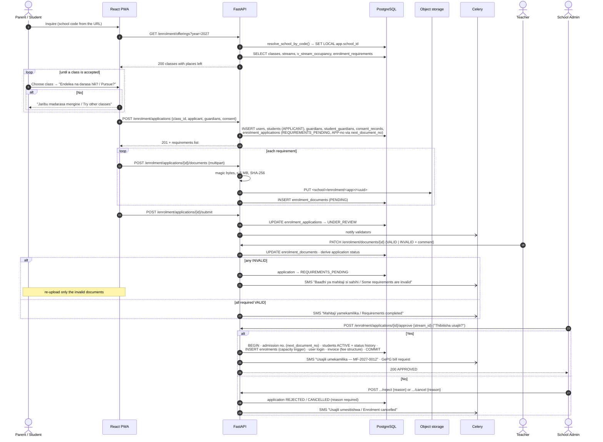
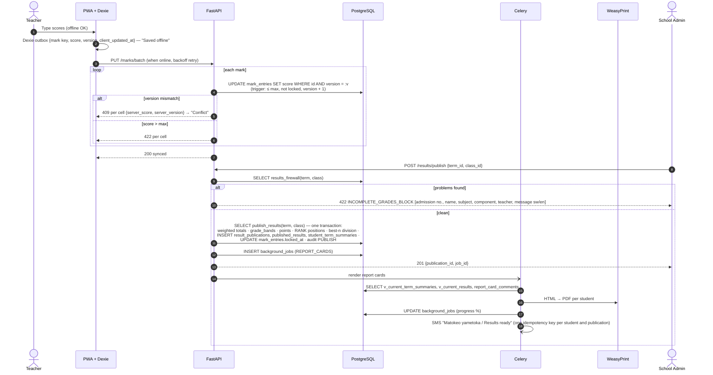
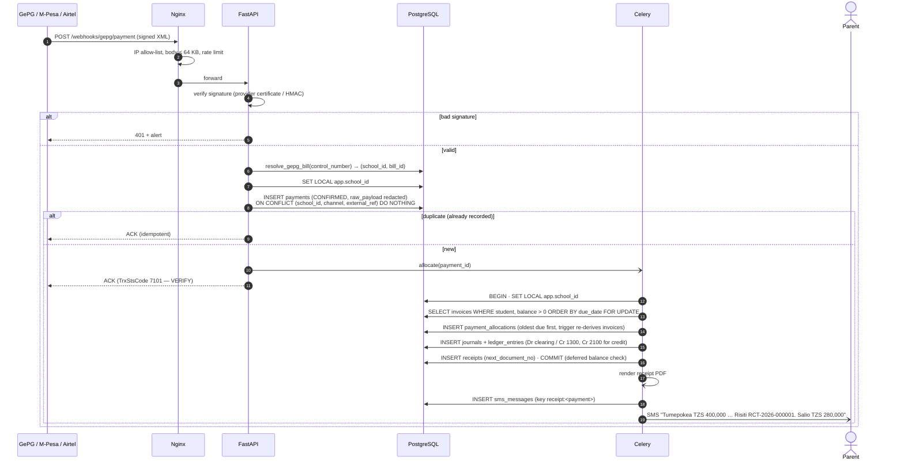
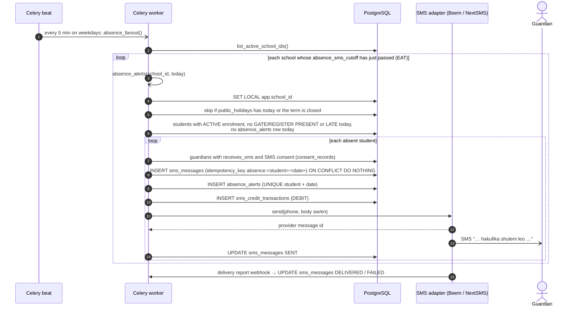
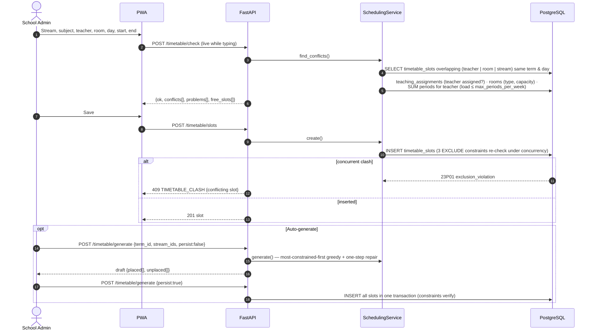
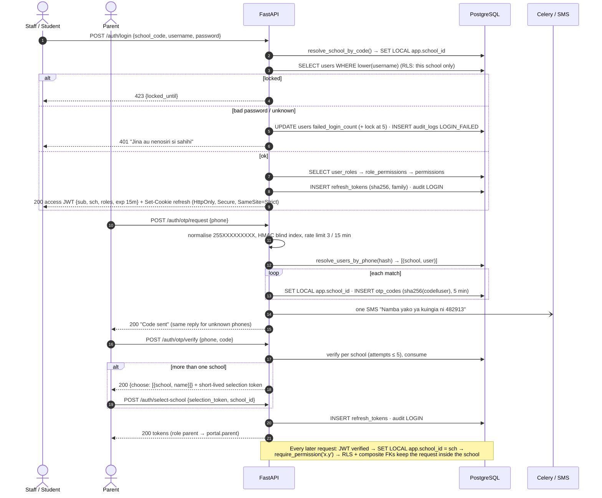

# 9. Sequence Diagrams

All endpoints are under `/api/v1`. Every API transaction starts with `SET LOCAL app.school_id, app.user_id, app.client_ip, app.request_id` (the tenant dependency) as the role `ssms_app`, so RLS and the audit trigger apply. `-)` is an asynchronous Celery message; `-->>` is a reply. Tables touched are named on the database arrows.

## 9.1 Enrolment (corrected from the baseline)

Corrections against the baseline:

- The baseline used lifelines for data ("Student Information", "Successfully Enrolled"); here the lifelines are real components.
- A "no" answer loops back to the class list.
- Faculty validation is per document.
- Approval is one transaction with capacity, admission number and invoice.
- Long-lived lifelines are not destroyed.

## 9.2 Mark entry → validation firewall → publish → report cards → SMS

## 9.3 Payment callback (GePG / mobile money) — respond in < 2 s

The heavy work (allocation, ledger, PDF, SMS) is queued, so the gateway always gets its acknowledgement in under 2 s. Retries with the same `external_ref` are absorbed by the unique constraint.

## 9.4 Daily absence alert job

## 9.5 Class scheduling with clash detection

## 9.6 Login with role check, OTP for parents, audit

