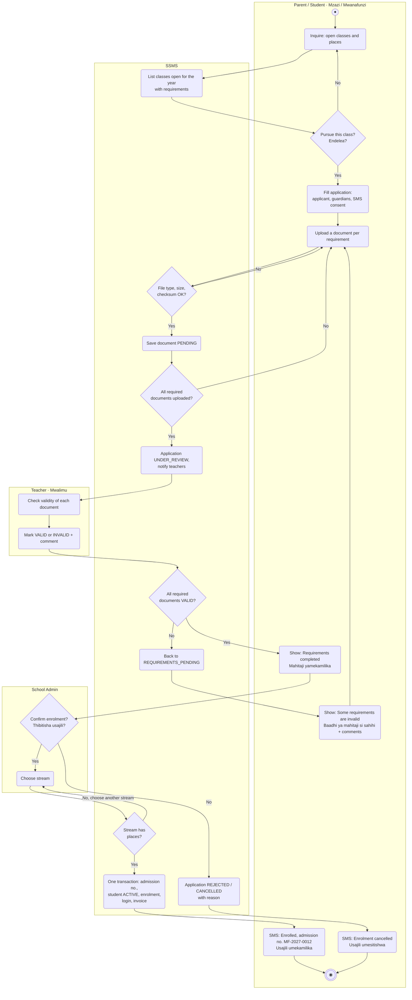
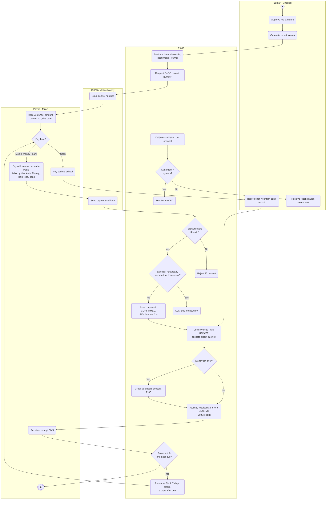
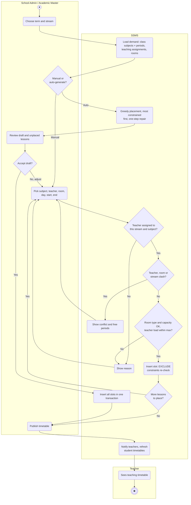
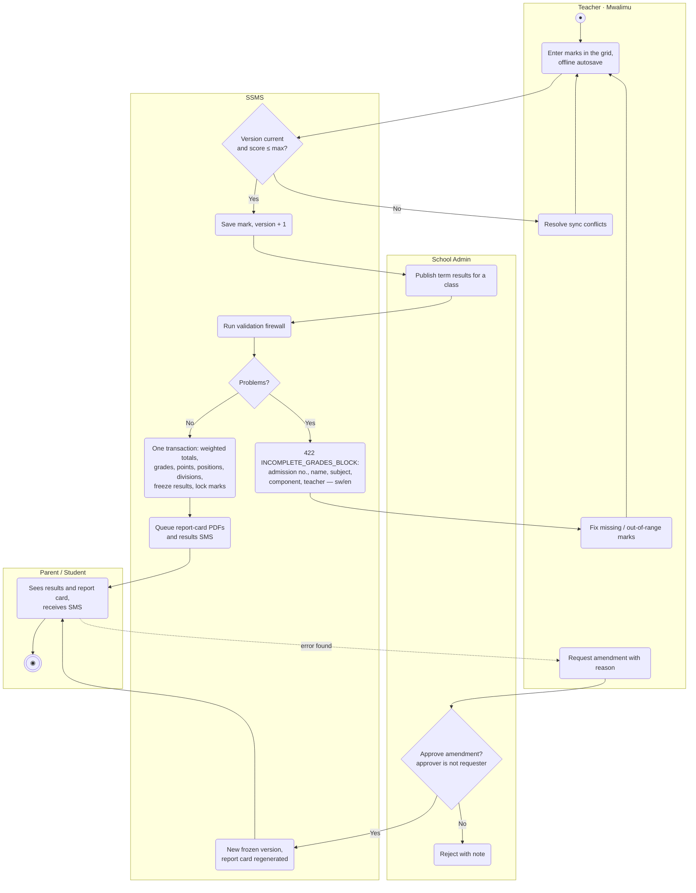

# 10. Activity Diagrams (swimlanes)

Mermaid has no UML activity diagram, so each swimlane is a subgraph. Notation: `((●))` is the start, `(((◉)))` the end, diamonds are decisions, and rounded boxes are actions. Guards are written on the arrows.

## 10.1 Enrolment

Compared with the baseline, the main changes are:

- files are checked before saving;
- validity is decided per document, and only the invalid ones are re-uploaded;
- the confirm/cancel decision is made by the school, after validation;
- approval is atomic, including the capacity check.

## 10.2 Fee payment

A wrong payment is never edited: the bursar requests a **reversal**, a second person approves it, and a reversing journal is posted. Overpayments stay as credit and are applied to the next invoice.

## 10.3 Class scheduling

## 10.4 Publishing results

