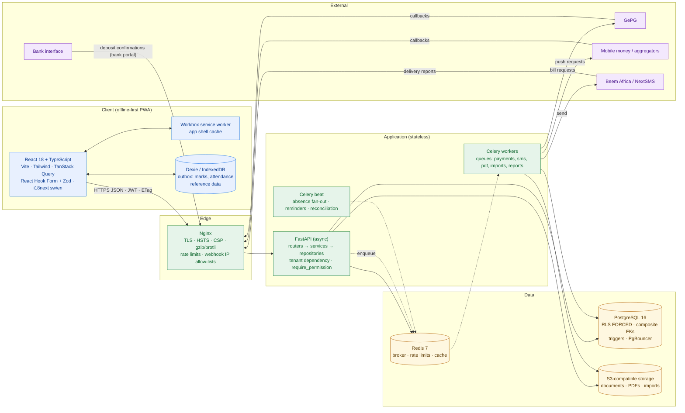
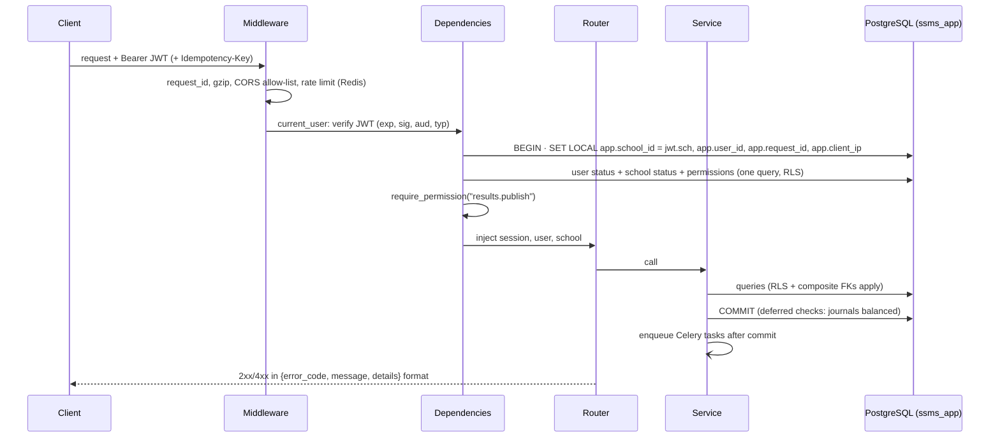
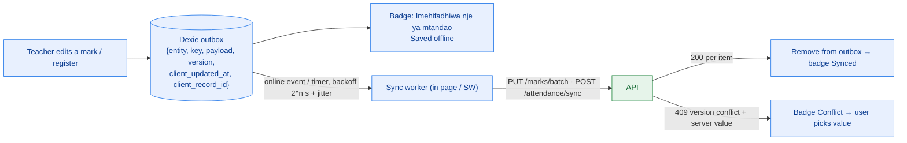
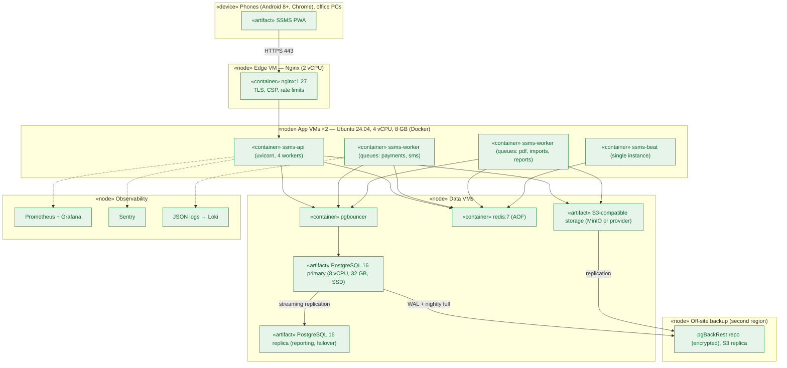

# 11. Architecture and Deployment

## 11.1 Logical architecture

| Layer | Rule |
|---|---|
| Router | Parses and validates input (Pydantic v2), declares `require_permission("module.action")`, calls exactly one service method, maps errors to the single error format. No SQL. |
| Service | Business rules, transactions, idempotency, enqueuing Celery tasks **after commit**. |
| Repository | SQLAlchemy 2 async queries with explicit column lists (no `SELECT *`), cursor pagination, always tenant-scoped. |
| Database | Last line of defence: RLS, composite FKs, CHECK/EXCLUDE, triggers ([06-data-model.md](06-data-model.md)). |

## 11.2 Request lifecycle and tenant context

**Background jobs.** Each Celery task receives `school_id` and opens its own transaction with the same `SET LOCAL`. Cross-school schedules (absence alerts, reminders, reconciliation) fan out per school through `list_active_school_ids()`. Every task is idempotent: it uses natural keys or `idempotency_key` with `ON CONFLICT DO NOTHING`, and retries with exponential backoff and jitter (max 5).

## 11.3 Offline-first client

- **App shell.** Workbox precaches it and keeps the initial JS under 200 KB gzipped; each role's module is lazy-loaded.
- **Reference data** (class lists, components, timetable) is cached in IndexedDB with an `ETag`, and refreshed on `If-None-Match`.
- **Marks** use optimistic concurrency (`version`). **Attendance** uses an idempotent `client_record_id`, and the last `captured_at` wins.
- **No data is lost on refresh or app close**, because the outbox persists in IndexedDB. A Playwright test covers offline → reload → sync.

## 11.4 Results day and scale

Target: **5,000 concurrent parent logins, ~500 requests/s**, pages under 3 s on 3G.

| Technique | Detail |
|---|---|
| Pre-computed results | `publish_results()` freezes everything; reads are index lookups on `(school_id, enrolment_id)` |
| Pre-rendered PDFs | Report cards rendered by Celery into object storage at publication; download via short-lived signed URL (no API CPU) |
| Lightweight endpoints | `GET /parent/children/{id}/results` returns < 5 KB JSON with `ETag`; repeat visits get 304 |
| OTP throttling | 3 OTPs per phone per 15 min, 20 per IP per hour (Redis), SMS queue with a priority lane |
| Connection pooling | PgBouncer (transaction mode) in front of PostgreSQL. `SET LOCAL` is transaction-scoped, so it is safe with transaction pooling. |
| Horizontal scale | API and worker containers scale out (stateless JWT); Nginx least-connections |
| Read replica | Reporting and analytics read from a streaming replica as `ssms_reporting` |
| Staggered SMS | "Results ready" SMS sent in batches of 200/min per school, so not everyone logs in at the same second |
| Load test | k6 spike 0 → 5,000 virtual users in 2 min; pass = p95 < 1 s, errors < 0.5 % |

## 11.5 Deployment

- **Environments:** `dev` (docker-compose on a laptop), `staging` (one VM, anonymised data), `production` (above).
- **Hosting:** in a Tanzanian data centre where possible (PDPA cross-border rules — **VERIFY** contracts).
- **CI/CD (GitHub Actions):**
  - lint (ruff, eslint), type-check (mypy, tsc);
  - pytest with coverage ≥ 80 % on services;
  - the SQL tests in `design/sql/tests` against a PostgreSQL 16 service container, run as `ssms_app`;
  - `alembic check`, Playwright, bundle size < 200 KB;
  - ZAP baseline, `pip-audit` / `npm audit`;
  - build images → staging → manual approval → production.
- **Backups:** WAL archiving (RPO ≤ 15 min), nightly full, 35-day retention, quarterly restore drill (RTO ≤ 4 h).
- **Secrets:** environment variables injected from the host secret store. Never in images or git.

## 11.6 Architecture decisions

Full records (context, decision, consequences, evidence): [adr/](adr/README.md). Phase 1 added [0011](adr/0011-permissions-per-request.md) permissions per request, [0012](adr/0012-synchronous-onboarding.md) synchronous onboarding and [0013](adr/0013-all-or-nothing-imports.md) all-or-nothing imports.

| ADR | Decision | Main reason |
|---|---|---|
| 0001 | Shared schema + `school_id` + forced RLS + composite FKs (pool model) | Cheapest for many small schools; three independent isolation layers |
| 0002 | Resolver functions (SECURITY DEFINER, ids only) for pre-tenant lookups | Webhooks, devices, OTP and cookies arrive before the school is known |
| 0003 | UUIDv7 generated in the API | Ids known offline; time-ordered B-tree inserts |
| 0004 | Business rules duplicated in the DB (EXCLUDE, triggers) and the services | Correct under concurrency and against buggy clients; friendly errors from services |
| 0005 | Frozen results + amendments instead of updates | Legal record; audit; maker-checker |
| 0006 | Double-entry ledger with deferred balance check | Reconciliation and auditor trust |
| 0007 | Webhooks acknowledge fast; Celery does allocation/PDF/SMS | < 2 s callback SLA; retries are idempotent |
| 0008 | Optimistic concurrency (`version`) for marks, `client_record_id` for attendance | Offline-first on weak networks without lost updates |
| 0009 | Provider adapters (`PaymentGateway`, `SmsGateway`) | Swap Beem/NextSMS or aggregators by configuration |
| 0010 | Application-level encryption + HMAC blind index | PDPA; DB dumps do not reveal phones or NIDA |
