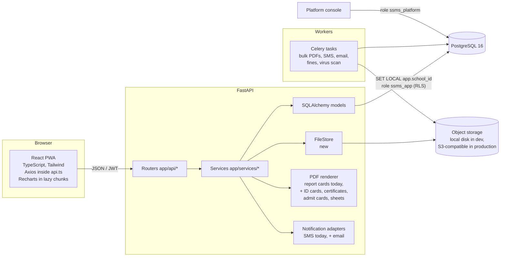
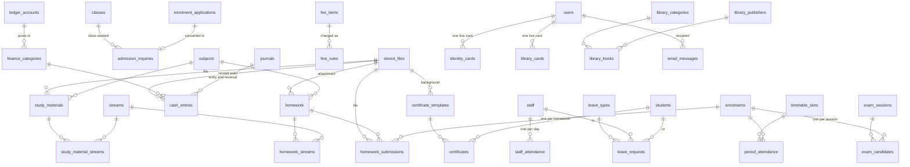
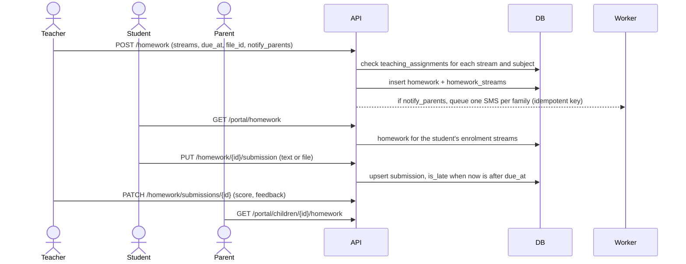
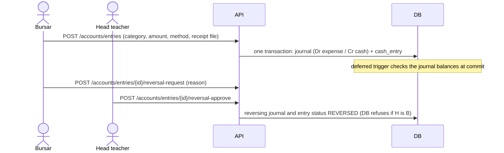

# 20. Extension architecture and database design (Phase 2)

Design for FR-72 to FR-99 ([19-reference-analysis.md](19-reference-analysis.md)). It extends the running system
([11-architecture.md](11-architecture.md)) and changes none of its rules: one PostgreSQL database shared by all schools
with forced row-level security (ADR 0001), permissions checked on every request (ADR 0011), frozen results (ADR 0005),
a double-entry ledger (ADR 0006), and an offline-first web app (ADR 0008).

## 20.1 What stays and what is added

| Layer | Today | Added in this extension |
|---|---|---|
| Routers | 25 router modules, 179 routes | 8 new router files (§20.5) |
| Services | Business rules, one transaction per request | `files`, `inquiries`, `calendar`, `staff_attendance`, `leave`, `admit_cards`, `accounts`, `fines`, `materials`, `homework`, `documents` (cards, certificates), `email` |
| Data access | SQLAlchemy models + `services/crud.py` helpers; RLS in the database | Same. No separate repository layer (decision D5 in 19.3) |
| Files | Import files and report-card PDFs only | `FileStore` interface: `put`, `open`, `delete`; local disk in development, S3-compatible store in production |
| PDF | Report cards (ADR 0014) | Same renderer for ID cards, library cards, certificates, admit cards, attendance sheets, exam timetables, income statement |
| Notifications | SMS adapters BEEM, NextSMS, console (ADR 0009) | Email adapters SMTP and console |
| Web | Fetch wrapper, CSS charts, controlled forms | Axios transport, Recharts, React Hook Form, shared table, dialogs and session selector (§20.6) |

## 20.2 Database design

`design/sql/extension.sql` creates **23 tables** and changes 3 existing objects. With migrations 0001–0010 the
database grows from 106 to 129 tables. Each new table follows the existing rules:

- `school_id` on every row, `UNIQUE (school_id, id)`, and **composite foreign keys** `(school_id, x_id)`, so a row
  can never point to another school's data even through a programming error;
- RLS **enabled and forced** with the `tenant_isolation` policy;
- `created_at`, `updated_at` (trigger), `created_by`, and the audit trigger `fn_audit_row`;
- `ssms_app` gets `SELECT, INSERT, UPDATE`, never `DELETE`; records that people edit are soft-deleted with `deleted_at`;
- facts that must not change (cash entries, certificates) are protected by triggers, not just by the API.

### Entity relationships

### Tables

| Table | Purpose (requirement) | Key rules enforced by the database |
|---|---|---|
| `stored_files` | Every uploaded file (NFR-16) | Random unique `storage_key`; size ≤ 20 MB; allowed purposes; scan status |
| `admission_inquiries` | Front-desk inquiries (FR-77) | Phone or email required; Tanzanian phone format; CONVERTED ⇔ linked application |
| `school_events` | Calendar (FR-99) | End ≥ start; audience list |
| `staff_attendance` | Staff register (FR-80) | One row per staff member per day |
| `leave_types`, `leave_requests` | Leave (FR-81) | Exactly one of staff or student; **no overlapping approved leave** (exclusion constraint); decided ⇔ decider and time set; nobody approves their own request |
| `period_attendance` | Subject attendance (FR-82) | One row per slot, student and date |
| `exam_candidates` | Admit-card numbers (FR-85) | Number unique per session; one number per student per session |
| `finance_categories`, `cash_entries` | Other income and expenses (FR-87) | Amount > 0; every entry has a journal; **no edit, no delete** (trigger); reversal needs four fields and two different people |
| `fine_rules` | Fines (FR-89, FR-97) | One active rule per kind; charged through a fee item |
| `study_materials`, `study_material_streams` | Materials (FR-90) | Exactly one of file or link; links must be `https://` |
| `homework`, `homework_streams`, `homework_submissions` | Homework (FR-91–93) | One submission per student per homework; text or file required; marked ⇔ marker and time set |
| `certificate_templates`, `certificates` | Certificates (FR-95) | Serial unique per school; text frozen at issue; revoked once, with a reason; never deleted |
| `identity_cards`, `library_cards` | Cards (FR-94, FR-96) | Card number unique per school; one live card per person |
| `library_categories`, `library_publishers` | Library (FR-96) | Unique names per school; `library_books` gets two optional foreign keys |
| `email_messages` | Email channel (FR-98) | Idempotency key unique per school; the address is not copied (read from `users.email` at sending time) |

### Changes to existing objects

| Object | Change | Why |
|---|---|---|
| `journals.ck_journals_source` | Adds `CASH_ENTRY`, `CASH_REVERSE` and keeps every existing source | Income and expense entries post journals |
| `library_books` | Adds `category_id`, `publisher_id` (optional) | FR-96 |
| `roles` | Adds `receptionist`; `bursar` is shown as "Accountant (bursar)" | Brief §3; the code `bursar` stays, so nothing else changes |
| `permissions` | 18 new permission codes, granted to existing roles (table below) | |

No table needed for the session selector (FR-72): the chosen year is sent with each request
(`X-Academic-Year` header) and checked by the API against `academic_years` under RLS, so a year from another school is
simply not found.

### Permissions added

| Permission | Granted to |
|---|---|
| `inquiries.manage` | school_admin, receptionist, registrar |
| `calendar.manage` | school_admin, receptionist |
| `staff_attendance.take`, `staff_attendance.read` | school_admin |
| `leave.request` | every staff role (school_admin, bursar, teacher, department_head, librarian, receptionist) |
| `leave.decide` | school_admin |
| `exams.admit_cards` | school_admin, department_head |
| `accounts.record` | bursar |
| `accounts.read` | school_admin, bursar |
| `accounts.approve` | school_admin (approves the bursar's reversals) |
| `fines.configure` | school_admin, bursar |
| `materials.publish`, `homework.manage` | teacher, department_head |
| `homework.submit` | student |
| `certificates.issue` | school_admin, registrar |
| `cards.print` | school_admin, librarian, receptionist |
| `students.export` | school_admin, registrar |
| `email.manage` | school_admin |

The receptionist also gets `students.read` and `enrolment.manage`. Test X11 checks that it has no permission on
marks, results, fees, payments, accounts or health.

Data-level limits that permissions alone cannot express are checked in the services and listed in
[15-security.md](15-security.md): a teacher publishes materials and homework only for the streams and subjects in
their `teaching_assignments`; a student sees only materials and homework for their own enrolment; a parent sees only
their linked children.

## 20.3 Key flows

### Homework

### Income or expense with reversal

### File upload (every module)

1. The browser sends the file to `POST /files` with its purpose.
2. The API reads the first bytes to find the real type, and refuses anything not allowed for that purpose
   (photo: JPEG/PNG ≤ 300 KB after resizing; materials and homework: PDF, DOCX, PPTX, XLSX, JPEG, PNG, MP3, MP4 ≤ 20 MB).
3. The file is stored under a random key outside the web root; `stored_files` keeps its hash and size.
4. A worker scans it (**VERIFY** the scanner; ClamAV is the likely choice); until then `scan_status = PENDING` and
   only the uploader can open it.
5. Downloads go through `GET /files/{id}`, which checks the permission of the record that uses the file, then streams it.

## 20.4 Reports and printable documents

| Document | Source | Format |
|---|---|---|
| Student and staff ID card | `identity_cards`, photo, school logo | PDF, 8 per A4 page (CR80 size), QR code with the card number only |
| Library card | `library_cards` | PDF, same layout |
| Certificate | `certificates.rendered_text` + template background | PDF, A4 |
| Admit card | `exam_candidates` + `exams` of the session | PDF, 2 per A4 page |
| Exam timetable | `exams` | PDF and print view |
| Monthly attendance sheet | `attendance_records` | Print view, A4 landscape (days × students) |
| Income statement, cash book | `ledger_entries` | Print view and CSV |
| Student, staff, invoice and attendance lists | current filters | CSV (FR-79); encrypted and health fields never included |

## 20.5 API additions

All under `/api/v1`, JSON, the existing error format (`error_code`, `message`, `details`) and paging (`Page[T]`).

| Router | Endpoints | Permission |
|---|---|---|
| `files.py` | `POST /files`, `GET /files/{id}` | by purpose / by the record using the file |
| `front_office.py` | `GET/POST/PATCH /inquiries`, `POST /inquiries/{id}/convert`; `GET/POST/PATCH/DELETE /events` | `inquiries.manage`; `calendar.manage` (read: any signed-in user) |
| `staff_attendance.py` | `GET/PUT /staff-attendance?date=`, `GET /staff-attendance/monthly`; `GET/POST /leave-types`; `GET/POST /leave-requests`, `POST /leave-requests/{id}/decide`, `POST /leave-requests/{id}/cancel` | `staff_attendance.*`; `leave.request`, `leave.decide` |
| `attendance.py` (existing) | `GET/PUT /attendance/periods/{slot_id}?date=`, `GET /attendance/monthly-sheet` | `attendance.take`, `attendance.read` |
| `exams.py` (existing) | `POST /exam-sessions/{id}/candidates` (numbering), `GET /exam-sessions/{id}/admit-cards.pdf`, `GET /exam-sessions/{id}/timetable.pdf` | `exams.admit_cards`, `exams.read` |
| `accounts.py` | `GET/POST /finance-categories`; `GET/POST /accounts/entries`, `POST .../reversal-request`, `POST .../reversal-approve`; `GET /accounts/income-statement`, `GET /accounts/cash-book`; `GET/PUT /fine-rules`, `POST /invoice-lines/{id}/waive` | `accounts.*`, `fines.configure` |
| `teaching.py` | `GET/POST/PATCH/DELETE /materials`; `GET/POST/PATCH/DELETE /homework`, `GET /homework/{id}/submissions`, `PUT /homework/{id}/submission`, `PATCH /homework/submissions/{id}` | `materials.publish`, `homework.manage`, `homework.submit` |
| `documents.py` | `POST /identity-cards` (bulk per stream), `GET /identity-cards.pdf`; `GET/POST/PATCH /certificate-templates`; `GET/POST /certificates`, `POST /certificates/{id}/revoke`, `GET /certificates/{id}.pdf`; `POST /library-cards`, `GET /library-cards.pdf` | `cards.print`, `certificates.issue` |
| `student_life.py` (existing) | `GET/POST /library/categories`, `GET/POST /library/publishers` | `library.manage` |
| `exports.py` | `GET /exports/{students\|staff\|invoices\|attendance}.csv` | `students.export`, `finance.read`, `attendance.read` (audited) |
| `portal.py` (existing) | `GET /portal/homework`, `GET /portal/materials`, `GET /portal/admit-card.pdf`, `GET /portal/id-card.pdf`, `GET /portal/events` | parent or student, own records only |
| `analytics.py` (existing) | `GET /analytics/dashboard/{teacher\|librarian\|receptionist\|accountant}` | role's own permissions |
| `platform.py` (existing) | `GET /platform/dashboard` | platform admin |

OpenAPI stays generated by FastAPI at `/api/docs`; every new route has a `summary` and response model, as today.

## 20.6 Web application

| Area | Design |
|---|---|
| Theme | Indigo, as the brief asks: primary `#4F46E5`, sidebar `#1E1B4B`, background `#F8FAFC`, cards `#FFFFFF`. Only `tailwind.config.js` tokens change; every page follows. Text and badge contrast re-checked (WCAG AA). |
| Transport | Axios instance inside `api.ts`; interceptors for the access token, refresh on 401, and the idempotency key. The function signatures used by the 31 pages do not change. Offline queue unchanged. |
| Forms | React Hook Form for new forms; server validation messages mapped to fields as today. |
| Charts | Recharts, loaded only in dashboard and report chunks. Colours validated for colour-blind readers; every chart has a legend or labels and a table view. |
| Shared components | `DataTable` (server-side search, sorting, paging, CSV export button), `Modal`, `ConfirmDialog`, `FileUpload`, `SessionSelect`, `EmptyState`, `Skeleton`. |
| Navigation | The module pages (`/m/:key`) get new links: Front office (inquiries, calendar), Staff (attendance, leave), Teaching (materials, homework), Accounts (income and expenses), Documents (ID cards, certificates). |
| Dashboards | One per role (FR-73), chosen by permissions, not by role name, so custom roles still get the right tiles. |
| Portals | Parent and student homes add homework, materials, events, admit card and ID card. |
| Budget | First load ≤ 200 KB gzipped (NFR-18), checked by `npm run size` in CI. |

## 20.7 Build plan

Mapped to the phases in the brief. Phases 1 and 2 are this document and document 19. The brief's phases 3–5
(environment, authentication, core administration) are already built; they get only the additions listed here.
Each phase ends with migrations applied to a fresh database, pytest, Playwright, and an update to `PROGRESS.md`.

| Brief phase | Work | Migration | Tests added |
|---|---|---|---|
| 3 Environment — **done 2026-10-31** | `/files` (upload, read, discard) with type from content and limits per purpose; Axios inside `api.ts`; indigo tokens; `DataTable`, `Modal`, `useConfirm` (`web/src/widgets.tsx`). Moved: email settings to phase 11, S3 storage and virus scanner to phase 13, the `FileUpload` component to phase 5 (first form that attaches a file) | `0011_files` (`stored_files`) | `tests/test_files.py` (7); `e2e/foundation.spec.ts` (3) |
| 4 Auth and roles — **done 2026-10-31** | Receptionist role and 18 permissions; session selector (`X-Academic-Year`: student list, office dashboard, admissions desk and report defaults follow it; while another year is shown every change is refused with 409 `YEAR_READ_ONLY`, except sign-in, password and inbox); librarian and receptionist dashboards, chosen by permission | `0012_roles_extension` | `tests/test_years_dashboards.py` (6); `design/sql/tests/03_roles.sql` (R01–R03); `e2e/roles.spec.ts` (2) |
| 5 Core administration — **done 2026-10-31** | Inquiries (follow-up, convert to application), calendar (by audience; upcoming events on every home page), staff register (day and month; approved leave shown), leave (types, yearly limit, approve or reject by someone else, overlap refused, cancel while pending), student photos (`FileUpload` shrinks in the browser), CSV export of students, staff, invoices and attendance (audited; formula cells neutralised) | `0013_front_office_staff` | `tests/test_front_office.py` (10); `design/sql/tests/04_front_office.sql` (X02–X05); `e2e/frontdesk.spec.ts` (4) |
| 6 Academic — **done 2026-11-01** | Study materials (file or https link, to streams the teacher teaches), homework (attachment, deadline, optional SMS to parents, roster, marking with score and feedback), submissions (text or file; replaced only before the deadline and before marking; first late answer flagged), lesson register on `attendance_sessions` of kind LESSON (no new table: `period_attendance` dropped from the design as a duplicate), monthly sheet (days × students, A4 landscape print) | `0014_teaching` | `tests/test_teaching.py` (7); `design/sql/tests/05_teaching.sql` (X09); `e2e/teaching.spec.ts` (2) |
| 7 Exams — **done 2026-11-01** | Candidate numbers (default prefix: the centre number from `schools.registration_no`, VERIFY the NECTA format; numbering again only adds), admit cards (PDF, two per A4, only numbered candidates; a student downloads their own), exam timetable PDF (Kiswahili or English), subject ranking by term and class (positions already stored at publishing), term picker on the Exams page. GPA not built: the NECTA A-Level rule is still VERIFY | `0015_exams_extension` | `tests/test_exam_docs.py` (5); `design/sql/tests/06_exams.sql` (X06); `e2e/exams.spec.ts` (2) |
| 8 Accounting — **done 2026-11-01** | Income and expense categories on their own ledger accounts (4060 fines, 4800/4810 other income, 5000–5900 expenses, added to every school and to onboarding), entries posting balanced journals (receipt scan optional), reversal asked by the recorder and decided by another person (mirror journal), income statement (fees included) and cash book with running balance, late-payment fine charged once per overdue invoice through the existing invoice charge path. Not built: waiving a fine (a discount line needs a discount rule) | `0016_accounts` | `tests/test_accounts.py` (5); `design/sql/tests/07_accounts.sql` (X07); `e2e/accounts.spec.ts` (2) |
| 9 Library, transport, hostel — **done 2026-11-01** | Library categories and publishers on books, library cards (number series LC-YYYY-nnnnnn, one live card per person, PDF eight per page, lending by card number), library fine per day charged on the student's latest invoice when a late book comes back (rule LIBRARY_DAY), driver name and phone on the bus list (drivers are staff records), transport manifest filtered and ordered by route for printing; hostel occupancy prints from its page | `0017_library_extension` | `tests/test_library_extension.py` (5); `design/sql/tests/08_library.sql` (L01, L02); `e2e/library.spec.ts` (1) |
| 10 Portals — **done 2026-11-01** | Parents: each child's results with report card download, progress by term (average, position, division), homework not handed in, month attendance (results and progress were missing before). Students: progress, own month attendance and homework due on the home page. Homework, materials and admit cards came with phases 6 and 7; events with phase 5. ID cards wait for phase 11 | — | `tests/test_portal_extension.py` (2); `e2e/portal.spec.ts` (2) |
| 11 Notifications and reports — **done 2026-11-02** | Email adapter (console or SMTP, sent once by the `email.send` task, only to users with an address; announcements can also go by email), certificate templates and frozen numbered certificates with revoke, student and staff ID cards with photo and QR (staff photos), the student's own ID card, platform console page with counts per school. Also a public front page at `/` modelled on the reference product's front page; sign-in moved to `/login` | `0018_documents_email` | X08, X10 in `design/sql/tests/09_documents.sql`; `tests/test_documents.py` (5); `e2e/documents.spec.ts` (4), front page test in `e2e/foundation.spec.ts` |
| 12 Testing and security — **done 2026-11-02** | Security review against the brief's §8 list (design/21): six findings fixed (spreadsheet formula injection in reports, imports and compliance; files in use could be discarded; console email marked sent in production; axios and react-router advisories; unfiltered Docker build contexts). Results-day load test (`loadtest.py results-day`): 63–70 req/s, 0 errors on a laptop; staging run with k6 still to do | — | `tests/test_security_review.py` (10); full regression pytest 278, Playwright 45 |
| 13 Deployment — **done 2026-11-02** | S3 storage adapter (any S3-compatible store; SeaweedFS in the `objects` profile) and ClamAV scanning of every upload (`antivirus` profile; production needs it or an explicit opt-out); HTTPS edge (Caddy, `edge` profile); restart policies, log rotation, real health checks; `gen-secrets.sh`, `deploy-check`, install and restore drills; CI builds and checks the images. The production-mode install drill found and fixed F7–F11 (design/21) | — | `tests/test_deployment.py` (7); install drill 12/12; restore drill passed |

`design/sql/extension.sql` is the reference for these migrations; each migration takes its part of the file unchanged.

## 20.8 Verification of this design

On 2026-10-31, on PostgreSQL 16.9 (Docker, throwaway database): migrations 0001–0010, `seed.sql`, then
`extension.sql`. Tests connected as `ssms_app` (not a superuser, no BYPASSRLS):

| File | Result |
|---|---|
| `tests/01_isolation.sql` (now also covers the 23 new tables, since it checks every RLS table) | 16 passed |
| `tests/02_integrity.sql` | 27 passed |
| `extension_tests.sql` (new: X01–X11) | 11 passed |

The journal source constraint after the change lists all six original sources plus `CASH_ENTRY` and `CASH_REVERSE`.

## 20.9 Open points (VERIFY)

| Point | Why it matters |
|---|---|
| NECTA A-Level GPA formula | FR-86 must not publish a wrong GPA |
| Whether the targeted private schools need card payments | Decision D6 |
| Virus scanner for uploads (ClamAV assumed) | NFR-16 in production |
| NECTA centre-number format on admit cards | FR-84, FR-85 |
| Data-protection rules for staff photos and ID cards under the Personal Data Protection Act 2022 | FR-78, FR-94 |
