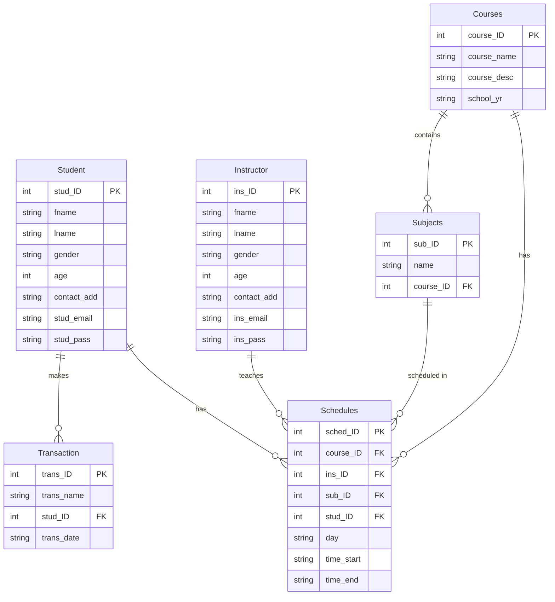

# 3. Entity Relationship Diagram and PostgreSQL DDL

## 3.1 Baseline ERD (reproduced as given)



**Problems in the baseline:** `age` instead of date of birth; plaintext `stud_pass` / `ins_pass`; Student and Instructor duplicate the same person columns; `Schedules.stud_ID` forces one schedule row per student per session (massive duplication, and a class with 45 students needs 45 copies of the same session); a subject belongs to only one course; `school_yr` on Courses means a course has to be re-created every year; no money in Transaction; times and dates stored as strings; no rooms, terms, results, attendance, fees, guardians, requirements or audit. All of these are fixed below. Full list: [section 16](16-corrections-summary.md).

## 3.2 Corrected ERD

Key and important attributes only; every column is listed in the [data dictionary](04-data-dictionary.md).

```mermaid
erDiagram
    users ||--o| staff : "is a"
    users ||--o| instructors : "is a"
    users ||--o| students : "is a"
    users ||--o| guardians : "is a"
    users ||--o{ refresh_tokens : "holds"
    users |o--o{ audit_logs : "performs"

    departments ||--o{ instructors : "employs"
    departments ||--o{ subjects : "owns"

    students ||--o{ student_guardians : "has"
    guardians ||--o{ student_guardians : "cares for"
    students ||--o{ student_status_history : "changes status"

    instructors ||--o{ instructor_subjects : "qualified for"
    subjects ||--o{ instructor_subjects : "taught by"
    instructors ||--o{ instructor_designations : "holds"
    designations ||--o{ instructor_designations : "assigned as"
    academic_years ||--o{ instructor_designations : "valid in"

    academic_years ||--|{ terms : "divided into"
    exam_scales ||--o{ class_levels : "graded by"
    exam_scales ||--|{ grading_scales : "defines"
    exam_scales ||--o{ division_scales : "defines"

    courses ||--o{ course_subjects : "includes"
    subjects ||--o{ course_subjects : "part of"
    class_levels ||--o{ course_subjects : "at level"
    courses ||--o{ course_offerings : "offered as"
    academic_years ||--o{ course_offerings : "in year"
    class_levels ||--o{ course_offerings : "for level"

    course_offerings ||--o{ schedules : "timetabled as"
    terms ||--o{ schedules : "during"
    subjects ||--o{ schedules : "teaches"
    instructors ||--o{ schedules : "teaches"
    rooms ||--o{ schedules : "hosts"

    students ||--o{ enrolments : "applies"
    course_offerings ||--o{ enrolments : "receives"
    enrolments ||--o{ enrolment_schedules : "attends"
    schedules ||--o{ enrolment_schedules : "has students"
    enrolments ||--o{ enrolment_documents : "submits"
    enrolment_requirements ||--o{ enrolment_documents : "satisfied by"

    enrolments ||--o{ results : "earns"
    subjects ||--o{ results : "in"
    terms ||--o{ results : "for"
    enrolment_schedules ||--o{ attendance : "records"

    terms ||--o{ fee_structures : "billed in"
    class_levels ||--o{ fee_structures : "for level"
    courses |o--o{ fee_structures : "for course"
    students ||--o{ invoices : "billed"
    terms ||--o{ invoices : "for term"
    invoices ||--|{ invoice_items : "contains"
    fee_structures |o--o{ invoice_items : "priced from"
    students ||--o{ transactions : "pays"
    invoices |o--o{ transactions : "settled by"
    transactions |o--o| transactions : "reverses"

    users {
        bigint user_id PK
        varchar username UK
        varchar password_hash "Argon2id"
        varchar role "ADMIN REGISTRAR BURSAR INSTRUCTOR STUDENT PARENT"
        varchar first_name
        varchar last_name
        char gender
        date date_of_birth
        varchar phone "255XXXXXXXXX"
        varchar email UK
        char preferred_language "sw or en"
    }
    staff {
        bigint staff_id PK
        bigint user_id FK, UK
        varchar employee_no UK
        varchar job_title
    }
    instructors {
        bigint instructor_id PK
        bigint user_id FK, UK
        varchar employee_no UK
        int department_id FK
        varchar qualification
        smallint max_periods_per_week
    }
    guardians {
        bigint guardian_id PK
        bigint user_id FK, UK
        char nida_no UK
    }
    students {
        bigint student_id PK
        bigint user_id FK, UK
        varchar admission_no UK
        varchar necta_index_no UK
        date admission_date
        varchar current_status
    }
    student_guardians {
        bigint student_id PK, FK
        bigint guardian_id PK, FK
        varchar relationship
        boolean is_primary
    }
    student_status_history {
        bigint history_id PK
        bigint student_id FK
        varchar old_status
        varchar new_status
        varchar reason
        bigint changed_by FK
    }
    departments {
        int department_id PK
        varchar code UK
        varchar name_en
        varchar name_sw
    }
    designations {
        int designation_id PK
        varchar code UK
        varchar name_en
        varchar name_sw
    }
    instructor_designations {
        bigint instructor_designation_id PK
        bigint instructor_id FK
        int designation_id FK
        int academic_year_id FK
        int level_id FK
        varchar stream
    }
    instructor_subjects {
        bigint instructor_id PK, FK
        int subject_id PK, FK
    }
    academic_years {
        int academic_year_id PK
        varchar name UK
        date start_date
        date end_date
        boolean is_current
    }
    terms {
        int term_id PK
        int academic_year_id FK
        smallint term_no
        date start_date
        date end_date
    }
    exam_scales {
        varchar exam_scale PK "PSLE CSEE ACSEE"
        smallint best_n_subjects
    }
    grading_scales {
        int grading_scale_id PK
        varchar exam_scale FK
        varchar grade
        numeric min_score
        smallint points
    }
    division_scales {
        int division_scale_id PK
        varchar exam_scale FK
        varchar division
        smallint min_points
        smallint max_points
    }
    class_levels {
        int level_id PK
        varchar code UK "F1-F6 STD1-STD7"
        varchar name_sw "Kidato cha Kwanza"
        varchar exam_scale FK
    }
    subjects {
        int subject_id PK
        varchar subject_code UK
        varchar necta_code
        varchar name_en
        varchar name_sw
        int department_id FK
        varchar room_type_required
    }
    courses {
        int course_id PK
        varchar course_code UK "OLG PCM HGL"
        varchar course_name
        varchar education_level
    }
    course_subjects {
        int course_id PK, FK
        int level_id PK, FK
        int subject_id PK, FK
        boolean is_compulsory
        smallint periods_per_week
    }
    course_offerings {
        bigint offering_id PK
        int course_id FK
        int academic_year_id FK
        int level_id FK
        smallint capacity
        boolean is_open
    }
    rooms {
        int room_id PK
        varchar room_code UK
        varchar room_type
        smallint capacity
    }
    schedules {
        bigint schedule_id PK
        bigint offering_id FK
        varchar stream
        int term_id FK
        int subject_id FK
        bigint instructor_id FK
        int room_id FK
        smallint day_of_week
        time time_start
        time time_end
    }
    enrolments {
        bigint enrolment_id PK
        varchar enrolment_no UK
        bigint student_id FK
        bigint offering_id FK
        varchar stream
        varchar status
    }
    enrolment_schedules {
        bigint enrolment_id PK, FK
        bigint schedule_id PK, FK
    }
    enrolment_requirements {
        int requirement_id PK
        varchar code UK
        varchar name_sw
        boolean is_mandatory
    }
    enrolment_documents {
        bigint document_id PK
        bigint enrolment_id FK
        int requirement_id FK
        varchar storage_key UK
        char sha256
        varchar status
        bigint validated_by FK
    }
    results {
        bigint result_id PK
        bigint enrolment_id FK
        int subject_id FK
        int term_id FK
        varchar assessment_type
        numeric score
    }
    attendance {
        bigint attendance_id PK
        bigint enrolment_id FK
        bigint schedule_id FK
        date attendance_date
        varchar status
    }
    fee_structures {
        bigint fee_structure_id PK
        int term_id FK
        int level_id FK
        int course_id FK
        varchar fee_item
        numeric amount_tzs
    }
    invoices {
        bigint invoice_id PK
        varchar invoice_no UK
        bigint student_id FK
        int term_id FK
        varchar gepg_control_no UK
        date due_date
    }
    invoice_items {
        bigint invoice_item_id PK
        bigint invoice_id FK
        bigint fee_structure_id FK
        numeric amount_tzs
    }
    transactions {
        bigint trans_id PK
        varchar trans_no UK
        varchar trans_type
        bigint student_id FK
        bigint invoice_id FK
        numeric amount_tzs
        varchar payment_method
        varchar reference_no
        varchar status
        bigint reverses_trans_id FK
        bigint recorded_by FK
    }
    refresh_tokens {
        bigint token_id PK
        bigint user_id FK
        char token_hash UK
        uuid family_id
    }
    audit_logs {
        bigint audit_id PK
        bigint actor_user_id FK
        varchar action
        varchar entity_type
        varchar entity_id
        jsonb old_values
        jsonb new_values
    }
```



**Reading the diagram.** `users` is the single account table: one row per person, holding the shared Person attributes and the login. Each person is exactly one of `staff`, `instructors`, `students` or `guardians` (1 : 0..1). A **schedule** is one weekly class session and has no student column; students reach sessions through `enrolments → enrolment_schedules` (many-to-many). Courses and subjects are many-to-many per level (`course_subjects`). A course is opened each year as a `course_offering`, so `school_yr` no longer sits on the course. Money flows `fee_structures → invoices → invoice_items`, and payments are `transactions`.

## 3.3 Integrity rules enforced by the database

| Rule | Mechanism |
|---|---|
| No instructor double-booking | `EXCLUDE USING gist (instructor_id =, term_id =, day_of_week =, slot &&)` on `schedules` |
| No room double-booking | `EXCLUDE … (room_id =, term_id =, day_of_week =, slot &&)` |
| No two subjects for one class stream at the same time | `EXCLUDE … (offering_id =, stream =, term_id =, day_of_week =, slot &&)` |
| No student in two overlapping sessions | trigger `fn_enrolment_schedules_no_clash` (locks the student row, raises SQLSTATE `23P01`) |
| One active enrolment per student per academic year | trigger `fn_enrolments_one_per_year` (SQLSTATE `23505`) |
| Back-to-back periods allowed (08:00–08:40 then 08:40–09:20) | `slot` is a half-open `[)` `timerange` |
| Payment cannot be posted twice | `UNIQUE (payment_method, reference_no)` |
| Payment must belong to the invoice's student | composite FK `(invoice_id, student_id) → invoices` |
| Ledger is append-only | trigger `fn_transactions_guard`: no DELETE, and only PENDING → COMPLETED/FAILED |
| Audit log is append-only | statement trigger blocks UPDATE, DELETE, TRUNCATE |
| Every change to key tables is audited, without password hashes | `fn_audit_row` AFTER trigger on 14 tables; actor read from `SET LOCAL app.user_id` |
| Attendance only for students in that session | composite FK `(enrolment_id, schedule_id) → enrolment_schedules` |
| One primary guardian, one current year | partial unique indexes |
| Phones `255XXXXXXXXX`, NIDA 20 digits, control number 12 digits | `CHECK` with regular expressions |

All of these were tested by loading the schema and seed into PostgreSQL (PGlite engine) and attempting each violation; every violation was rejected and every valid case accepted (see [section 15.4](15-test-plan.md#154-database-constraint-tests)).

## 3.4 Normalisation notes (3NF)

- **1NF**: every column is atomic. The baseline's `Subjects.instructor` and `Subjects.schedule` strings become foreign keys and the `schedules` table.
- **2NF**: in every composite-key table (`course_subjects`, `enrolment_schedules`, `student_guardians`, `instructor_subjects`) the non-key columns depend on the whole key.
- **3NF**: no non-key column depends on another non-key column:
  - grade, points and division are derived from `score` and the level's `exam_scale` in the view `v_student_results`;
  - invoice total, amount paid, balance and payment status are computed in `v_invoice_balances`;
  - a student's current form and stream come from `v_student_current_enrolment`;
  - the academic year of an enrolment comes from its offering (the one-per-year rule uses a trigger instead of copying the year);
  - fee structures reference the term only (the year comes through the term).
- **Three deliberate, constraint-protected exceptions:**
  1. `invoice_items.description` and `amount_tzs` are **snapshots** of the fee at billing time. A fee change in March must not alter January's invoice.
  2. `transactions.student_id` is needed for advance payments that have no invoice yet. When `invoice_id` is set, a composite FK guarantees it matches the invoice's student.
  3. `students.current_status` is the current state, and `student_status_history` is its event log. Both are written in the same database transaction by `StudentService.change_status`.

## 3.5 Full DDL — `db/schema.sql`

Runs on PostgreSQL 16 or later (`UNIQUE NULLS NOT DISTINCT` needs 15+). Run it with `psql -d sms -f db/schema.sql` or through the Alembic baseline migration ([section 11](11-api-design.md#117-migrations)).

<!-- BEGIN schema.sql -->
```sql
-- File: db/schema.sql
-- =====================================================================
--  School Management System (SMS) - PostgreSQL 16 schema
--  File: db/schema.sql
--
--  Normal form: 3NF. Derived values (invoice totals, balances, grades,
--  divisions, a student's current class) are computed in views, never
--  stored. The two deliberate exceptions are documented in
--  docs/03-erd-and-ddl.md section 3.4.
--
--  Conventions
--    * snake_case, plural table names, <entity>_id surrogate keys
--    * enumerations are VARCHAR + CHECK (easier to migrate than ENUM)
--    * money is NUMERIC(14,2) Tanzanian shillings (TZS), never FLOAT
--    * timestamps are TIMESTAMPTZ (stored UTC, shown in Africa/Dar_es_Salaam)
--    * phones are 255XXXXXXXXX (12 digits, no "+")
--    * every user-facing label has an _en and _sw column
-- =====================================================================

CREATE EXTENSION IF NOT EXISTS btree_gist;   -- lets EXCLUDE mix "=" and "&&"

-- A range type over TIME so timetable clashes can be tested with "&&".
CREATE TYPE timerange AS RANGE (subtype = time);

CREATE FUNCTION fn_set_updated_at() RETURNS trigger
LANGUAGE plpgsql AS $$
BEGIN
    NEW.updated_at := now();
    RETURN NEW;
END $$;

-- =====================================================================
-- 1. NECTA grading reference data
-- =====================================================================
CREATE TABLE exam_scales (
    exam_scale       VARCHAR(5)   PRIMARY KEY,           -- PSLE / CSEE / ACSEE
    name_en          VARCHAR(80)  NOT NULL,
    name_sw          VARCHAR(80)  NOT NULL,
    best_n_subjects  SMALLINT,                           -- subjects counted for division
    CONSTRAINT ck_exam_scales_best_n CHECK (best_n_subjects BETWEEN 1 AND 10)
);

CREATE TABLE grading_scales (
    grading_scale_id INTEGER GENERATED ALWAYS AS IDENTITY PRIMARY KEY,
    exam_scale       VARCHAR(5)   NOT NULL REFERENCES exam_scales (exam_scale),
    grade            VARCHAR(2)   NOT NULL,
    min_score        NUMERIC(5,2) NOT NULL,
    max_score        NUMERIC(5,2) NOT NULL,
    points           SMALLINT     NOT NULL,
    remark_en        VARCHAR(20)  NOT NULL,
    remark_sw        VARCHAR(20)  NOT NULL,
    CONSTRAINT uq_grading_scales_grade UNIQUE (exam_scale, grade),
    CONSTRAINT uq_grading_scales_min   UNIQUE (exam_scale, min_score),
    CONSTRAINT ck_grading_scales_range CHECK (min_score >= 0 AND max_score <= 100 AND max_score >= min_score),
    CONSTRAINT ck_grading_scales_points CHECK (points BETWEEN 1 AND 9)
);

CREATE TABLE division_scales (
    division_scale_id INTEGER GENERATED ALWAYS AS IDENTITY PRIMARY KEY,
    exam_scale        VARCHAR(5) NOT NULL REFERENCES exam_scales (exam_scale),
    division          VARCHAR(3) NOT NULL,                -- I, II, III, IV, 0
    min_points        SMALLINT   NOT NULL,
    max_points        SMALLINT   NOT NULL,
    CONSTRAINT uq_division_scales UNIQUE (exam_scale, division),
    CONSTRAINT ck_division_scales_range CHECK (max_points >= min_points)
);

-- =====================================================================
-- 2. People and accounts (abstract Person/User -> role subtables)
-- =====================================================================
CREATE TABLE users (
    user_id             BIGINT GENERATED ALWAYS AS IDENTITY PRIMARY KEY,
    username            VARCHAR(50)  NOT NULL,
    password_hash       VARCHAR(255) NOT NULL,                 -- Argon2id PHC string
    role                VARCHAR(12)  NOT NULL,
    first_name          VARCHAR(50)  NOT NULL,
    middle_name         VARCHAR(50),
    last_name           VARCHAR(50)  NOT NULL,
    gender              CHAR(1)      NOT NULL,
    date_of_birth       DATE,                                  -- never store age
    phone               VARCHAR(12),
    email               VARCHAR(254),
    preferred_language  CHAR(2)      NOT NULL DEFAULT 'sw',
    is_active           BOOLEAN      NOT NULL DEFAULT TRUE,
    failed_login_count  SMALLINT     NOT NULL DEFAULT 0,
    locked_until        TIMESTAMPTZ,
    last_login_at       TIMESTAMPTZ,
    created_at          TIMESTAMPTZ  NOT NULL DEFAULT now(),
    updated_at          TIMESTAMPTZ  NOT NULL DEFAULT now(),
    CONSTRAINT ck_users_role   CHECK (role IN ('ADMIN','REGISTRAR','BURSAR','INSTRUCTOR','STUDENT','PARENT')),
    CONSTRAINT ck_users_gender CHECK (gender IN ('M','F')),
    CONSTRAINT ck_users_dob    CHECK (date_of_birth >= DATE '1920-01-01'),
    CONSTRAINT ck_users_phone  CHECK (phone ~ '^255[0-9]{9}$'),
    CONSTRAINT ck_users_email  CHECK (email ~* '^[^@\s]+@[^@\s]+\.[^@\s]+$'),
    CONSTRAINT ck_users_lang   CHECK (preferred_language IN ('sw','en')),
    CONSTRAINT ck_users_failed CHECK (failed_login_count >= 0)
);
CREATE UNIQUE INDEX uq_users_username ON users (lower(username));
CREATE UNIQUE INDEX uq_users_email    ON users (lower(email)) WHERE email IS NOT NULL;
CREATE INDEX ix_users_role  ON users (role);
CREATE INDEX ix_users_phone ON users (phone);
CREATE INDEX ix_users_name  ON users (lower(last_name), lower(first_name));

-- Admin / Registrar / Bursar
CREATE TABLE staff (
    staff_id     BIGINT GENERATED ALWAYS AS IDENTITY PRIMARY KEY,
    user_id      BIGINT      NOT NULL UNIQUE REFERENCES users (user_id),
    employee_no  VARCHAR(20) NOT NULL UNIQUE,
    job_title    VARCHAR(80) NOT NULL,
    hired_on     DATE,
    created_at   TIMESTAMPTZ NOT NULL DEFAULT now()
);

CREATE TABLE departments (
    department_id INTEGER GENERATED ALWAYS AS IDENTITY PRIMARY KEY,
    code          VARCHAR(10) NOT NULL UNIQUE,
    name_en       VARCHAR(80) NOT NULL,
    name_sw       VARCHAR(80) NOT NULL
);

CREATE TABLE instructors (
    instructor_id        BIGINT GENERATED ALWAYS AS IDENTITY PRIMARY KEY,
    user_id              BIGINT       NOT NULL UNIQUE REFERENCES users (user_id),
    employee_no          VARCHAR(20)  NOT NULL UNIQUE,         -- government check number
    department_id        INTEGER      NOT NULL REFERENCES departments (department_id),
    qualification        VARCHAR(100) NOT NULL,
    employment_date      DATE,
    employment_status    VARCHAR(12)  NOT NULL DEFAULT 'ACTIVE',
    max_periods_per_week SMALLINT     NOT NULL DEFAULT 30,
    created_at           TIMESTAMPTZ  NOT NULL DEFAULT now(),
    updated_at           TIMESTAMPTZ  NOT NULL DEFAULT now(),
    CONSTRAINT ck_instructors_status CHECK (employment_status IN ('ACTIVE','ON_LEAVE','TRANSFERRED','RETIRED')),
    CONSTRAINT ck_instructors_load   CHECK (max_periods_per_week BETWEEN 1 AND 50)
);
CREATE INDEX ix_instructors_department ON instructors (department_id);

CREATE TABLE guardians (
    guardian_id  BIGINT GENERATED ALWAYS AS IDENTITY PRIMARY KEY,
    user_id      BIGINT       NOT NULL UNIQUE REFERENCES users (user_id),
    nida_no      CHAR(20)     UNIQUE,                          -- National ID, digits only
    occupation   VARCHAR(80),
    address      VARCHAR(200),
    created_at   TIMESTAMPTZ  NOT NULL DEFAULT now(),
    CONSTRAINT ck_guardians_nida CHECK (nida_no ~ '^[0-9]{20}$')
);

CREATE TABLE students (
    student_id      BIGINT GENERATED ALWAYS AS IDENTITY PRIMARY KEY,
    user_id         BIGINT       NOT NULL UNIQUE REFERENCES users (user_id),
    admission_no    VARCHAR(20)  NOT NULL UNIQUE,
    birth_cert_no   VARCHAR(30),
    necta_index_no  VARCHAR(20)  UNIQUE,                       -- e.g. S0334/0045/2025
    admission_date  DATE         NOT NULL DEFAULT CURRENT_DATE,
    current_status  VARCHAR(12)  NOT NULL DEFAULT 'APPLICANT',
    region          VARCHAR(40),
    district        VARCHAR(40),
    home_address    VARCHAR(200),
    created_at      TIMESTAMPTZ  NOT NULL DEFAULT now(),
    updated_at      TIMESTAMPTZ  NOT NULL DEFAULT now(),
    CONSTRAINT ck_students_status CHECK (current_status IN
        ('APPLICANT','ACTIVE','SUSPENDED','TRANSFERRED','DROPPED_OUT','GRADUATED'))
);
CREATE INDEX ix_students_status ON students (current_status);

CREATE TABLE student_guardians (
    student_id    BIGINT      NOT NULL REFERENCES students (student_id),
    guardian_id   BIGINT      NOT NULL REFERENCES guardians (guardian_id),
    relationship  VARCHAR(10) NOT NULL,
    is_primary    BOOLEAN     NOT NULL DEFAULT FALSE,
    PRIMARY KEY (student_id, guardian_id),
    CONSTRAINT ck_student_guardians_rel CHECK (relationship IN ('FATHER','MOTHER','GUARDIAN','SPONSOR','OTHER'))
);
CREATE UNIQUE INDEX uq_student_primary_guardian ON student_guardians (student_id) WHERE is_primary;
CREATE INDEX ix_student_guardians_guardian ON student_guardians (guardian_id);

CREATE TABLE student_status_history (
    history_id      BIGINT GENERATED ALWAYS AS IDENTITY PRIMARY KEY,
    student_id      BIGINT       NOT NULL REFERENCES students (student_id),
    old_status      VARCHAR(12),
    new_status      VARCHAR(12)  NOT NULL,
    reason          VARCHAR(300) NOT NULL,
    effective_date  DATE         NOT NULL DEFAULT CURRENT_DATE,
    changed_by      BIGINT       REFERENCES users (user_id),
    changed_at      TIMESTAMPTZ  NOT NULL DEFAULT now(),
    CONSTRAINT ck_status_history_new CHECK (new_status IN
        ('APPLICANT','ACTIVE','SUSPENDED','TRANSFERRED','DROPPED_OUT','GRADUATED')),
    CONSTRAINT ck_status_history_changed CHECK (old_status IS DISTINCT FROM new_status)
);
CREATE INDEX ix_status_history_student ON student_status_history (student_id, changed_at DESC);

-- =====================================================================
-- 3. Academic calendar and class levels (Forms / Standards)
-- =====================================================================
CREATE TABLE academic_years (
    academic_year_id INTEGER GENERATED ALWAYS AS IDENTITY PRIMARY KEY,
    name             VARCHAR(9) NOT NULL UNIQUE,              -- '2026'
    start_date       DATE       NOT NULL,
    end_date         DATE       NOT NULL,
    is_current       BOOLEAN    NOT NULL DEFAULT FALSE,
    CONSTRAINT ck_academic_years_dates CHECK (end_date > start_date)
);
CREATE UNIQUE INDEX uq_academic_years_current ON academic_years (is_current) WHERE is_current;

CREATE TABLE terms (
    term_id          INTEGER GENERATED ALWAYS AS IDENTITY PRIMARY KEY,
    academic_year_id INTEGER     NOT NULL REFERENCES academic_years (academic_year_id),
    term_no          SMALLINT    NOT NULL,
    name_en          VARCHAR(30) NOT NULL,
    name_sw          VARCHAR(30) NOT NULL,
    start_date       DATE        NOT NULL,
    end_date         DATE        NOT NULL,
    CONSTRAINT uq_terms_year_no UNIQUE (academic_year_id, term_no),
    CONSTRAINT ck_terms_no      CHECK (term_no BETWEEN 1 AND 4),
    CONSTRAINT ck_terms_dates   CHECK (end_date > start_date),
    CONSTRAINT ex_terms_overlap EXCLUDE USING gist
        (academic_year_id WITH =, daterange(start_date, end_date, '[]') WITH &&)
);

CREATE TABLE class_levels (
    level_id        INTEGER GENERATED ALWAYS AS IDENTITY PRIMARY KEY,
    code            VARCHAR(5)  NOT NULL UNIQUE,              -- F1..F6, STD1..STD7
    name_en         VARCHAR(30) NOT NULL,                     -- Form One
    name_sw         VARCHAR(30) NOT NULL,                     -- Kidato cha Kwanza
    education_level VARCHAR(12) NOT NULL,
    exam_scale      VARCHAR(5)  NOT NULL REFERENCES exam_scales (exam_scale),
    sort_order      SMALLINT    NOT NULL UNIQUE,
    CONSTRAINT ck_class_levels_edu CHECK (education_level IN ('PRE_PRIMARY','PRIMARY','O_LEVEL','A_LEVEL'))
);

-- =====================================================================
-- 4. Courses, subjects, offerings, rooms
-- =====================================================================
CREATE TABLE subjects (
    subject_id          INTEGER GENERATED ALWAYS AS IDENTITY PRIMARY KEY,
    subject_code        VARCHAR(10) NOT NULL UNIQUE,
    necta_code          VARCHAR(5),
    name_en             VARCHAR(80) NOT NULL,
    name_sw             VARCHAR(80) NOT NULL,
    department_id       INTEGER     NOT NULL REFERENCES departments (department_id),
    room_type_required  VARCHAR(12) NOT NULL DEFAULT 'CLASSROOM',
    description         TEXT,
    is_active           BOOLEAN     NOT NULL DEFAULT TRUE,
    CONSTRAINT ck_subjects_room_type CHECK (room_type_required IN ('CLASSROOM','LABORATORY','ICT_LAB','LIBRARY','HALL'))
);
CREATE INDEX ix_subjects_department ON subjects (department_id);

CREATE TABLE instructor_subjects (                         -- who is qualified to teach what
    instructor_id BIGINT  NOT NULL REFERENCES instructors (instructor_id),
    subject_id    INTEGER NOT NULL REFERENCES subjects (subject_id),
    PRIMARY KEY (instructor_id, subject_id)
);
CREATE INDEX ix_instructor_subjects_subject ON instructor_subjects (subject_id);

CREATE TABLE designations (
    designation_id INTEGER GENERATED ALWAYS AS IDENTITY PRIMARY KEY,
    code           VARCHAR(20) NOT NULL UNIQUE,
    name_en        VARCHAR(60) NOT NULL,
    name_sw        VARCHAR(60) NOT NULL
);

CREATE TABLE instructor_designations (
    instructor_designation_id BIGINT GENERATED ALWAYS AS IDENTITY PRIMARY KEY,
    instructor_id    BIGINT     NOT NULL REFERENCES instructors (instructor_id),
    designation_id   INTEGER    NOT NULL REFERENCES designations (designation_id),
    academic_year_id INTEGER    NOT NULL REFERENCES academic_years (academic_year_id),
    department_id    INTEGER    REFERENCES departments (department_id),   -- for Head of Department
    level_id         INTEGER    REFERENCES class_levels (level_id),       -- for Class Teacher
    stream           VARCHAR(5),                                          -- for Class Teacher
    assigned_on      DATE       NOT NULL DEFAULT CURRENT_DATE,
    ended_on         DATE,
    assigned_by      BIGINT     REFERENCES users (user_id),
    CONSTRAINT ck_instr_desig_dates  CHECK (ended_on IS NULL OR ended_on >= assigned_on),
    CONSTRAINT ck_instr_desig_class  CHECK ((level_id IS NULL) = (stream IS NULL)),
    CONSTRAINT uq_instructor_designation UNIQUE NULLS NOT DISTINCT
        (instructor_id, designation_id, academic_year_id, department_id, level_id, stream)
);
CREATE INDEX ix_instr_desig_year ON instructor_designations (academic_year_id, designation_id);

CREATE TABLE courses (                                      -- programme / combination
    course_id       INTEGER GENERATED ALWAYS AS IDENTITY PRIMARY KEY,
    course_code     VARCHAR(10)  NOT NULL UNIQUE,              -- OLG, PCM, HGL ...
    course_name     VARCHAR(100) NOT NULL,
    course_name_sw  VARCHAR(100) NOT NULL,
    course_desc     TEXT,
    education_level VARCHAR(12)  NOT NULL,
    is_active       BOOLEAN      NOT NULL DEFAULT TRUE,
    created_at      TIMESTAMPTZ  NOT NULL DEFAULT now(),
    updated_at      TIMESTAMPTZ  NOT NULL DEFAULT now(),
    CONSTRAINT ck_courses_edu CHECK (education_level IN ('PRE_PRIMARY','PRIMARY','O_LEVEL','A_LEVEL'))
);

CREATE TABLE course_subjects (                              -- M:N course <-> subject, per level
    course_id        INTEGER  NOT NULL REFERENCES courses (course_id),
    level_id         INTEGER  NOT NULL REFERENCES class_levels (level_id),
    subject_id       INTEGER  NOT NULL REFERENCES subjects (subject_id),
    is_compulsory    BOOLEAN  NOT NULL DEFAULT TRUE,
    periods_per_week SMALLINT NOT NULL DEFAULT 4,
    PRIMARY KEY (course_id, level_id, subject_id),
    CONSTRAINT ck_course_subjects_periods CHECK (periods_per_week BETWEEN 1 AND 12)
);
CREATE INDEX ix_course_subjects_subject ON course_subjects (subject_id);

CREATE TABLE course_offerings (                             -- a course opened for a year + level
    offering_id      BIGINT GENERATED ALWAYS AS IDENTITY PRIMARY KEY,
    course_id        INTEGER  NOT NULL REFERENCES courses (course_id),
    academic_year_id INTEGER  NOT NULL REFERENCES academic_years (academic_year_id),
    level_id         INTEGER  NOT NULL REFERENCES class_levels (level_id),
    capacity         SMALLINT NOT NULL,
    is_open          BOOLEAN  NOT NULL DEFAULT TRUE,
    created_at       TIMESTAMPTZ NOT NULL DEFAULT now(),
    CONSTRAINT uq_course_offerings UNIQUE (course_id, academic_year_id, level_id),
    CONSTRAINT ck_course_offerings_capacity CHECK (capacity > 0)
);
CREATE INDEX ix_course_offerings_year ON course_offerings (academic_year_id, is_open);

CREATE TABLE rooms (
    room_id    INTEGER GENERATED ALWAYS AS IDENTITY PRIMARY KEY,
    room_code  VARCHAR(10) NOT NULL UNIQUE,
    name       VARCHAR(60) NOT NULL,
    room_type  VARCHAR(12) NOT NULL DEFAULT 'CLASSROOM',
    capacity   SMALLINT    NOT NULL,
    is_active  BOOLEAN     NOT NULL DEFAULT TRUE,
    CONSTRAINT ck_rooms_type     CHECK (room_type IN ('CLASSROOM','LABORATORY','ICT_LAB','LIBRARY','HALL')),
    CONSTRAINT ck_rooms_capacity CHECK (capacity > 0)
);

-- =====================================================================
-- 5. Timetable. A schedule row is ONE weekly class session; it has no
--    student column. Students are linked through enrolment_schedules.
--    The three EXCLUDE constraints make instructor, room and class
--    clashes impossible even under concurrent writes.
-- =====================================================================
CREATE TABLE schedules (
    schedule_id   BIGINT GENERATED ALWAYS AS IDENTITY PRIMARY KEY,
    offering_id   BIGINT     NOT NULL REFERENCES course_offerings (offering_id),
    stream        VARCHAR(5) NOT NULL DEFAULT 'A',
    term_id       INTEGER    NOT NULL REFERENCES terms (term_id),
    subject_id    INTEGER    NOT NULL REFERENCES subjects (subject_id),
    instructor_id BIGINT     NOT NULL REFERENCES instructors (instructor_id),
    room_id       INTEGER    NOT NULL REFERENCES rooms (room_id),
    day_of_week   SMALLINT   NOT NULL,                         -- 1 = Monday ... 6 = Saturday
    time_start    TIME       NOT NULL,
    time_end      TIME       NOT NULL,
    slot          timerange  GENERATED ALWAYS AS (timerange(time_start, time_end, '[)')) STORED,
    created_by    BIGINT     REFERENCES users (user_id),
    created_at    TIMESTAMPTZ NOT NULL DEFAULT now(),
    updated_at    TIMESTAMPTZ NOT NULL DEFAULT now(),
    CONSTRAINT ck_schedules_stream CHECK (stream ~ '^[A-Z]{1,5}$'),
    CONSTRAINT ck_schedules_day    CHECK (day_of_week BETWEEN 1 AND 6),
    CONSTRAINT ck_schedules_time   CHECK (time_end > time_start),
    CONSTRAINT ex_schedules_instructor EXCLUDE USING gist
        (instructor_id WITH =, term_id WITH =, day_of_week WITH =, slot WITH &&),
    CONSTRAINT ex_schedules_room EXCLUDE USING gist
        (room_id WITH =, term_id WITH =, day_of_week WITH =, slot WITH &&),
    CONSTRAINT ex_schedules_class EXCLUDE USING gist
        (offering_id WITH =, stream WITH =, term_id WITH =, day_of_week WITH =, slot WITH &&)
);
CREATE INDEX ix_schedules_offering_term ON schedules (offering_id, stream, term_id);
CREATE INDEX ix_schedules_subject ON schedules (subject_id);

-- =====================================================================
-- 6. Enrolment, requirements and documents
-- =====================================================================
CREATE TABLE enrolment_requirements (
    requirement_id  INTEGER GENERATED ALWAYS AS IDENTITY PRIMARY KEY,
    code            VARCHAR(20)  NOT NULL UNIQUE,
    name_en         VARCHAR(100) NOT NULL,
    name_sw         VARCHAR(100) NOT NULL,
    description     TEXT,
    education_level VARCHAR(12),                               -- NULL = every level
    is_mandatory    BOOLEAN      NOT NULL DEFAULT TRUE,
    is_active       BOOLEAN      NOT NULL DEFAULT TRUE,
    CONSTRAINT ck_requirements_edu CHECK (education_level IN ('PRE_PRIMARY','PRIMARY','O_LEVEL','A_LEVEL'))
);

CREATE TABLE enrolments (
    enrolment_id   BIGINT GENERATED ALWAYS AS IDENTITY PRIMARY KEY,
    enrolment_no   VARCHAR(20)  NOT NULL UNIQUE,               -- ENR-2026-000001
    student_id     BIGINT       NOT NULL REFERENCES students (student_id),
    offering_id    BIGINT       NOT NULL REFERENCES course_offerings (offering_id),
    stream         VARCHAR(5),
    status         VARCHAR(10)  NOT NULL DEFAULT 'PENDING',
    applied_at     TIMESTAMPTZ  NOT NULL DEFAULT now(),
    submitted_at   TIMESTAMPTZ,
    confirmed_at   TIMESTAMPTZ,
    confirmed_by   BIGINT       REFERENCES users (user_id),
    cancelled_at   TIMESTAMPTZ,
    cancel_reason  VARCHAR(300),
    created_at     TIMESTAMPTZ  NOT NULL DEFAULT now(),
    updated_at     TIMESTAMPTZ  NOT NULL DEFAULT now(),
    CONSTRAINT ck_enrolments_status CHECK (status IN
        ('PENDING','SUBMITTED','INVALID','VALIDATED','CONFIRMED','CANCELLED')),
    CONSTRAINT ck_enrolments_stream    CHECK (stream ~ '^[A-Z]{1,5}$'),
    CONSTRAINT ck_enrolments_confirmed CHECK (status <> 'CONFIRMED' OR (confirmed_at IS NOT NULL AND stream IS NOT NULL)),
    CONSTRAINT ck_enrolments_cancelled CHECK (status <> 'CANCELLED' OR (cancelled_at IS NOT NULL AND cancel_reason IS NOT NULL))
);
CREATE INDEX ix_enrolments_student  ON enrolments (student_id);
CREATE INDEX ix_enrolments_offering ON enrolments (offering_id, stream, status);

CREATE TABLE enrolment_documents (
    document_id     BIGINT GENERATED ALWAYS AS IDENTITY PRIMARY KEY,
    enrolment_id    BIGINT       NOT NULL REFERENCES enrolments (enrolment_id),
    requirement_id  INTEGER      NOT NULL REFERENCES enrolment_requirements (requirement_id),
    file_name       VARCHAR(255) NOT NULL,
    storage_key     VARCHAR(255) NOT NULL UNIQUE,              -- object-storage key, not a path
    mime_type       VARCHAR(50)  NOT NULL,
    file_size_bytes INTEGER      NOT NULL,
    sha256          CHAR(64)     NOT NULL,
    status          VARCHAR(8)   NOT NULL DEFAULT 'PENDING',
    remarks         VARCHAR(300),
    uploaded_at     TIMESTAMPTZ  NOT NULL DEFAULT now(),
    validated_by    BIGINT       REFERENCES users (user_id),
    validated_at    TIMESTAMPTZ,
    CONSTRAINT uq_enrolment_documents UNIQUE (enrolment_id, requirement_id),
    CONSTRAINT ck_documents_mime   CHECK (mime_type IN ('application/pdf','image/jpeg','image/png')),
    CONSTRAINT ck_documents_size   CHECK (file_size_bytes BETWEEN 1 AND 5242880),   -- 5 MB
    CONSTRAINT ck_documents_status CHECK (status IN ('PENDING','VALID','INVALID')),
    CONSTRAINT ck_documents_validated CHECK (status = 'PENDING' OR (validated_by IS NOT NULL AND validated_at IS NOT NULL)),
    CONSTRAINT ck_documents_remarks   CHECK (status <> 'INVALID' OR remarks IS NOT NULL)
);

CREATE TABLE enrolment_schedules (                          -- M:N student enrolment <-> class session
    enrolment_id BIGINT      NOT NULL REFERENCES enrolments (enrolment_id),
    schedule_id  BIGINT      NOT NULL REFERENCES schedules (schedule_id),
    assigned_at  TIMESTAMPTZ NOT NULL DEFAULT now(),
    PRIMARY KEY (enrolment_id, schedule_id)
);
CREATE INDEX ix_enrolment_schedules_schedule ON enrolment_schedules (schedule_id);

-- =====================================================================
-- 7. Results and attendance
-- =====================================================================
CREATE TABLE results (
    result_id       BIGINT GENERATED ALWAYS AS IDENTITY PRIMARY KEY,
    enrolment_id    BIGINT       NOT NULL REFERENCES enrolments (enrolment_id),
    subject_id      INTEGER      NOT NULL REFERENCES subjects (subject_id),
    term_id         INTEGER      NOT NULL REFERENCES terms (term_id),
    assessment_type VARCHAR(10)  NOT NULL,
    score           NUMERIC(5,2) NOT NULL,                    -- grade/points derived in v_student_results
    is_published    BOOLEAN      NOT NULL DEFAULT FALSE,
    entered_by      BIGINT       NOT NULL REFERENCES users (user_id),
    entered_at      TIMESTAMPTZ  NOT NULL DEFAULT now(),
    updated_at      TIMESTAMPTZ  NOT NULL DEFAULT now(),
    CONSTRAINT uq_results UNIQUE (enrolment_id, subject_id, term_id, assessment_type),
    CONSTRAINT ck_results_type  CHECK (assessment_type IN ('MONTHLY','MIDTERM','TERMINAL','ANNUAL','MOCK')),
    CONSTRAINT ck_results_score CHECK (score BETWEEN 0 AND 100)
);
CREATE INDEX ix_results_term_subject ON results (term_id, subject_id);

CREATE TABLE attendance (
    attendance_id   BIGINT GENERATED ALWAYS AS IDENTITY PRIMARY KEY,
    enrolment_id    BIGINT       NOT NULL,
    schedule_id     BIGINT       NOT NULL,
    attendance_date DATE         NOT NULL,
    status          VARCHAR(8)   NOT NULL,
    remarks         VARCHAR(200),
    recorded_by     BIGINT       NOT NULL REFERENCES users (user_id),
    recorded_at     TIMESTAMPTZ  NOT NULL DEFAULT now(),
    CONSTRAINT fk_attendance_enrolment_schedule FOREIGN KEY (enrolment_id, schedule_id)
        REFERENCES enrolment_schedules (enrolment_id, schedule_id),   -- only students in that class
    CONSTRAINT uq_attendance UNIQUE (enrolment_id, schedule_id, attendance_date),
    CONSTRAINT ck_attendance_status CHECK (status IN ('PRESENT','ABSENT','LATE','EXCUSED'))
);
CREATE INDEX ix_attendance_schedule_date ON attendance (schedule_id, attendance_date);

-- =====================================================================
-- 8. Fees, invoices and transactions (TZS)
-- =====================================================================
CREATE TABLE fee_structures (
    fee_structure_id BIGINT GENERATED ALWAYS AS IDENTITY PRIMARY KEY,
    term_id          INTEGER       NOT NULL REFERENCES terms (term_id),   -- annual fees are billed in term 1
    level_id         INTEGER       NOT NULL REFERENCES class_levels (level_id),
    course_id        INTEGER       REFERENCES courses (course_id),       -- NULL = every course at the level
    fee_item         VARCHAR(12)   NOT NULL,
    description      VARCHAR(120)  NOT NULL,
    amount_tzs       NUMERIC(14,2) NOT NULL,
    is_mandatory     BOOLEAN       NOT NULL DEFAULT TRUE,
    CONSTRAINT uq_fee_structures UNIQUE NULLS NOT DISTINCT (term_id, level_id, course_id, fee_item),
    CONSTRAINT ck_fee_structures_item   CHECK (fee_item IN ('TUITION','BOARDING','MEALS','EXAMINATION','UNIFORM','DEVELOPMENT','OTHER')),
    CONSTRAINT ck_fee_structures_amount CHECK (amount_tzs >= 0)
);

CREATE TABLE invoices (
    invoice_id      BIGINT GENERATED ALWAYS AS IDENTITY PRIMARY KEY,
    invoice_no      VARCHAR(20)  NOT NULL UNIQUE,              -- INV-2026-000001
    student_id      BIGINT       NOT NULL REFERENCES students (student_id),
    term_id         INTEGER      NOT NULL REFERENCES terms (term_id),
    gepg_control_no VARCHAR(12)  UNIQUE,                       -- issued by GePG
    issued_at       TIMESTAMPTZ  NOT NULL DEFAULT now(),
    due_date        DATE         NOT NULL,
    issued_by       BIGINT       REFERENCES users (user_id),
    cancelled_at    TIMESTAMPTZ,
    cancel_reason   VARCHAR(300),
    CONSTRAINT uq_invoices_id_student UNIQUE (invoice_id, student_id),   -- target of composite FK
    CONSTRAINT ck_invoices_control_no CHECK (gepg_control_no ~ '^[0-9]{12}$'),
    CONSTRAINT ck_invoices_cancel     CHECK ((cancelled_at IS NULL) = (cancel_reason IS NULL))
);
CREATE INDEX ix_invoices_student_term ON invoices (student_id, term_id);

CREATE TABLE invoice_items (
    invoice_item_id  BIGINT GENERATED ALWAYS AS IDENTITY PRIMARY KEY,
    invoice_id       BIGINT        NOT NULL REFERENCES invoices (invoice_id),
    fee_structure_id BIGINT        REFERENCES fee_structures (fee_structure_id),
    description      VARCHAR(120)  NOT NULL,                   -- snapshot at billing time
    amount_tzs       NUMERIC(14,2) NOT NULL,                   -- snapshot at billing time
    CONSTRAINT ck_invoice_items_amount CHECK (amount_tzs >= 0)
);
CREATE INDEX ix_invoice_items_invoice ON invoice_items (invoice_id);

CREATE TABLE transactions (                                 -- append-only money ledger
    trans_id          BIGINT GENERATED ALWAYS AS IDENTITY PRIMARY KEY,
    trans_no          VARCHAR(20)   NOT NULL UNIQUE,           -- TXN-2026-000001
    trans_type        VARCHAR(10)   NOT NULL,
    trans_name        VARCHAR(120)  NOT NULL,                  -- human description (baseline field)
    student_id        BIGINT        NOT NULL REFERENCES students (student_id),
    invoice_id        BIGINT,
    amount_tzs        NUMERIC(14,2) NOT NULL,
    payment_method    VARCHAR(12),
    reference_no      VARCHAR(50),                             -- M-Pesa / bank / GePG receipt
    payer_name        VARCHAR(100),
    payer_phone       VARCHAR(12),
    status            VARCHAR(10)   NOT NULL DEFAULT 'PENDING',
    source            VARCHAR(10)   NOT NULL DEFAULT 'MANUAL',
    reverses_trans_id BIGINT        UNIQUE REFERENCES transactions (trans_id),
    trans_date        TIMESTAMPTZ   NOT NULL DEFAULT now(),
    recorded_by       BIGINT        REFERENCES users (user_id),
    created_at        TIMESTAMPTZ   NOT NULL DEFAULT now(),
    CONSTRAINT fk_transactions_invoice FOREIGN KEY (invoice_id, student_id)
        REFERENCES invoices (invoice_id, student_id),
    CONSTRAINT ck_trans_type    CHECK (trans_type IN ('PAYMENT','REFUND','WAIVER','REVERSAL')),
    CONSTRAINT ck_trans_amount  CHECK (amount_tzs > 0),
    CONSTRAINT ck_trans_method  CHECK (payment_method IN ('CASH','BANK','MPESA','TIGO_PESA','AIRTEL_MONEY','GEPG')),
    CONSTRAINT ck_trans_status  CHECK (status IN ('PENDING','COMPLETED','FAILED')),
    CONSTRAINT ck_trans_source  CHECK (source IN ('MANUAL','GEPG','MOBILE_API')),
    CONSTRAINT ck_trans_method_required CHECK (trans_type IN ('WAIVER','REVERSAL') OR payment_method IS NOT NULL),
    CONSTRAINT ck_trans_reference CHECK (payment_method IS NULL OR payment_method = 'CASH' OR reference_no IS NOT NULL),
    CONSTRAINT ck_trans_reversal  CHECK ((trans_type = 'REVERSAL') = (reverses_trans_id IS NOT NULL)),
    CONSTRAINT ck_trans_recorder  CHECK (source <> 'MANUAL' OR recorded_by IS NOT NULL),
    CONSTRAINT ck_trans_phone     CHECK (payer_phone ~ '^255[0-9]{9}$'),
    CONSTRAINT uq_trans_reference UNIQUE (payment_method, reference_no)    -- no double posting
);
CREATE INDEX ix_transactions_student_date ON transactions (student_id, trans_date DESC);
CREATE INDEX ix_transactions_invoice ON transactions (invoice_id);
CREATE INDEX ix_transactions_date ON transactions (trans_date);

-- =====================================================================
-- 9. Security: refresh tokens and audit log
-- =====================================================================
CREATE TABLE refresh_tokens (
    token_id    BIGINT GENERATED ALWAYS AS IDENTITY PRIMARY KEY,
    user_id     BIGINT       NOT NULL REFERENCES users (user_id),
    token_hash  CHAR(64)     NOT NULL UNIQUE,                  -- SHA-256 of the opaque token
    family_id   UUID         NOT NULL,                         -- rotation chain (reuse detection)
    issued_at   TIMESTAMPTZ  NOT NULL DEFAULT now(),
    expires_at  TIMESTAMPTZ  NOT NULL,
    revoked_at  TIMESTAMPTZ,
    user_agent  VARCHAR(255),
    ip_address  INET,
    CONSTRAINT ck_refresh_tokens_expiry CHECK (expires_at > issued_at)
);
CREATE INDEX ix_refresh_tokens_user   ON refresh_tokens (user_id) WHERE revoked_at IS NULL;
CREATE INDEX ix_refresh_tokens_family ON refresh_tokens (family_id);

CREATE TABLE audit_logs (
    audit_id       BIGINT GENERATED ALWAYS AS IDENTITY PRIMARY KEY,
    occurred_at    TIMESTAMPTZ  NOT NULL DEFAULT now(),
    actor_user_id  BIGINT       REFERENCES users (user_id),    -- NULL = system / callback
    actor_role     VARCHAR(12),
    action         VARCHAR(20)  NOT NULL,
    entity_type    VARCHAR(40)  NOT NULL,
    entity_id      VARCHAR(40),
    old_values     JSONB,
    new_values     JSONB,
    ip_address     INET,
    user_agent     VARCHAR(255),
    request_id     UUID,
    CONSTRAINT ck_audit_action CHECK (action IN ('INSERT','UPDATE','DELETE','LOGIN','LOGIN_FAILED',
        'LOGOUT','TOKEN_REFRESH','TOKEN_REUSE','PASSWORD_CHANGE','EXPORT','VIEW_SENSITIVE'))
);
CREATE INDEX ix_audit_entity ON audit_logs (entity_type, entity_id, occurred_at DESC);
CREATE INDEX ix_audit_actor  ON audit_logs (actor_user_id, occurred_at DESC);
CREATE INDEX brin_audit_occurred ON audit_logs USING brin (occurred_at);

-- Document numbers (S2026-0001, ENR-2026-000001, INV-…, TXN-…) come from
-- sequences, so two clerks working at the same moment never get the same number.
CREATE SEQUENCE seq_admission_no;
CREATE SEQUENCE seq_enrolment_no;
CREATE SEQUENCE seq_invoice_no;
CREATE SEQUENCE seq_trans_no;

-- =====================================================================
-- 10. Integrity and audit triggers
-- =====================================================================

-- 10.1 Audit log is append-only (also REVOKE UPDATE/DELETE from the app role).
CREATE FUNCTION fn_audit_logs_append_only() RETURNS trigger
LANGUAGE plpgsql AS $$
BEGIN
    RAISE EXCEPTION 'audit_logs is append-only (% blocked)', TG_OP;
END $$;
CREATE TRIGGER trg_audit_logs_append_only
    BEFORE UPDATE OR DELETE OR TRUNCATE ON audit_logs
    FOR EACH STATEMENT EXECUTE FUNCTION fn_audit_logs_append_only();

-- 10.2 Generic row audit. The API sets app.user_id / app.user_role /
--      app.client_ip / app.request_id with SET LOCAL in every transaction.
CREATE FUNCTION fn_audit_row() RETURNS trigger
LANGUAGE plpgsql AS $$
DECLARE
    v_old JSONB;
    v_new JSONB;
BEGIN
    IF TG_OP IN ('UPDATE','DELETE') THEN v_old := to_jsonb(OLD) - 'password_hash'; END IF;
    IF TG_OP IN ('INSERT','UPDATE') THEN v_new := to_jsonb(NEW) - 'password_hash'; END IF;
    IF TG_OP = 'UPDATE' AND (v_old - 'updated_at') = (v_new - 'updated_at') THEN
        RETURN NULL;                                           -- nothing visible changed
    END IF;
    INSERT INTO audit_logs (actor_user_id, actor_role, action, entity_type, entity_id,
                            old_values, new_values, ip_address, request_id)
    VALUES (NULLIF(current_setting('app.user_id', true), '')::BIGINT,
            NULLIF(current_setting('app.user_role', true), ''),
            TG_OP, TG_TABLE_NAME,
            COALESCE(v_new, v_old) ->> TG_ARGV[0],
            v_old, v_new,
            NULLIF(current_setting('app.client_ip', true), '')::INET,
            NULLIF(current_setting('app.request_id', true), '')::UUID);
    RETURN NULL;
END $$;

CREATE TRIGGER trg_audit_users        AFTER INSERT OR UPDATE OR DELETE ON users        FOR EACH ROW EXECUTE FUNCTION fn_audit_row('user_id');
CREATE TRIGGER trg_audit_students     AFTER INSERT OR UPDATE OR DELETE ON students     FOR EACH ROW EXECUTE FUNCTION fn_audit_row('student_id');
CREATE TRIGGER trg_audit_instructors  AFTER INSERT OR UPDATE OR DELETE ON instructors  FOR EACH ROW EXECUTE FUNCTION fn_audit_row('instructor_id');
CREATE TRIGGER trg_audit_instr_desig  AFTER INSERT OR UPDATE OR DELETE ON instructor_designations FOR EACH ROW EXECUTE FUNCTION fn_audit_row('instructor_designation_id');
CREATE TRIGGER trg_audit_courses      AFTER INSERT OR UPDATE OR DELETE ON courses      FOR EACH ROW EXECUTE FUNCTION fn_audit_row('course_id');
CREATE TRIGGER trg_audit_subjects     AFTER INSERT OR UPDATE OR DELETE ON subjects     FOR EACH ROW EXECUTE FUNCTION fn_audit_row('subject_id');
CREATE TRIGGER trg_audit_offerings    AFTER INSERT OR UPDATE OR DELETE ON course_offerings FOR EACH ROW EXECUTE FUNCTION fn_audit_row('offering_id');
CREATE TRIGGER trg_audit_schedules    AFTER INSERT OR UPDATE OR DELETE ON schedules    FOR EACH ROW EXECUTE FUNCTION fn_audit_row('schedule_id');
CREATE TRIGGER trg_audit_enrolments   AFTER INSERT OR UPDATE OR DELETE ON enrolments   FOR EACH ROW EXECUTE FUNCTION fn_audit_row('enrolment_id');
CREATE TRIGGER trg_audit_documents    AFTER INSERT OR UPDATE OR DELETE ON enrolment_documents FOR EACH ROW EXECUTE FUNCTION fn_audit_row('document_id');
CREATE TRIGGER trg_audit_results      AFTER INSERT OR UPDATE OR DELETE ON results      FOR EACH ROW EXECUTE FUNCTION fn_audit_row('result_id');
CREATE TRIGGER trg_audit_fees         AFTER INSERT OR UPDATE OR DELETE ON fee_structures FOR EACH ROW EXECUTE FUNCTION fn_audit_row('fee_structure_id');
CREATE TRIGGER trg_audit_invoices     AFTER INSERT OR UPDATE OR DELETE ON invoices     FOR EACH ROW EXECUTE FUNCTION fn_audit_row('invoice_id');
CREATE TRIGGER trg_audit_transactions AFTER INSERT OR UPDATE OR DELETE ON transactions FOR EACH ROW EXECUTE FUNCTION fn_audit_row('trans_id');

-- 10.3 updated_at maintenance
CREATE TRIGGER trg_users_updated       BEFORE UPDATE ON users       FOR EACH ROW EXECUTE FUNCTION fn_set_updated_at();
CREATE TRIGGER trg_students_updated    BEFORE UPDATE ON students    FOR EACH ROW EXECUTE FUNCTION fn_set_updated_at();
CREATE TRIGGER trg_instructors_updated BEFORE UPDATE ON instructors FOR EACH ROW EXECUTE FUNCTION fn_set_updated_at();
CREATE TRIGGER trg_courses_updated     BEFORE UPDATE ON courses     FOR EACH ROW EXECUTE FUNCTION fn_set_updated_at();
CREATE TRIGGER trg_schedules_updated   BEFORE UPDATE ON schedules   FOR EACH ROW EXECUTE FUNCTION fn_set_updated_at();
CREATE TRIGGER trg_enrolments_updated  BEFORE UPDATE ON enrolments  FOR EACH ROW EXECUTE FUNCTION fn_set_updated_at();
CREATE TRIGGER trg_results_updated     BEFORE UPDATE ON results     FOR EACH ROW EXECUTE FUNCTION fn_set_updated_at();

-- 10.4 Transactions are append-only. Only a PENDING row may change, and
--      only its status / reference_no / trans_date (payment callback).
--      Mistakes are corrected by posting a REVERSAL row.
CREATE FUNCTION fn_transactions_guard() RETURNS trigger
LANGUAGE plpgsql AS $$
BEGIN
    IF TG_OP = 'DELETE' THEN
        RAISE EXCEPTION 'transactions are append-only; post a REVERSAL instead';
    END IF;
    IF OLD.status <> 'PENDING'
       OR NEW.status NOT IN ('PENDING','COMPLETED','FAILED')
       OR (to_jsonb(NEW) - 'status' - 'reference_no' - 'trans_date')
          <> (to_jsonb(OLD) - 'status' - 'reference_no' - 'trans_date') THEN
        RAISE EXCEPTION 'transaction % is immutable once %', OLD.trans_no, OLD.status;
    END IF;
    RETURN NEW;
END $$;
CREATE TRIGGER trg_transactions_guard
    BEFORE UPDATE OR DELETE ON transactions
    FOR EACH ROW EXECUTE FUNCTION fn_transactions_guard();

-- 10.5 One active (non-cancelled) enrolment per student per academic year.
--      Done in a trigger instead of copying academic_year_id into
--      enrolments, which would break 3NF. The student row lock
--      serialises concurrent enrolments of the same student.
CREATE FUNCTION fn_enrolments_one_per_year() RETURNS trigger
LANGUAGE plpgsql AS $$
BEGIN
    IF NEW.status = 'CANCELLED' THEN
        RETURN NEW;
    END IF;
    PERFORM 1 FROM students WHERE student_id = NEW.student_id FOR UPDATE;
    IF EXISTS (
        SELECT 1
        FROM enrolments e
        JOIN course_offerings o ON o.offering_id = e.offering_id
        JOIN course_offerings n ON n.offering_id = NEW.offering_id
        WHERE e.student_id = NEW.student_id
          AND e.enrolment_id <> NEW.enrolment_id
          AND e.status <> 'CANCELLED'
          AND o.academic_year_id = n.academic_year_id
    ) THEN
        RAISE EXCEPTION 'student % already has an active enrolment for this academic year', NEW.student_id
            USING ERRCODE = 'unique_violation';
    END IF;
    RETURN NEW;
END $$;
CREATE TRIGGER trg_enrolments_one_per_year
    BEFORE INSERT OR UPDATE OF student_id, offering_id, status ON enrolments
    FOR EACH ROW EXECUTE FUNCTION fn_enrolments_one_per_year();

-- 10.6 A student can never be placed in two overlapping class sessions.
CREATE FUNCTION fn_enrolment_schedules_no_clash() RETURNS trigger
LANGUAGE plpgsql AS $$
DECLARE
    v_student BIGINT;
    v_term    INTEGER;
    v_day     SMALLINT;
    v_slot    timerange;
BEGIN
    SELECT student_id INTO v_student FROM enrolments WHERE enrolment_id = NEW.enrolment_id;
    SELECT term_id, day_of_week, slot INTO v_term, v_day, v_slot
      FROM schedules WHERE schedule_id = NEW.schedule_id;
    PERFORM 1 FROM students WHERE student_id = v_student FOR UPDATE;
    IF EXISTS (
        SELECT 1
        FROM enrolment_schedules es
        JOIN enrolments e ON e.enrolment_id = es.enrolment_id
        JOIN schedules  s ON s.schedule_id  = es.schedule_id
        WHERE e.student_id = v_student
          AND e.status <> 'CANCELLED'
          AND s.schedule_id <> NEW.schedule_id
          AND s.term_id = v_term
          AND s.day_of_week = v_day
          AND s.slot && v_slot
    ) THEN
        RAISE EXCEPTION 'student % already has a class that overlaps schedule %', v_student, NEW.schedule_id
            USING ERRCODE = 'exclusion_violation';
    END IF;
    RETURN NEW;
END $$;
CREATE TRIGGER trg_enrolment_schedules_no_clash
    BEFORE INSERT OR UPDATE ON enrolment_schedules
    FOR EACH ROW EXECUTE FUNCTION fn_enrolment_schedules_no_clash();

-- =====================================================================
-- 11. Views (derived data lives here, not in tables)
-- =====================================================================
CREATE VIEW v_invoice_balances AS
SELECT i.invoice_id,
       i.invoice_no,
       i.student_id,
       i.term_id,
       i.gepg_control_no,
       i.due_date,
       COALESCE(it.total_tzs, 0)                              AS total_tzs,
       COALESCE(tx.credited_tzs, 0)                           AS paid_tzs,
       COALESCE(it.total_tzs, 0) - COALESCE(tx.credited_tzs, 0) AS balance_tzs,
       CASE
           WHEN i.cancelled_at IS NOT NULL                            THEN 'CANCELLED'
           WHEN COALESCE(tx.credited_tzs, 0) >= COALESCE(it.total_tzs, 0) THEN 'PAID'
           WHEN COALESCE(tx.credited_tzs, 0) > 0                      THEN 'PARTIALLY_PAID'
           WHEN i.due_date < CURRENT_DATE                             THEN 'OVERDUE'
           ELSE 'UNPAID'
       END                                                    AS payment_status
FROM invoices i
LEFT JOIN (SELECT invoice_id, SUM(amount_tzs) AS total_tzs
           FROM invoice_items GROUP BY invoice_id) it ON it.invoice_id = i.invoice_id
LEFT JOIN (SELECT invoice_id,
                  SUM(CASE WHEN trans_type IN ('PAYMENT','WAIVER') THEN amount_tzs
                           ELSE -amount_tzs END) AS credited_tzs        -- REFUND, REVERSAL
           FROM transactions
           WHERE status = 'COMPLETED' AND invoice_id IS NOT NULL
           GROUP BY invoice_id) tx ON tx.invoice_id = i.invoice_id;

CREATE VIEW v_student_results AS
SELECT r.result_id,
       e.student_id,
       r.enrolment_id,
       r.term_id,
       r.subject_id,
       r.assessment_type,
       r.score,
       cl.exam_scale,
       g.grade,
       g.points,
       g.remark_en,
       g.remark_sw,
       r.is_published
FROM results r
JOIN enrolments       e  ON e.enrolment_id = r.enrolment_id
JOIN course_offerings o  ON o.offering_id  = e.offering_id
JOIN class_levels     cl ON cl.level_id    = o.level_id
LEFT JOIN LATERAL (
    SELECT gs.grade, gs.points, gs.remark_en, gs.remark_sw
    FROM grading_scales gs
    WHERE gs.exam_scale = cl.exam_scale AND r.score >= gs.min_score
    ORDER BY gs.min_score DESC
    LIMIT 1
) g ON TRUE;

CREATE VIEW v_class_lists AS                                 -- "List of Students" for instructors
SELECT s.schedule_id, s.term_id, s.subject_id, s.instructor_id,
       e.enrolment_id, e.stream, st.student_id, st.admission_no,
       u.first_name, u.middle_name, u.last_name, u.gender
FROM schedules s
JOIN enrolment_schedules es ON es.schedule_id = s.schedule_id
JOIN enrolments e  ON e.enrolment_id = es.enrolment_id AND e.status = 'CONFIRMED'
JOIN students   st ON st.student_id  = e.student_id
JOIN users      u  ON u.user_id      = st.user_id;

CREATE VIEW v_student_current_enrolment AS
SELECT e.student_id, e.enrolment_id, e.stream,
       o.offering_id, o.course_id, o.level_id, o.academic_year_id
FROM enrolments e
JOIN course_offerings o ON o.offering_id = e.offering_id
JOIN academic_years  ay ON ay.academic_year_id = o.academic_year_id AND ay.is_current
WHERE e.status = 'CONFIRMED';

-- =====================================================================
-- 12. Least-privilege roles (run as superuser; adjust passwords)
-- =====================================================================
-- CREATE ROLE sms_app LOGIN PASSWORD 'change-me';
-- GRANT USAGE ON SCHEMA public TO sms_app;
-- GRANT SELECT, INSERT, UPDATE ON ALL TABLES IN SCHEMA public TO sms_app;
-- GRANT USAGE ON ALL SEQUENCES IN SCHEMA public TO sms_app;
-- REVOKE UPDATE ON audit_logs FROM sms_app;            -- append-only
-- CREATE ROLE sms_reporting LOGIN PASSWORD 'change-me'; -- read-only for reports
-- GRANT SELECT ON ALL TABLES IN SCHEMA public TO sms_reporting;
-- REVOKE SELECT ON users, refresh_tokens FROM sms_reporting;
```
<!-- END schema.sql -->

## 3.6 Sample data — `db/seed.sql`

A fictional school, *Shule ya Sekondari Mfano* in Dodoma, with 3 staff, 3 instructors, 3 students (two in Form II A, one Form V PCM applicant), 2 parents, 7 timetable sessions, results, attendance, invoices and four payments (M-Pesa, GePG, cash, failed Airtel Money). Every demo account's password is `Mfano@2026`.

<!-- BEGIN seed.sql -->
```sql
-- File: db/seed.sql
-- =====================================================================
--  Sample data for a fictional school: "Shule ya Sekondari Mfano", Dodoma
--  File: db/seed.sql
--  Run after db/schema.sql on an EMPTY database: rows are inserted in
--  order, so the generated IDs below (1, 2, 3 ...) are predictable.
--  Demo password for every account: Mfano@2026  (change after first login)
--  Amounts are illustrative for a fee-paying school. Government schools
--  are fee-free for tuition, so their fee_structures hold only contributions.
-- =====================================================================

-- ---------- NECTA scales (verify against the current NECTA regulations) ----------
INSERT INTO exam_scales (exam_scale, name_en, name_sw, best_n_subjects) VALUES
 ('PSLE',  'Primary School Leaving Examination',                      'Mtihani wa Kumaliza Elimu ya Msingi', NULL),
 ('CSEE',  'Certificate of Secondary Education Examination',          'Mtihani wa Kidato cha Nne',           7),
 ('ACSEE', 'Advanced Certificate of Secondary Education Examination', 'Mtihani wa Kidato cha Sita',          3);

INSERT INTO grading_scales (exam_scale, grade, min_score, max_score, points, remark_en, remark_sw) VALUES
 ('CSEE','A', 75, 100,   1, 'Excellent',    'Bora'),
 ('CSEE','B', 65, 74.99, 2, 'Very Good',    'Vizuri Sana'),
 ('CSEE','C', 45, 64.99, 3, 'Good',         'Vizuri'),
 ('CSEE','D', 30, 44.99, 4, 'Satisfactory', 'Inaridhisha'),
 ('CSEE','F',  0, 29.99, 5, 'Fail',         'Hafifu'),
 ('ACSEE','A', 80, 100,   1, 'Excellent',    'Bora'),
 ('ACSEE','B', 70, 79.99, 2, 'Very Good',    'Vizuri Sana'),
 ('ACSEE','C', 60, 69.99, 3, 'Good',         'Vizuri'),
 ('ACSEE','D', 50, 59.99, 4, 'Average',      'Wastani'),
 ('ACSEE','E', 40, 49.99, 5, 'Satisfactory', 'Inaridhisha'),
 ('ACSEE','S', 35, 39.99, 6, 'Subsidiary',   'Ufaulu Hafifu'),
 ('ACSEE','F',  0, 34.99, 7, 'Fail',         'Hafifu'),
 ('PSLE','A', 81, 100,   1, 'Excellent',    'Bora'),
 ('PSLE','B', 61, 80.99, 2, 'Very Good',    'Vizuri Sana'),
 ('PSLE','C', 41, 60.99, 3, 'Good',         'Vizuri'),
 ('PSLE','D', 21, 40.99, 4, 'Satisfactory', 'Inaridhisha'),
 ('PSLE','E',  0, 20.99, 5, 'Fail',         'Hafifu');

INSERT INTO division_scales (exam_scale, division, min_points, max_points) VALUES
 ('CSEE','I',7,17), ('CSEE','II',18,21), ('CSEE','III',22,25), ('CSEE','IV',26,33), ('CSEE','0',34,35),
 ('ACSEE','I',3,9), ('ACSEE','II',10,12), ('ACSEE','III',13,17), ('ACSEE','IV',18,19), ('ACSEE','0',20,21);

-- ---------- Calendar and levels ----------
INSERT INTO academic_years (name, start_date, end_date, is_current) VALUES
 ('2026', '2026-01-01', '2026-12-31', TRUE);                                      -- id 1

INSERT INTO terms (academic_year_id, term_no, name_en, name_sw, start_date, end_date) VALUES
 (1, 1, 'Term One', 'Muhula wa Kwanza', '2026-01-12', '2026-06-05'),              -- id 1
 (1, 2, 'Term Two', 'Muhula wa Pili',   '2026-07-06', '2026-12-04');              -- id 2

INSERT INTO class_levels (code, name_en, name_sw, education_level, exam_scale, sort_order) VALUES
 ('F1','Form One',  'Kidato cha Kwanza','O_LEVEL','CSEE', 11),                    -- id 1
 ('F2','Form Two',  'Kidato cha Pili',  'O_LEVEL','CSEE', 12),                    -- id 2
 ('F3','Form Three','Kidato cha Tatu',  'O_LEVEL','CSEE', 13),                    -- id 3
 ('F4','Form Four', 'Kidato cha Nne',   'O_LEVEL','CSEE', 14),                    -- id 4
 ('F5','Form Five', 'Kidato cha Tano',  'A_LEVEL','ACSEE',15),                    -- id 5
 ('F6','Form Six',  'Kidato cha Sita',  'A_LEVEL','ACSEE',16),                    -- id 6
 ('STD1','Standard One',  'Darasa la Kwanza','PRIMARY','PSLE',1),
 ('STD2','Standard Two',  'Darasa la Pili',  'PRIMARY','PSLE',2),
 ('STD3','Standard Three','Darasa la Tatu',  'PRIMARY','PSLE',3),
 ('STD4','Standard Four', 'Darasa la Nne',   'PRIMARY','PSLE',4),
 ('STD5','Standard Five', 'Darasa la Tano',  'PRIMARY','PSLE',5),
 ('STD6','Standard Six',  'Darasa la Sita',  'PRIMARY','PSLE',6),
 ('STD7','Standard Seven','Darasa la Saba',  'PRIMARY','PSLE',7);

-- ---------- Departments, designations, subjects ----------
INSERT INTO departments (code, name_en, name_sw) VALUES
 ('SCI', 'Science',     'Sayansi'),                                               -- id 1
 ('LANG','Languages',   'Lugha'),                                                 -- id 2
 ('HUM', 'Humanities',  'Masomo ya Sanaa'),                                       -- id 3
 ('MATH','Mathematics', 'Hisabati');                                              -- id 4

INSERT INTO designations (code, name_en, name_sw) VALUES
 ('HEAD_OF_SCHOOL',   'Head of School',          'Mkuu wa Shule'),               -- id 1
 ('ACADEMIC_MASTER',  'Academic Master/Mistress','Mwalimu wa Taaluma'),          -- id 2
 ('HOD',              'Head of Department',      'Mkuu wa Idara'),               -- id 3
 ('CLASS_TEACHER',    'Class Teacher',           'Mwalimu wa Darasa'),           -- id 4
 ('DISCIPLINE_MASTER','Discipline Master/Mistress','Mwalimu wa Nidhamu'),        -- id 5
 ('SUBJECT_TEACHER',  'Subject Teacher',         'Mwalimu wa Somo');             -- id 6

INSERT INTO subjects (subject_code, necta_code, name_en, name_sw, department_id, room_type_required) VALUES
 ('CIV',   '011','Civics',               'Uraia',              3,'CLASSROOM'),    -- id 1
 ('HIST',  '012','History',              'Historia',           3,'CLASSROOM'),    -- id 2
 ('GEO',   '013','Geography',            'Jiografia',          3,'CLASSROOM'),    -- id 3
 ('KISW',  '021','Kiswahili',            'Kiswahili',          2,'CLASSROOM'),    -- id 4
 ('ENG',   '022','English Language',     'Kiingereza',         2,'CLASSROOM'),    -- id 5
 ('PHY',   '031','Physics',              'Fizikia',            1,'LABORATORY'),   -- id 6
 ('CHEM',  '032','Chemistry',            'Kemia',              1,'LABORATORY'),   -- id 7
 ('BIO',   '033','Biology',              'Biolojia',           1,'LABORATORY'),   -- id 8
 ('BMATH', '041','Basic Mathematics',    'Hisabati za Msingi', 4,'CLASSROOM'),    -- id 9
 ('GS',    '111','General Studies',      'Maarifa ya Jumla',   3,'CLASSROOM'),    -- id 10
 ('PHY-A', '131','Physics (Advanced)',   'Fizikia (Juu)',      1,'LABORATORY'),   -- id 11
 ('CHEM-A','132','Chemistry (Advanced)', 'Kemia (Juu)',        1,'LABORATORY'),   -- id 12
 ('AMATH', '142','Advanced Mathematics', 'Hisabati ya Juu',    4,'CLASSROOM');    -- id 13

-- ---------- Courses (programmes / combinations) ----------
INSERT INTO courses (course_code, course_name, course_name_sw, course_desc, education_level) VALUES
 ('OLG','O-Level General Secondary','Elimu ya Sekondari ya Kawaida',
        'Form I-IV general curriculum leading to CSEE', 'O_LEVEL'),               -- id 1
 ('PCM','Physics, Chemistry and Advanced Mathematics','Fizikia, Kemia na Hisabati ya Juu',
        'Form V-VI science combination leading to ACSEE', 'A_LEVEL');             -- id 2

INSERT INTO course_subjects (course_id, level_id, subject_id, is_compulsory, periods_per_week)
SELECT 1, lvl, sub, TRUE, ppw
FROM (VALUES (1),(2)) AS l(lvl)
CROSS JOIN (VALUES (1,2),(2,3),(3,3),(4,4),(5,5),(6,3),(7,3),(8,3),(9,6)) AS s(sub, ppw);
INSERT INTO course_subjects (course_id, level_id, subject_id, is_compulsory, periods_per_week) VALUES
 (2,5,11,TRUE,6), (2,5,12,TRUE,6), (2,5,13,TRUE,6), (2,5,10,TRUE,3);

INSERT INTO course_offerings (course_id, academic_year_id, level_id, capacity) VALUES
 (1,1,1,160),                                                                     -- id 1  OLG Form I 2026
 (1,1,2,160),                                                                     -- id 2  OLG Form II 2026
 (2,1,5, 45);                                                                     -- id 3  PCM Form V 2026

INSERT INTO rooms (room_code, name, room_type, capacity) VALUES
 ('F1A',     'Form I A Classroom',  'CLASSROOM', 45),                             -- id 1
 ('F2A',     'Form II A Classroom', 'CLASSROOM', 45),                             -- id 2
 ('F5PCM',   'Form V PCM Classroom','CLASSROOM', 45),                             -- id 3
 ('LAB-PHY', 'Physics Laboratory',  'LABORATORY',40),                             -- id 4
 ('LAB-CHEM','Chemistry Laboratory','LABORATORY',40),                             -- id 5
 ('HALL',    'Assembly Hall',       'HALL',     400);                             -- id 6

-- ---------- Users (one table, role column, Argon2id hashes) ----------
INSERT INTO users (username, password_hash, role, first_name, middle_name, last_name,
                   gender, date_of_birth, phone, email, preferred_language)
SELECT v.username, h.hash, v.role, v.fn, v.mn, v.ln, v.g, v.dob::date, v.phone, v.email, v.lang
FROM (VALUES
 ('admin',      'ADMIN',      'Halima',   'Juma',     'Mrisho',   'F','1985-04-02','255754000001','admin@mfano.sc.tz',     'en'),  -- 1
 ('registrar',  'REGISTRAR',  'Joseph',   NULL,       'Mwakyusa', 'M','1980-09-17','255754000002','registrar@mfano.sc.tz', 'sw'),  -- 2
 ('bursar',     'BURSAR',     'Rehema',   NULL,       'Kileo',    'F','1988-01-25','255754000003','bursar@mfano.sc.tz',    'sw'),  -- 3
 ('tch.mwita',  'INSTRUCTOR', 'Daudi',    NULL,       'Mwita',    'M','1987-06-11','255754000004','d.mwita@mfano.sc.tz',   'sw'),  -- 4
 ('tch.salma',  'INSTRUCTOR', 'Salma',    NULL,       'Abdallah', 'F','1990-12-03','255754000005','s.abdallah@mfano.sc.tz','en'),  -- 5
 ('tch.kimaro', 'INSTRUCTOR', 'Peter',    NULL,       'Kimaro',   'M','1984-03-29','255754000006','p.kimaro@mfano.sc.tz',  'sw'),  -- 6
 ('s2025-0014', 'STUDENT',    'Amani',    'John',     'Massawe',  'M','2012-03-14',NULL,          NULL,                    'sw'),  -- 7
 ('s2025-0027', 'STUDENT',    'Zawadi',   'Ally',     'Hassan',   'F','2012-08-02',NULL,          NULL,                    'sw'),  -- 8
 ('s2026-0003', 'STUDENT',    'Baraka',   'Emmanuel', 'Lyimo',    'M','2009-11-21','255683000009',NULL,                    'en'),  -- 9
 ('p.massawe',  'PARENT',     'John',     NULL,       'Massawe',  'M','1978-05-12','255754000010',NULL,                    'sw'),  -- 10
 ('p.hassan',   'PARENT',     'Mwanaisha',NULL,       'Hassan',   'F','1983-10-30','255715000011',NULL,                    'sw')   -- 11
) AS v(username, role, fn, mn, ln, g, dob, phone, email, lang)
CROSS JOIN (SELECT '$argon2id$v=19$m=65536,t=3,p=4$2JZvF1O+TsM6DnwjGpd33w$SfH+MNK3OfkgDVia5a+o99MhicDtpTVk/2+CrGeLQ5Q'::text AS hash) AS h;

INSERT INTO staff (user_id, employee_no, job_title, hired_on) VALUES
 (1,'EMP-0001','System Administrator','2019-01-07'),
 (2,'EMP-0002','Registrar',           '2015-07-01'),
 (3,'EMP-0003','Bursar',              '2020-02-03');

INSERT INTO instructors (user_id, employee_no, department_id, qualification, employment_date) VALUES
 (4,'TCH-0101',4,'B.Ed. Mathematics',               '2018-01-10'),                -- id 1
 (5,'TCH-0102',2,'B.A. Ed. English and Kiswahili',  '2019-07-01'),                -- id 2
 (6,'TCH-0103',1,'B.Sc. Ed. Physics and Chemistry', '2016-01-11');                -- id 3

INSERT INTO instructor_subjects (instructor_id, subject_id) VALUES
 (1,9),(1,13),(2,4),(2,5),(3,6),(3,7),(3,11),(3,12);

INSERT INTO instructor_designations (instructor_id, designation_id, academic_year_id, department_id, level_id, stream, assigned_on, assigned_by) VALUES
 (1,3,1,4,NULL,NULL,'2026-01-05',1),     -- Mwita: HOD Mathematics
 (2,4,1,NULL,2,'A', '2026-01-05',1),     -- Salma: Class Teacher Form II A
 (3,2,1,NULL,NULL,NULL,'2026-01-05',1);  -- Kimaro: Academic Master

INSERT INTO guardians (user_id, nida_no, occupation, address) VALUES
 (10,'19780512141230000123','Farmer',      'Kisasa, Dodoma'),                     -- id 1
 (11,'19831030141230000456','Businesswoman','Area D, Dodoma');                    -- id 2

INSERT INTO students (user_id, admission_no, birth_cert_no, necta_index_no, admission_date,
                      current_status, region, district, home_address) VALUES
 (7,'S2025-0014','BC-DOD-2012-004411',NULL,             '2025-01-13','ACTIVE',   'Dodoma','Dodoma City','Kisasa, Dodoma'),  -- id 1
 (8,'S2025-0027','BC-DOD-2012-007920',NULL,             '2025-01-13','ACTIVE',   'Dodoma','Dodoma City','Area D, Dodoma'),  -- id 2
 (9,'S2026-0003','BC-ARU-2009-001276','S0334/0045/2025','2026-01-06','APPLICANT','Arusha','Arusha City','Njiro, Arusha');   -- id 3

INSERT INTO student_guardians (student_id, guardian_id, relationship, is_primary) VALUES
 (1,1,'FATHER',TRUE), (2,2,'MOTHER',TRUE);

INSERT INTO student_status_history (student_id, old_status, new_status, reason, effective_date, changed_by, changed_at) VALUES
 (1,'APPLICANT','ACTIVE','Enrolment confirmed - Form I 2025','2025-01-13',2,'2025-01-13 09:00+03'),
 (2,'APPLICANT','ACTIVE','Enrolment confirmed - Form I 2025','2025-01-13',2,'2025-01-13 09:05+03');

-- ---------- Enrolment requirements ----------
INSERT INTO enrolment_requirements (code, name_en, name_sw, education_level, is_mandatory) VALUES
 ('BIRTH_CERT',     'Birth certificate',              'Cheti cha kuzaliwa',               NULL,     TRUE),   -- id 1
 ('PASSPORT_PHOTO', 'Passport-size photograph',       'Picha ya pasipoti',                NULL,     TRUE),   -- id 2
 ('MEDICAL_FORM',   'Medical examination form',       'Fomu ya uchunguzi wa afya',        NULL,     TRUE),   -- id 3
 ('PSLE_RESULTS',   'Standard VII (PSLE) results slip','Matokeo ya Darasa la Saba',       'O_LEVEL',TRUE),   -- id 4
 ('CSEE_RESULTS',   'Form IV (CSEE) results slip',    'Matokeo ya Kidato cha Nne',        'A_LEVEL',TRUE),   -- id 5
 ('TRANSFER_LETTER','Transfer letter (if transferring)','Barua ya uhamisho (kama unahamia)',NULL,   FALSE);  -- id 6

-- ---------- Enrolments ----------
INSERT INTO enrolments (enrolment_no, student_id, offering_id, stream, status, applied_at, submitted_at, confirmed_at, confirmed_by) VALUES
 ('ENR-2026-000001',1,2,'A','CONFIRMED','2025-12-01 10:00+03','2025-12-01 10:30+03','2026-01-08 09:00+03',2),  -- id 1
 ('ENR-2026-000002',2,2,'A','CONFIRMED','2025-12-02 11:00+03','2025-12-02 11:20+03','2026-01-08 09:10+03',2),  -- id 2
 ('ENR-2026-000003',3,3,NULL,'SUBMITTED','2026-01-06 08:30+03','2026-01-06 09:15+03',NULL,NULL);                -- id 3

INSERT INTO enrolment_documents (enrolment_id, requirement_id, file_name, storage_key, mime_type, file_size_bytes, sha256, status, validated_by, validated_at) VALUES
 (3,1,'cheti_kuzaliwa.pdf','enrolments/3/BIRTH_CERT/7f3a.pdf','application/pdf',284113,encode(sha256('doc-3-1'::bytea),'hex'),'VALID',  6,'2026-01-07 10:00+03'),
 (3,2,'picha.jpg',         'enrolments/3/PASSPORT_PHOTO/91bc.jpg','image/jpeg', 98112,encode(sha256('doc-3-2'::bytea),'hex'),'VALID',  6,'2026-01-07 10:02+03'),
 (3,3,'medical.pdf',       'enrolments/3/MEDICAL_FORM/0d44.pdf','application/pdf',412880,encode(sha256('doc-3-3'::bytea),'hex'),'PENDING',NULL,NULL),
 (3,5,'csee_slip.png',     'enrolments/3/CSEE_RESULTS/c2e1.png','image/png',  1022331,encode(sha256('doc-3-5'::bytea),'hex'),'PENDING',NULL,NULL);

-- ---------- Timetable, Term One (Mon=1). Mwita's 08:00-08:40 and 08:40-10:00 do not clash: '[)' ----------
INSERT INTO schedules (offering_id, stream, term_id, subject_id, instructor_id, room_id, day_of_week, time_start, time_end, created_by) VALUES
 (2,'A',1, 9,1,2,1,'08:00','08:40',1),     -- id 1  Form II A  Basic Maths   Mon
 (2,'A',1, 5,2,2,1,'08:40','09:20',1),     -- id 2  Form II A  English       Mon
 (2,'A',1, 6,3,4,2,'10:20','11:40',1),     -- id 3  Form II A  Physics (lab) Tue double
 (2,'A',1, 4,2,2,2,'08:00','08:40',1),     -- id 4  Form II A  Kiswahili     Tue
 (2,'A',1, 9,1,2,3,'08:00','08:40',1),     -- id 5  Form II A  Basic Maths   Wed
 (3,'A',1,13,1,3,1,'08:40','10:00',1),     -- id 6  Form V PCM Adv. Maths    Mon double
 (3,'A',1,11,3,4,1,'10:20','11:40',1);     -- id 7  Form V PCM Physics (lab) Mon double

INSERT INTO enrolment_schedules (enrolment_id, schedule_id)
SELECT e, s FROM (VALUES (1),(2)) AS en(e) CROSS JOIN (VALUES (1),(2),(3),(4),(5)) AS sc(s);

-- ---------- Results (Term One mid-term) and attendance ----------
INSERT INTO results (enrolment_id, subject_id, term_id, assessment_type, score, is_published, entered_by) VALUES
 (1, 9,1,'MIDTERM',78.50,TRUE,4), (1,5,1,'MIDTERM',66.00,TRUE,5), (1,6,1,'MIDTERM',52.00,TRUE,6), (1,4,1,'MIDTERM',81.00,TRUE,5),
 (2, 9,1,'MIDTERM',44.00,TRUE,4), (2,5,1,'MIDTERM',71.00,TRUE,5), (2,6,1,'MIDTERM',29.50,TRUE,6), (2,4,1,'MIDTERM',88.00,TRUE,5);

INSERT INTO attendance (enrolment_id, schedule_id, attendance_date, status, recorded_by) VALUES
 (1,1,'2026-03-02','PRESENT',4), (2,1,'2026-03-02','LATE',4),
 (1,2,'2026-03-02','PRESENT',5), (2,2,'2026-03-02','ABSENT',5);

-- ---------- Fees, invoices, transactions ----------
INSERT INTO fee_structures (term_id, level_id, course_id, fee_item, description, amount_tzs) VALUES
 (1,2,NULL,'TUITION',    'Tuition fee - Term One',      450000),   -- id 1
 (1,2,NULL,'MEALS',      'Meals - Term One',            150000),   -- id 2
 (1,2,NULL,'EXAMINATION','Examination fee - Term One',   30000),   -- id 3
 (1,2,NULL,'DEVELOPMENT','Development levy (annual)',    50000),   -- id 4
 (1,5,2,   'TUITION',    'Tuition fee - Term One (PCM)',600000),   -- id 5
 (1,5,2,   'MEALS',      'Meals - Term One',            150000),   -- id 6
 (1,5,2,   'EXAMINATION','Examination fee - Term One',   40000),   -- id 7
 (2,2,NULL,'TUITION',    'Tuition fee - Term Two',      450000),   -- id 8
 (2,2,NULL,'MEALS',      'Meals - Term Two',            150000),   -- id 9
 (2,2,NULL,'EXAMINATION','Examination fee - Term Two',   30000),   -- id 10
 (2,5,2,   'TUITION',    'Tuition fee - Term Two (PCM)',600000),   -- id 11
 (2,5,2,   'MEALS',      'Meals - Term Two',            150000),   -- id 12
 (2,5,2,   'EXAMINATION','Examination fee - Term Two',   40000);   -- id 13

INSERT INTO invoices (invoice_no, student_id, term_id, gepg_control_no, issued_at, due_date, issued_by) VALUES
 ('INV-2026-000001',1,1,'994120000001','2026-01-08 12:00+03','2026-02-15',3),    -- id 1
 ('INV-2026-000002',2,1,'994120000002','2026-01-08 12:05+03','2026-02-15',3);    -- id 2

INSERT INTO invoice_items (invoice_id, fee_structure_id, description, amount_tzs)
SELECT i, f.fee_structure_id, f.description, f.amount_tzs
FROM (VALUES (1),(2)) AS inv(i)
CROSS JOIN fee_structures f
WHERE f.fee_structure_id IN (1,2,3,4);

INSERT INTO transactions (trans_no, trans_type, trans_name, student_id, invoice_id, amount_tzs, payment_method,
                          reference_no, payer_name, payer_phone, status, source, trans_date, recorded_by) VALUES
 ('TXN-2026-000001','PAYMENT','School fees Term One (M-Pesa)',1,1,400000,'MPESA','QKJ7H2LM9P','John Massawe','255754000010','COMPLETED','MANUAL','2026-01-10 10:15+03',3),
 ('TXN-2026-000002','PAYMENT','School fees Term One (GePG)',  1,1,280000,'GEPG', '7712345678','John Massawe','255754000010','COMPLETED','GEPG',  '2026-01-20 14:02+03',NULL),
 ('TXN-2026-000003','PAYMENT','School fees Term One (cash)',  2,2,200000,'CASH', 'RCT-2026-0001','Mwanaisha Hassan','255715000011','COMPLETED','MANUAL','2026-01-12 09:30+03',3),
 ('TXN-2026-000004','PAYMENT','School fees Term One (Airtel)',2,2,100000,'AIRTEL_MONEY','MP260115.1234.A12345','Mwanaisha Hassan','255715000011','FAILED','MOBILE_API','2026-01-15 16:45+03',NULL);

-- ---------- Continue document numbering after the sample rows ----------
SELECT setval('seq_admission_no', 100);
SELECT setval('seq_enrolment_no', 3);
SELECT setval('seq_invoice_no', 2);
SELECT setval('seq_trans_no', 4);
```
<!-- END seed.sql -->

Expected results after seeding:

| Query | Result |
|---|---|
| `SELECT invoice_no, total_tzs, paid_tzs, payment_status FROM v_invoice_balances` | INV-2026-000001: 680,000 / 680,000 / PAID; INV-2026-000002: 680,000 / 200,000 / PARTIALLY_PAID |
| `SELECT grade FROM v_student_results WHERE score = 29.50` | `F` (CSEE scale, Form II) |
| `SELECT count(*) FROM v_class_lists WHERE schedule_id = 1` | 2 |
