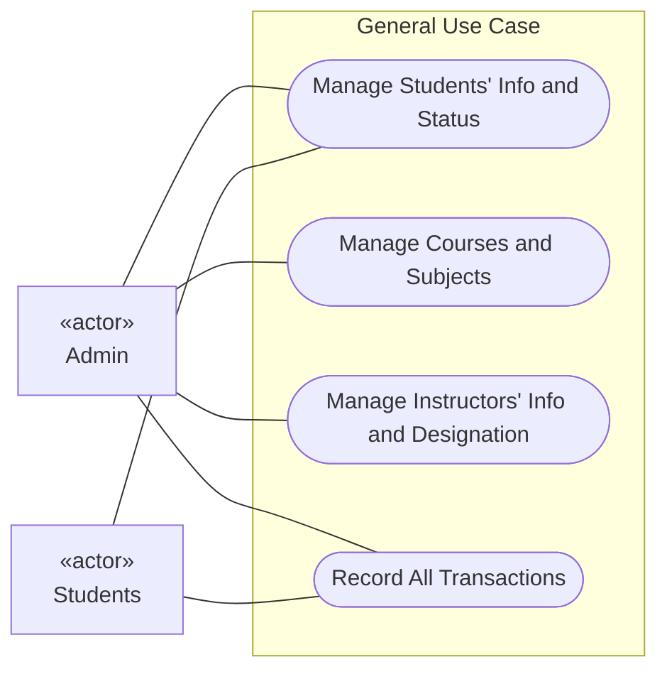
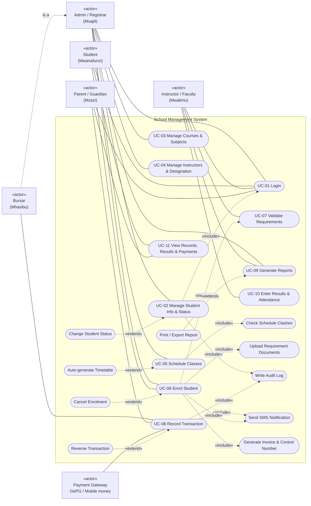

# 5. Use Cases

## 5.1 Baseline use case diagram (reproduced)

Gaps: no Instructor or Parent actor, no login, no scheduling or enrolment use case (although the sequence and activity diagrams describe them), no reports, and no `«include»` / `«extend»` relationships.

## 5.2 Corrected use case diagram

Mermaid has no UML use-case diagram, so actors are drawn as boxes marked «actor», use cases as stadium shapes inside the system boundary, and «include» / «extend» as dashed arrows. An «include» arrow points from the base use case to the included one. An «extend» arrow points from the extension to the base.

Every use case except UC-01 requires an authenticated session, so each one «include»s **Login**. Only one such arrow is drawn to keep the diagram readable.

## 5.3 Detailed use case descriptions

Common to all: **Precondition P0** is that the actor is logged in with the role shown (except UC-01). Every create, update or delete writes an `audit_logs` row (INC3).

### UC-01 Login

| Item | Description |
|---|---|
| Actors | All users (Admin, Registrar, Bursar, Instructor, Student, Parent) |
| Description | Authenticate a user and issue tokens scoped to their role. |
| Preconditions | Account exists and `is_active = TRUE`. |
| Trigger | User opens the PWA and submits the login form. |
| Main flow | 1. User enters username (or email) and password and chooses a language. 2. System finds the user case-insensitively. 3. System checks the account is not locked. 4. System verifies the Argon2id hash. 5. System resets `failed_login_count`, sets `last_login_at`, issues a 15-minute access JWT and a 7-day refresh token (hash stored in `refresh_tokens`). 6. System writes a `LOGIN` audit entry. 7. Client opens the dashboard for the user's role. |
| Alternate flows | **A1 Wrong credentials:** increment `failed_login_count`, audit `LOGIN_FAILED`, return `401` "Jina la mtumiaji au nenosiri si sahihi / Invalid username or password". **A2 5th failure:** also set `locked_until = now + 15 min`. **A3 Locked:** return `423` with unlock time. **A4 Inactive:** same generic `401`. **A5 Access token expired:** client calls `/auth/refresh`; a rotated token is issued; reuse of an old refresh token revokes the token family and audits `TOKEN_REUSE`. |
| Postconditions | Valid session; audit entry written. |
| Business rules | Messages never reveal whether the username exists. Passwords ≥ 10 characters with letters and digits. |
| Endpoints / tables | `POST /api/v1/auth/login`, `POST /auth/refresh`, `POST /auth/logout`, `GET /auth/me` · `users`, `refresh_tokens`, `audit_logs` |
| Requirements | FR-01 to FR-05, NFR-01, NFR-03 |

### UC-02 Manage Student Info and Status

| Item | Description |
|---|---|
| Actors | Registrar/Admin (primary); Student, Parent (view only) |
| Description | Register, search, update students, link guardians and change status with history. |
| Preconditions | P0. |
| Trigger | A new admission, a correction, or a disciplinary/transfer/graduation decision. |
| Main flow | 1. Registrar opens *Wanafunzi / Students* and chooses *Add*. 2. Enters names, gender, date of birth, birth-certificate number, region, district, address, and guardian(s) with phone `255…`. 3. System validates, creates the `users` row (role STUDENT, temporary password), the `students` row with admission number `S{YYYY}-{NNNN}` and status APPLICANT, and the guardian links. 4. System sends the login details by SMS to the primary guardian. 5. To update, the registrar searches, edits fields and saves; the system stores the change and its audit entry. |
| Alternate flows | **A1 Duplicate** (same names + DOB + guardian phone) → warning, registrar confirms or cancels. **A2 Invalid phone/date** → `422` with field errors in both languages. **E1 Change status (extends):** registrar picks the new status, reason and effective date; system checks the allowed transitions; updates `students.current_status`, inserts `student_status_history` and notifies the guardian. |
| Postconditions | Student record exists/updated; status history and audit complete. |
| Business rules | Allowed transitions: APPLICANT→ACTIVE (only via UC-06 confirmation); ACTIVE→SUSPENDED/TRANSFERRED/DROPPED_OUT/GRADUATED; SUSPENDED→ACTIVE/DROPPED_OUT; TRANSFERRED/DROPPED_OUT→ACTIVE (re-admission, Admin only); GRADUATED is final. Students are never deleted. |
| Endpoints / tables | `POST/GET /students`, `GET/PATCH /students/{id}`, `PATCH /students/{id}/status`, `GET /students/{id}/status-history`, `POST /students/{id}/guardians` · `users`, `students`, `guardians`, `student_guardians`, `student_status_history` |
| Requirements | FR-06 to FR-11 |

### UC-03 Manage Courses and Subjects

| Item | Description |
|---|---|
| Actors | Admin |
| Description | Maintain courses (programmes/combinations), subjects, course–subject mapping per level and yearly course offerings. |
| Preconditions | P0; departments and class levels exist. |
| Trigger | New academic year or a curriculum change. |
| Main flow | 1. Admin creates/edits a subject (code, NECTA code, Kiswahili and English names, department, required room type). 2. Admin creates/edits a course (code, names, education level). 3. Admin adds subjects to the course per level with compulsory flag and periods per week. 4. Admin opens an offering for year + level with capacity and `is_open`. 5. System saves and audits. |
| Alternate flows | **A1 Duplicate code** → `409`. **A2 Delete in use** → `409`, suggest *Deactivate*. **A3 Close offering** → `is_open = FALSE`; existing enrolments unaffected. |
| Postconditions | Offerings visible to students (D2 Course Offers). |
| Business rules | A subject can belong to many courses. Offering capacity cannot be reduced below the number of confirmed enrolments. |
| Endpoints / tables | `/courses`, `/subjects`, `/courses/{id}/subjects`, `/course-offerings` · `courses`, `subjects`, `course_subjects`, `course_offerings` |
| Requirements | FR-12 to FR-14 |

### UC-04 Manage Instructors and Designation

| Item | Description |
|---|---|
| Actors | Admin |
| Description | Register instructors, their qualified subjects and yearly designations. |
| Preconditions | P0; departments, designations and academic year exist. |
| Trigger | New hire, transfer or start of year. |
| Main flow | 1. Admin enters personal details, employee (check) number, department, qualification, load ceiling. 2. System creates `users` (INSTRUCTOR) and `instructors`. 3. Admin ticks the subjects the instructor can teach. 4. Admin assigns designations for the year (e.g. Class Teacher Form II A). 5. System saves, audits, and SMSs login details. |
| Alternate flows | **A1 Duplicate employee number** → `409`. **A2 Designation already held** (same year/class) → `409`. **A3 Instructor leaves:** status TRANSFERRED/RETIRED; future schedules flagged for reassignment; account deactivated. |
| Postconditions | Instructor can be scheduled for qualified subjects. |
| Business rules | One Class Teacher per class stream per year; one HOD per department per year (service rule). |
| Endpoints / tables | `/instructors`, `/instructors/{id}/subjects`, `/instructors/{id}/designations` · `users`, `instructors`, `instructor_subjects`, `instructor_designations` |
| Requirements | FR-15 to FR-17 |

### UC-05 Schedule Classes

| Item | Description |
|---|---|
| Actors | Admin (Academic Master) |
| Description | Create weekly class sessions free of instructor, room, class and student clashes. |
| Preconditions | P0; offering, term, subjects, qualified instructors and rooms exist. |
| Trigger | Before a term starts, or a timetable change. |
| Main flow | 1. Admin selects offering, stream and term. 2. Admin picks subject, instructor, room, day and times. 3. System runs **Check Schedule Clashes** (INC1): instructor qualified, instructor free, room free, class stream free, enrolled students free, room capacity ≥ stream size, room type matches the subject, instructor load within limit. 4. System saves the session (DB exclusion constraints re-check under concurrency). 5. System links confirmed students of that stream to the session and notifies the instructor. |
| Alternate flows | **A1 Clash** → `409` naming the conflicting session(s); nothing saved. **A2 Capacity/room type/load** → `422` with reason. **E1 Auto-generate (extends):** admin runs `schedulingAlgo` for the whole term; system returns a draft with unplaced periods; admin reviews and publishes. |
| Postconditions | Session in D4 Schedules; class lists available to instructors. |
| Business rules | Periods are half-open `[start, end)`; Monday–Saturday; laboratory subjects need a LABORATORY room. |
| Endpoints / tables | `POST /schedules`, `POST /schedules/check`, `POST /schedules/generate`, `GET /schedules?…`, `DELETE /schedules/{id}` · `schedules`, `rooms`, `instructor_subjects`, `enrolments`, `enrolment_schedules` |
| Requirements | FR-18 to FR-21 |

### UC-06 Enrol Student

| Item | Description |
|---|---|
| Actors | Student (primary), Registrar |
| Description | Apply to a course offering, submit requirements, and confirm or cancel the enrolment. |
| Preconditions | P0 (student account exists, status APPLICANT or ACTIVE); an offering is open. |
| Trigger | Student inquires about enrolment. |
| Main flow | 1. Student views open offerings (course, level, subjects, capacity left). 2. Student chooses an offering and views details. 3. Student confirms "Pursue this course?". 4. System creates the enrolment (PENDING) and lists the requirements for the education level. 5. Student uploads each document (**INC2**) and submits; status SUBMITTED. 6. Faculty validates (**UC-07**); when all mandatory documents are VALID the status becomes VALIDATED. 7. Registrar confirms: assigns a stream; system links the student to the stream's sessions, sets the student ACTIVE (status history), raises the term invoice and requests a GePG control number (**INC5**), all in one transaction. 8. System sends "Usajili umekamilika / Enrolment complete" (**INC4**). |
| Alternate flows | **A1 Student declines at step 3** → returns to the list ("Try other courses"). **A2 Offering full** → `409` "Nafasi zimejaa / No places left". **A3 Already enrolled this year** → `409`. **A4 Document invalid** → status INVALID; student re-uploads only the invalid ones (loop to step 5). **E1 Cancel Enrolment (extends)** at any status before CONFIRMED: reason required; status CANCELLED; "Usajili umesitishwa / Enrolment cancelled". |
| Postconditions | Enrolment CONFIRMED with schedules and invoice, or CANCELLED. |
| Business rules | One active enrolment per student per year (DB trigger). Confirmation requires every mandatory requirement VALID. Capacity counts CONFIRMED enrolments only. |
| Endpoints / tables | `GET /course-offerings`, `POST /enrolments`, `GET /enrolments/{id}/requirements`, `POST /enrolments/{id}/documents`, `POST /enrolments/{id}/submit`, `POST /enrolments/{id}/confirm`, `POST /enrolments/{id}/cancel` · `course_offerings`, `enrolments`, `enrolment_requirements`, `enrolment_documents`, `enrolment_schedules`, `students`, `student_status_history`, `invoices`, `invoice_items` |
| Requirements | FR-22 to FR-28 |

### UC-07 Validate Requirements

| Item | Description |
|---|---|
| Actors | Instructor (School Faculty) |
| Description | Check the validity of each uploaded requirement document. |
| Preconditions | P0; enrolment SUBMITTED; instructor has validation permission (Academic Master / class teacher, configurable). |
| Trigger | Notification "Documents waiting for validation". |
| Main flow | 1. Instructor opens the validation queue. 2. Opens a document (served through a short-lived signed URL). 3. Marks VALID, or INVALID with remarks. 4. System saves `validated_by` and `validated_at`. 5. When no document is PENDING, the system computes the enrolment status: all mandatory VALID → VALIDATED ("Your requirements are completed! / Mahitaji yako yamekamilika!"); otherwise INVALID ("Some of your requirements are invalid / Baadhi ya mahitaji yako si sahihi") with remarks per document. 6. Student is notified. |
| Alternate flows | **A1 Checksum mismatch** (file altered in storage) → document auto-marked INVALID "File corrupted, re-upload". **A2 Missing mandatory document** → enrolment stays SUBMITTED; student reminded. |
| Postconditions | Every document VALID or INVALID; enrolment VALIDATED or INVALID. |
| Business rules | INVALID requires remarks (DB check). A validator cannot validate their own child's documents (conflict-of-interest rule). |
| Endpoints / tables | `GET /enrolment-documents?status=PENDING`, `GET /enrolment-documents/{id}/download`, `PATCH /enrolment-documents/{id}` · `enrolment_documents`, `enrolments` |
| Requirements | FR-25, FR-26 |

### UC-08 Record Transaction

| Item | Description |
|---|---|
| Actors | Bursar (primary), Payment Gateway, Parent/Student (payer) |
| Description | Record fee payments, refunds, waivers and reversals in an append-only ledger. |
| Preconditions | P0 for the bursar; for callbacks, a valid gateway signature. |
| Trigger | Payer pays cash/bank at the school, or a GePG / mobile-money callback arrives. |
| Main flow (manual) | 1. Bursar searches the student and sees open invoices and balance. 2. Enters amount (TZS), method, reference/receipt number, payer name and phone. 3. System validates (reference required except cash; unique method+reference). 4. System inserts a COMPLETED PAYMENT with a `TXN-YYYY-NNNNNN` number. 5. System prints a receipt and sends an SMS receipt (**INC4**). |
| Main flow (GePG) | 1. Parent pays with the control number via M-Pesa/Tigo Pesa/Airtel Money/bank. 2. GePG posts a signed payment notification. 3. System verifies the signature, finds the invoice by control number, inserts a COMPLETED PAYMENT (source GEPG) idempotently, and acknowledges. 4. SMS receipt sent. |
| Alternate flows | **A1 Duplicate reference** → `409` (manual) / acknowledged without a new row (callback). **A2 Unknown control number** → stored for reconciliation and the admin is alerted. **A3 Overpayment** → credit balance shown and carried to the next invoice. **E1 Reverse Transaction (extends):** Bursar with Admin approval posts a REVERSAL linked to the original, with a reason; the original is never edited. |
| Postconditions | Ledger row stored; invoice balance updated (view). |
| Business rules | Transactions cannot be edited or deleted (DB trigger). Amount > 0. Only PAYMENT/WAIVER can be reversed, once. |
| Endpoints / tables | `POST /transactions`, `POST /transactions/{id}/reverse`, `GET /transactions`, `GET /students/{id}/statement`, `POST /payments/gepg/callback`, `POST /invoices/{id}/control-number` · `transactions`, `invoices`, `invoice_items`, `audit_logs` |
| Requirements | FR-29 to FR-34 |

### UC-09 Generate Reports

| Item | Description |
|---|---|
| Actors | Admin/Registrar, Bursar, Instructor (own classes), Parent/Student (own report card and statement) |
| Description | Produce the six standard reports in Kiswahili or English. |
| Preconditions | P0. |
| Trigger | User opens *Ripoti / Reports*. |
| Main flow | 1. User chooses a report: student list, class schedule, enrolment report, transaction history, student status report, report card. 2. User sets filters (year, term, level, stream, date range, status, method). 3. System checks the role may see that data. 4. System shows a preview (first 100 rows). 5. **Print / Export (extends):** user exports PDF or Excel/CSV; large exports run as Celery jobs and appear under *My reports*; an `EXPORT` audit entry is written. |
| Alternate flows | **A1 No data** → "Hakuna taarifa / No data". **A2 Large report** → `202 Accepted` with a job id; notification when ready. |
| Postconditions | Report displayed or file available for 7 days. |
| Business rules | Report cards show only published results. Instructor reports limited to their own sessions. |
| Endpoints / tables | `GET /reports/{type}`, `POST /reports/{type}/export`, `GET /reports/jobs/{id}` · read-only role `sms_reporting` on all views |
| Requirements | FR-38 to FR-40 |

### Supporting use cases (summary)

| ID | Name | Actor | Summary |
|---|---|---|---|
| UC-10 | Enter Results & Attendance | Instructor | Enter scores 0–100 per subject/term/assessment for own sessions; take attendance per session per date; Academic Master publishes. Tables `results`, `attendance`. |
| UC-11 | View Records, Results & Payments | Student, Parent | Read-only portal: profile, status, timetable, published results, attendance, invoices with control numbers, statement. Parents see only linked children. |
