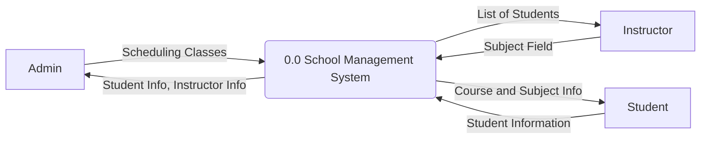
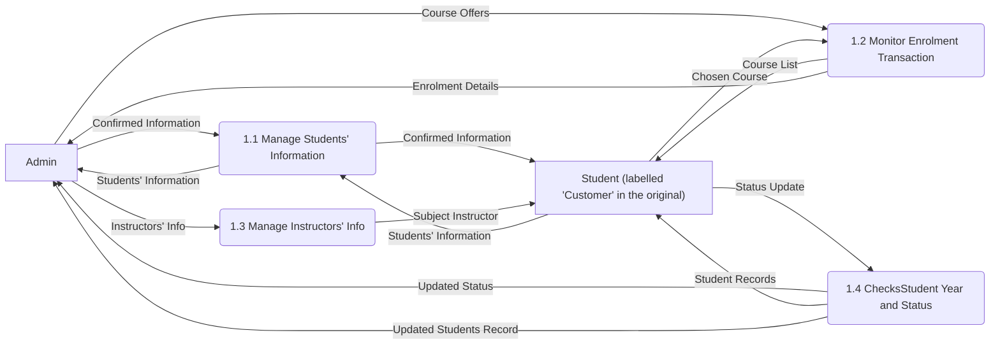
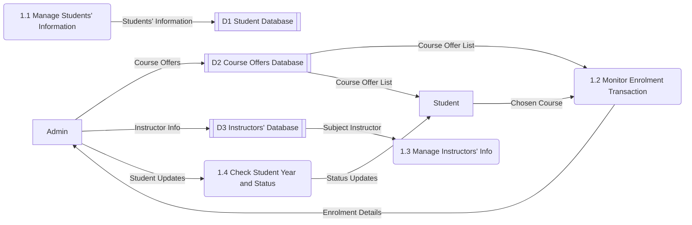
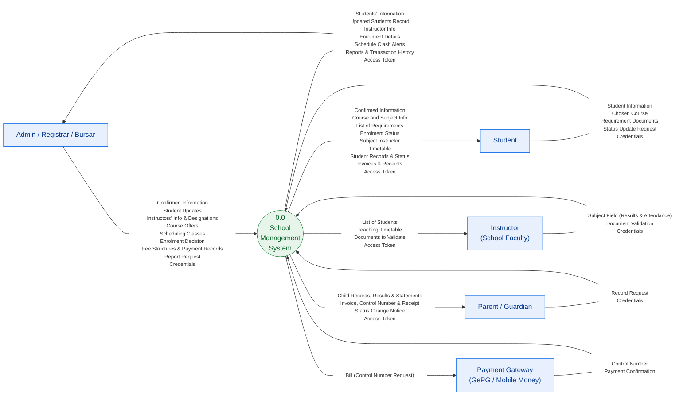
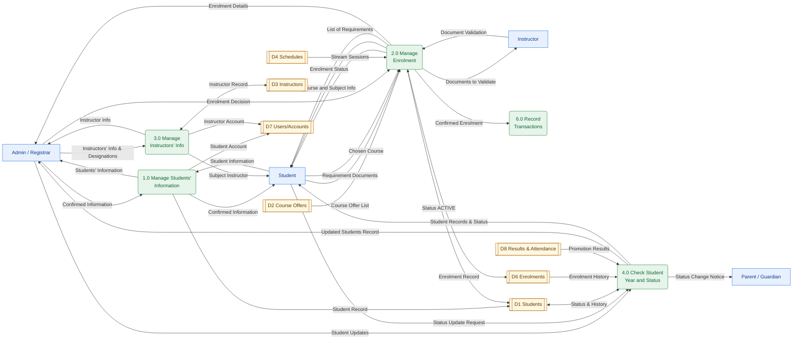
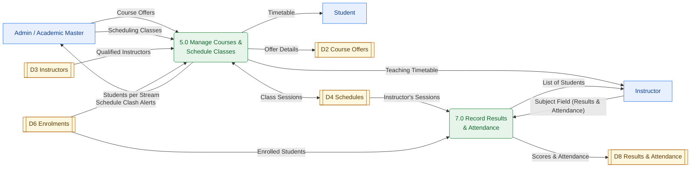
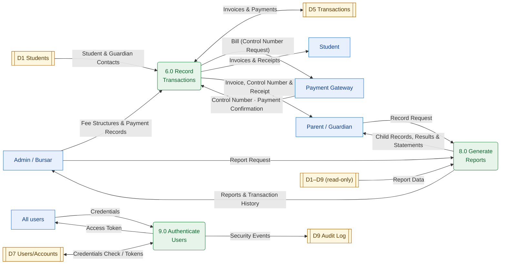
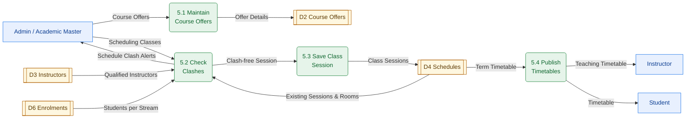
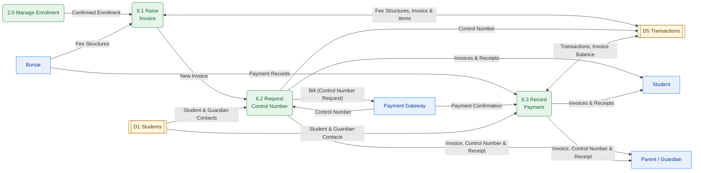

# 6. Data Flow Diagrams (Yourdon/DeMarco)

**Legend.** External entity = rectangle; process = rounded box numbered `n.0` (Level 1) or `n.m` (Level 2); data store = double-edged box `Dn`. Arrows carry data, never control. Mermaid has no open-ended rectangle, so the double-edged "subroutine" shape stands in for the DeMarco data store.

## 6.1 Baseline DFDs (reproduced)

### Baseline Level 0

### Baseline Level 1

### Baseline Level 2

**Baseline errors.**

1. **Unbalanced.** Level 0 has *Scheduling Classes*, *Subject Field* and *List of Students*, but no Level 1 process receives or produces them. Level 1 introduces *Course Offers*, *Chosen Course*, *Status Update* and others that are missing from Level 0.
2. **Illegal flows.** At Level 2, *Admin → D2* and *D2 → Student* connect an external entity directly to a data store. Every flow must pass through a process.
3. **Numbering.** Level 1 processes are numbered 1.1–1.4, which is Level 2 numbering of process 1. They should be 1.0–n.0.
4. **Wrong entity.** The entity was labelled "Customer" in the original; it must be **Student**.
5. **Missing stores.** Schedules, transactions, enrolments, accounts, results and audit have no stores.
6. **Missing entities.** Parents and the payment gateway are absent.
7. **Typos.** "ChecksStudent", "Informtion".

## 6.2 Corrected Level 0 — Context diagram

Each arrow carries the flows listed in the text block it passes through. The blocks are drawn as text nodes so that long labels do not overlap the boxes.

All baseline Level 0 flows are kept (*Scheduling Classes*, *Student Info* → *Students' Information*, *Instructor Info*, *Subject Field*, *List of Students*, *Student Information*, *Course and Subject Info*). The flows the baseline used at Level 1 but never showed at Level 0 are added, along with the Parent and Payment Gateway entities.

## 6.3 Corrected Level 1

**Data stores:**

| Store | Tables |
|---|---|
| D1 Students | `students`, `guardians`, `student_guardians`, `student_status_history` |
| D2 Course Offers | `courses`, `subjects`, `course_subjects`, `course_offerings`, `class_levels`, `academic_years`, `terms` |
| D3 Instructors | `instructors`, `instructor_subjects`, `instructor_designations`, `designations`, `departments` |
| D4 Schedules | `schedules`, `rooms` |
| D5 Transactions | `fee_structures`, `invoices`, `invoice_items`, `transactions` |
| D6 Enrolments | `enrolments`, `enrolment_requirements`, `enrolment_documents`, `enrolment_schedules` |
| D7 Users/Accounts | `users`, `staff`, `refresh_tokens` |
| D8 Results & Attendance | `results`, `attendance`, `grading_scales`, `division_scales` |
| D9 Audit Log | `audit_logs` |

Level 1 is one diagram. With 9 processes and about 60 flows it cannot be laid out legibly in one picture, so it is drawn as **three views of the same Level 1**. Each flow appears in exactly one view, and the balancing table below covers all three. Entities and stores repeat between views, which is allowed in DFDs (duplicates are often marked with a stroke).

#### View A — Student records, enrolment, instructors, status (1.0–4.0)

#### View B — Scheduling, results and attendance (5.0, 7.0)

#### View C — Transactions, reports and security (6.0, 8.0, 9.0)

Every process also writes its changes to **D9 Audit Log**, through the database trigger `fn_audit_row`. Only 9.0's arrow is drawn.

### Balancing table — Level 0 ↔ Level 1

| Level 0 flow | Direction | Level 1 process(es) |
|---|---|---|
| Confirmed Information | Admin → SMS | 1.0 |
| Student Updates | Admin → SMS | 4.0 |
| Instructors' Info & Designations | Admin → SMS | 3.0 |
| Course Offers | Admin → SMS | 5.0 |
| Scheduling Classes | Admin → SMS | 5.0 |
| Enrolment Decision | Admin → SMS | 2.0 |
| Fee Structures & Payment Records | Admin → SMS | 6.0 |
| Report Request | Admin → SMS | 8.0 |
| Students' Information | SMS → Admin | 1.0 |
| Updated Students Record | SMS → Admin | 4.0 |
| Instructor Info | SMS → Admin | 3.0 |
| Enrolment Details | SMS → Admin | 2.0 |
| Schedule Clash Alerts | SMS → Admin | 5.0 |
| Reports & Transaction History | SMS → Admin | 8.0 |
| Student Information | Student → SMS | 1.0 |
| Chosen Course, Requirement Documents | Student → SMS | 2.0 |
| Status Update Request | Student → SMS | 4.0 |
| Confirmed Information | SMS → Student | 1.0 |
| Course and Subject Info, List of Requirements, Enrolment Status | SMS → Student | 2.0 |
| Subject Instructor | SMS → Student | 3.0 |
| Timetable | SMS → Student | 5.0 |
| Student Records & Status | SMS → Student | 4.0 |
| Invoices & Receipts | SMS → Student | 6.0 |
| Subject Field (Results & Attendance) | Instructor → SMS | 7.0 |
| Document Validation | Instructor → SMS | 2.0 |
| List of Students | SMS → Instructor | 7.0 |
| Teaching Timetable | SMS → Instructor | 5.0 |
| Documents to Validate | SMS → Instructor | 2.0 |
| Record Request | Parent → SMS | 8.0 |
| Child Records, Results & Statements | SMS → Parent | 8.0 |
| Invoice, Control Number & Receipt | SMS → Parent | 6.0 |
| Status Change Notice | SMS → Parent | 4.0 |
| Bill (Control Number Request) | SMS → Gateway | 6.0 |
| Control Number · Payment Confirmation | Gateway → SMS | 6.0 |
| Credentials / Access Token | every user ↔ SMS | 9.0 |

Every Level 0 flow appears at Level 1 and every Level 1 flow to or from an external entity appears at Level 0. The flow *Confirmed Enrolment* (2.0 → 6.0) and all data-store flows are internal, so they do not appear at Level 0.

## 6.4 Corrected Level 2

### Level 2 for process 2.0 — Manage Enrolment

```mermaid
flowchart LR
    classDef ext fill:#e8f0fe,stroke:#1a73e8,color:#0b3d91
    classDef proc fill:#e6f4ea,stroke:#188038,color:#0d652d
    classDef store fill:#fef7e0,stroke:#b06000,color:#5c3900

    Admin["Admin / Registrar"]:::ext
    Student["Student"]:::ext
    Instructor["Instructor"]:::ext
    P6("6.0 Record Transactions"):::proc

    P21("2.1 Display<br/>Course Offers"):::proc
    P22("2.2 Register<br/>Application"):::proc
    P23("2.3 Receive Requirement<br/>Documents"):::proc
    P24("2.4 Record Document<br/>Validation"):::proc
    P25("2.5 Confirm or Cancel<br/>Enrolment"):::proc

    D1[["D1 Students"]]:::store
    D2[["D2 Course Offers"]]:::store
    D4[["D4 Schedules"]]:::store
    D6[["D6 Enrolments"]]:::store

    D2 -->|Course Offer List| P21
    P21 -->|Course and Subject Info| Student
    Student -->|Chosen Course| P22
    P21 -->|Selected Offer| P22
    P22 -->|New Enrolment PENDING| D6
    D6 -->|Requirements for Level| P22
    P22 -->|List of Requirements| Student
    Student -->|Requirement Documents| P23
    P23 -->|Document Metadata, SUBMITTED| D6
    P23 -->|Documents to Validate| Instructor
    Instructor -->|Document Validation| P24
    P24 <-->|Document Status / Enrolment Status| D6
    P24 -->|Enrolment Status| Student
    Admin -->|Enrolment Decision| P25
    D6 -->|VALIDATED Enrolment| P25
    D4 -->|Stream Sessions| P25
    P25 -->|"CONFIRMED / CANCELLED, Session Links"| D6
    P25 -->|Status ACTIVE| D1
    P25 -->|Enrolment Status| Student
    P25 -->|Enrolment Details| Admin
    P25 -->|Confirmed Enrolment| P6
```

Balance check against 2.0 at Level 1. Inputs are Chosen Course, Requirement Documents, Document Validation and Enrolment Decision. Outputs are Course and Subject Info, List of Requirements, Documents to Validate, Enrolment Status, Enrolment Details and Confirmed Enrolment. The process reads D2 and D4, reads and writes D6, and writes D1. All of these match Level 1.

### Level 2 for process 5.0 — Manage Courses & Schedule Classes

### Level 2 for process 6.0 — Record Transactions

*Fee Structures & Payment Records* at Level 1 splits into *Fee Structures* (6.1) and *Payment Records* (6.3). *Control Number · Payment Confirmation* splits across 6.2 and 6.3. The Level 1 outputs to Student and Parent are produced by 6.2 (invoice and control number) and 6.3 (receipt).
