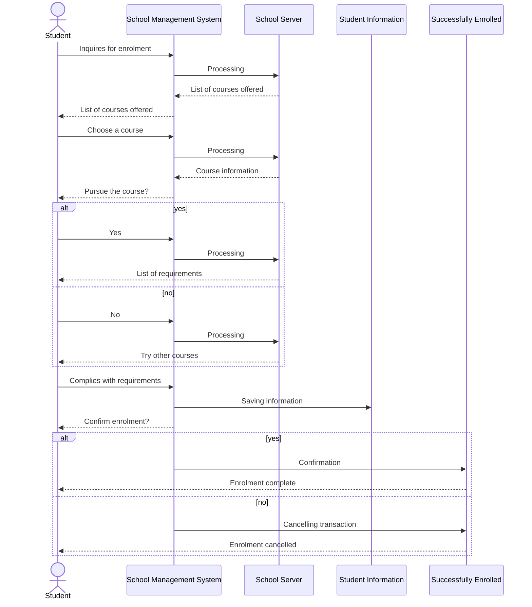
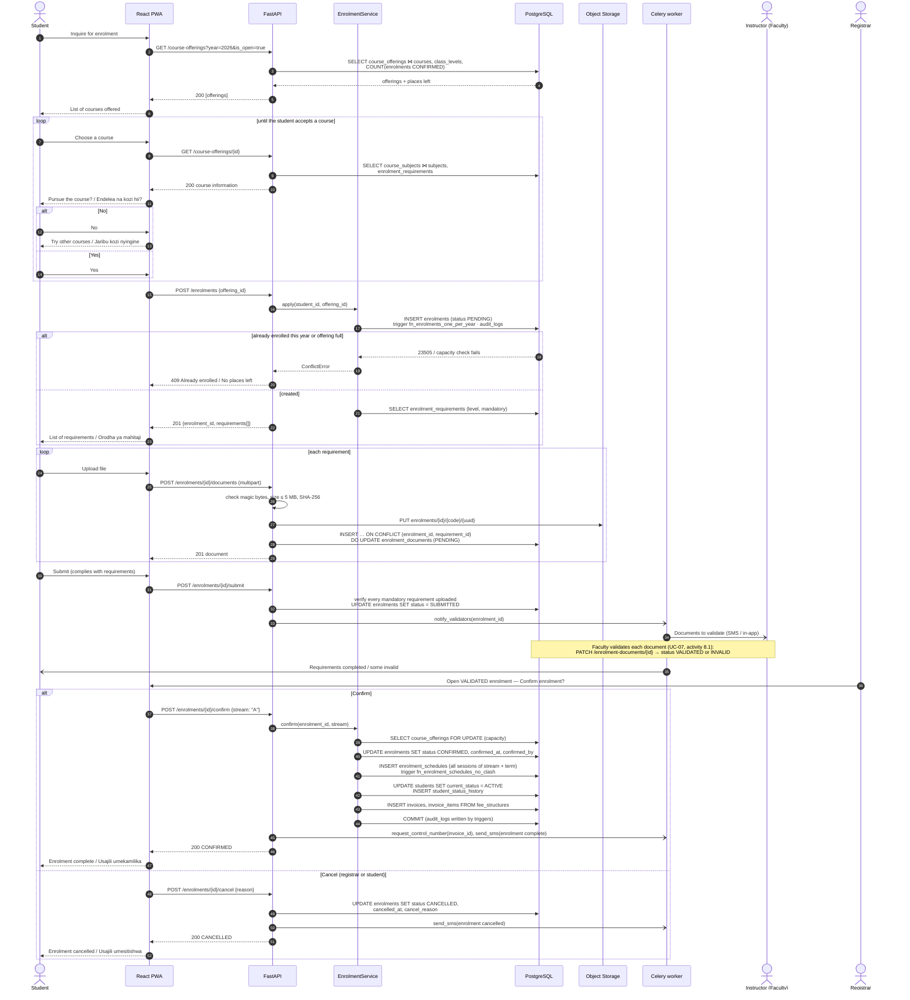
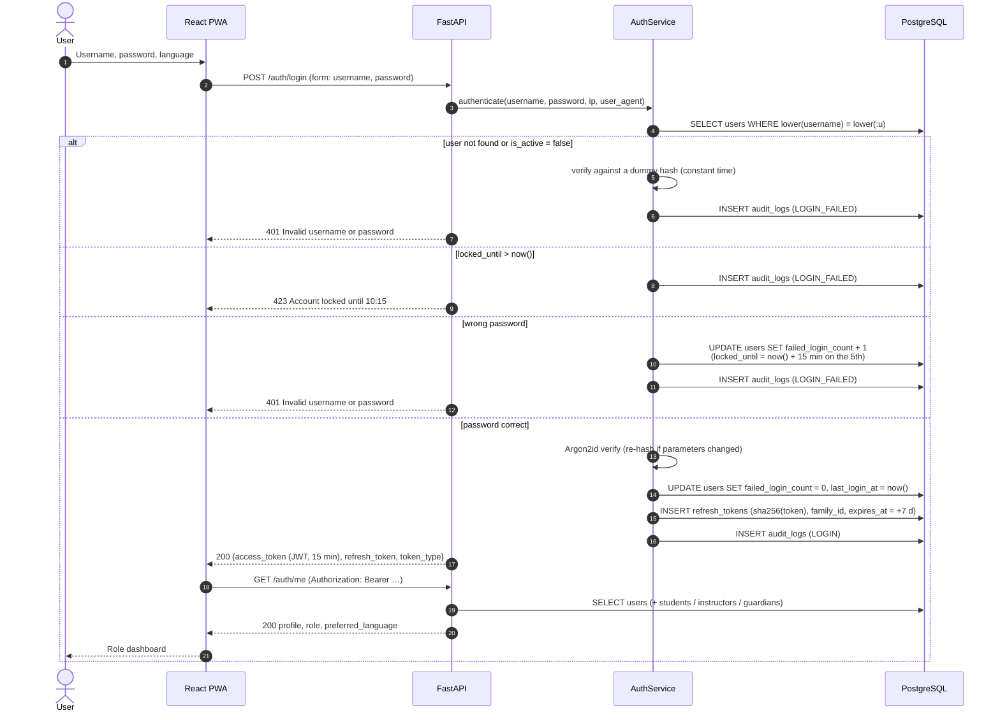
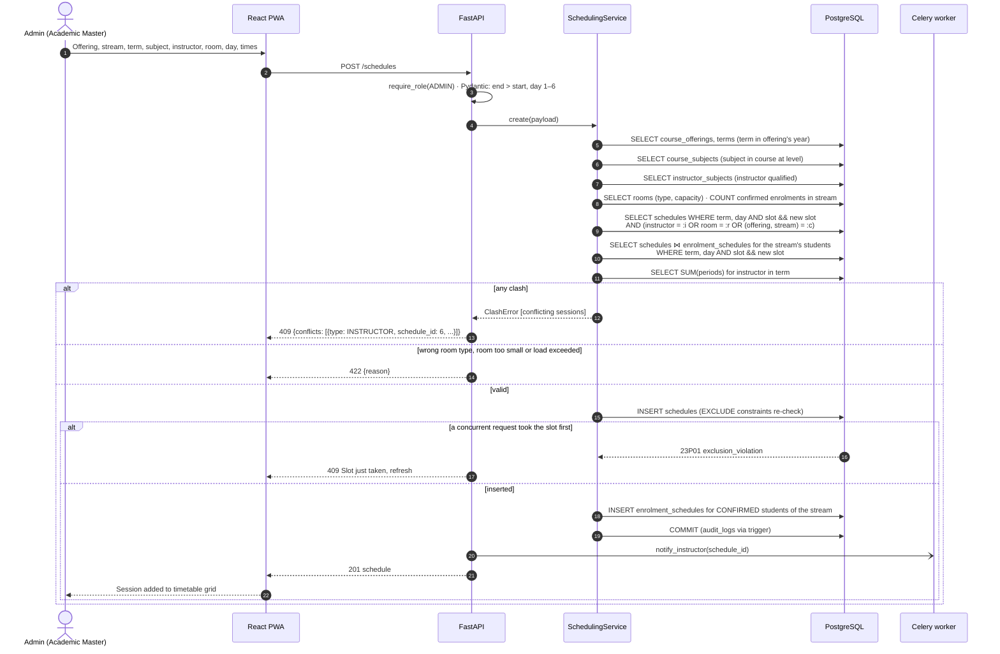
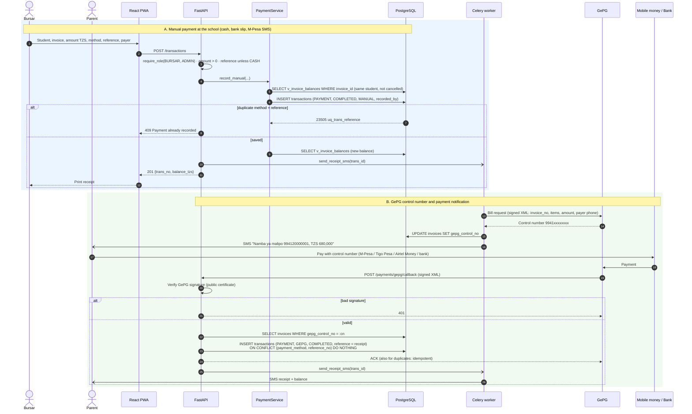
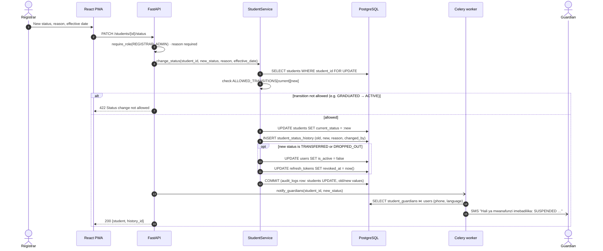

# 7. Sequence Diagrams

All endpoints are under `/api/v1`. Writes run inside one database transaction that begins with `SET LOCAL app.user_id / app.user_role / app.client_ip / app.request_id`, so the audit trigger records who did what. In the diagrams, `-)` is an asynchronous Celery message and `-->>` is a reply.

## 7.1 Baseline — Student Enrolment (reproduced)

**What is wrong.**

1. "Student Information" and "Successfully Enrolled" are data and a state, not objects that can receive messages.
2. Requirements are "saved" but nobody validates them, although the activity diagram says the faculty checks validity.
3. The "no" branch does not loop back to choosing a course.
4. Nothing checks capacity or an existing enrolment.
5. Confirmation creates no class links, no invoice and no status change.
6. **All lifelines are destroyed at the end**, including the server and the database. These live on after one enrolment; only the user's session ends.
7. Typos: "Inqure", "Succesfully".

## 7.2 Corrected — Student Enrolment

The student applies and submits documents, faculty validates them, and the **Registrar** confirms admission (the school's decision). The student or the registrar can cancel at any point before confirmation.

No lifeline is destroyed. The API, the services and the database are long-lived, and the client simply leaves the screen.

## 7.3 Login

## 7.4 Schedule a Class

## 7.5 Record a Payment (manual and GePG)

## 7.6 Update Student Status

