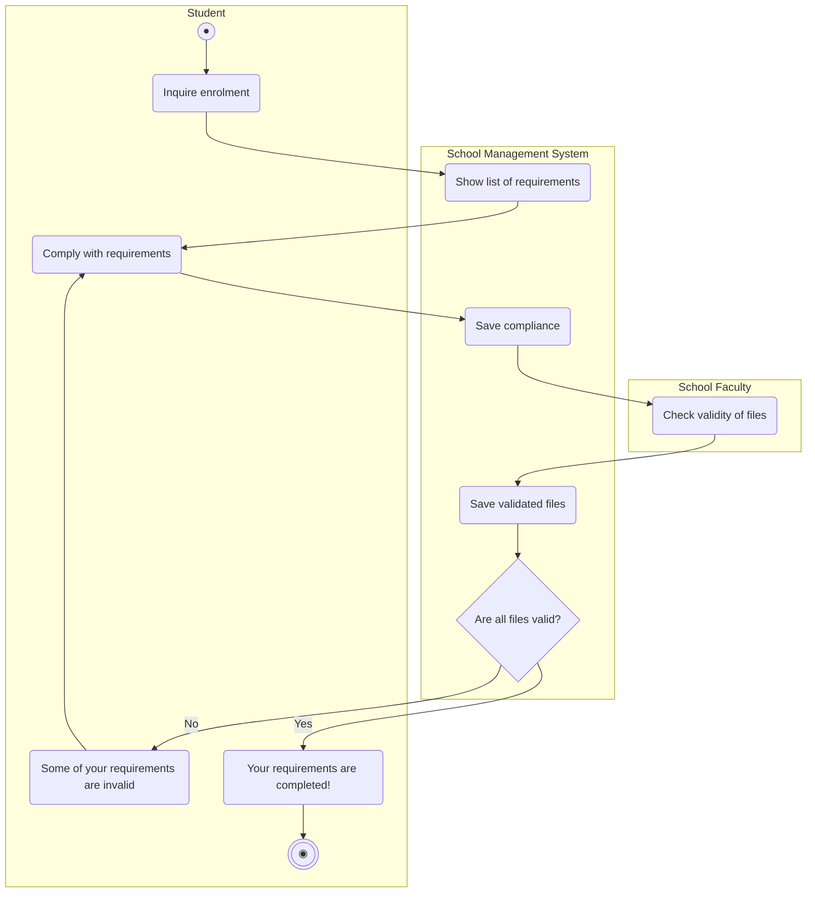
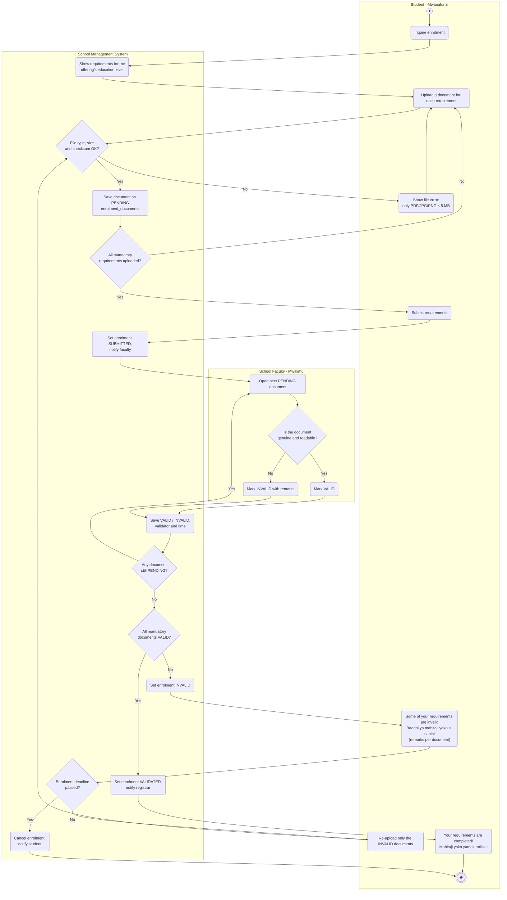
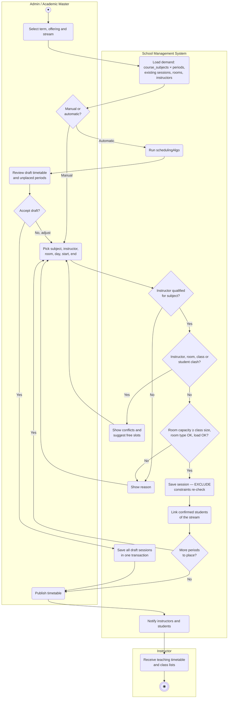
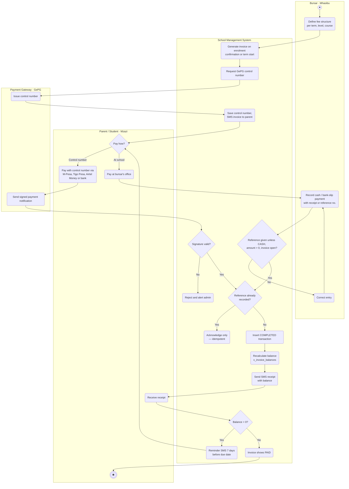

# 8. Activity Diagrams (with swimlanes)

Mermaid has no UML activity diagram, so each swimlane is a subgraph. Notation: `((●))` is the initial node, `(((◉)))` the final node, diamonds are decisions/merges, and rounded boxes are actions. The text under each diagram lists every guard condition.

## 8.0 Baseline — Enrolment Requirements (reproduced)

**Problems.**

- Files are "saved" before anyone checks their type or size.
- Validity is all-or-nothing, so the student re-uploads every file even if only one is invalid and is never told which one.
- There is no "all mandatory documents uploaded?" check before the faculty is involved.
- There is no deadline or cancel path, so the loop can run forever.
- "Save validated files" saves files that have already been saved; what should be saved is the validation result.

## 8.1 Corrected — Enrolment Requirements

**Fixes.**

- Files are checked (type by magic bytes, size, SHA-256) before they are saved.
- Faculty validates each document separately, and INVALID requires remarks.
- The student re-uploads only the invalid documents.
- The enrolment status is derived: VALIDATED only when every mandatory document is VALID.
- A deadline ends the loop.
- Optional documents (e.g. a transfer letter) never block validation.

## 8.2 Class Scheduling

Guards: a session is saved only when the instructor is qualified, there is no clash of any of the four kinds, the room is big enough and of the right type, and the instructor stays within `max_periods_per_week`. The algorithm is described in [section 9.3](09-class-diagram.md#93-scheduling-algorithm-schedulingalgo).

## 8.3 Fee Payment

A wrong entry is never edited. The bursar posts a **REVERSAL** (with Admin approval), which links to the original transaction and restores the balance. The reversal follows the same path from `Y8`.
