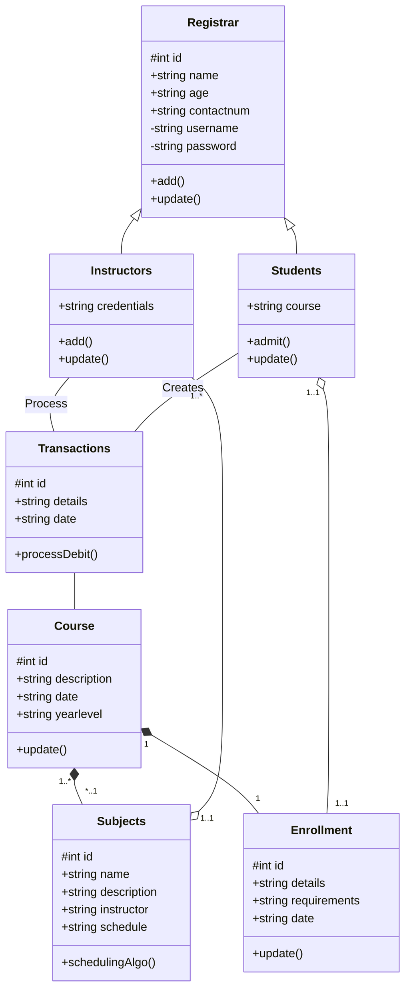

# 9. Class Diagram

## 9.1 Baseline class diagram (reproduced)



**Problems.**

- A student **is not a** registrar. Inheriting from Registrar gives students `add()`/`update()` rights over everyone, and a `password` field.
- `age` is a string, and `date` is a string.
- `Subjects.instructor` and `Subjects.schedule` are strings instead of associations.
- `schedulingAlgo()` sits on a subject, but scheduling spans many subjects, rooms and instructors, so it belongs in a service.
- `Course ◆ Enrollment 1..1` means a course has exactly one enrolment and an enrolment dies with its course.
- `Students 1..1 ◇ Enrollment 1..1` means a student enrols only once in a lifetime.
- `"*..1"` is not valid UML multiplicity.
- Instructors "Process" transactions, which is a bursar's job.
- There are no fees, terms, rooms, results or audit.
- Typo: "Trasactions".

## 9.2 Corrected class diagram

```mermaid
classDiagram
    direction TB

    class Person {
        <<abstract>>
        #int id
        +str first_name
        +str middle_name
        +str last_name
        +Gender gender
        +date date_of_birth
        +str phone
        +str email
        +str username
        -str password_hash
        +Role role
        +bool is_active
        +full_name() str
        +age(on: date) int
        +set_password(raw: str) void
        +verify_password(raw: str) bool
    }
    class Student {
        +str admission_no
        +str necta_index_no
        +date admission_date
        +StudentStatus current_status
        +apply(offering: CourseOffering) Enrolment
        +change_status(new: StudentStatus, reason: str, by: Staff) StatusChange
        +current_enrolment() Enrolment
        +balance_tzs() Decimal
    }
    class Instructor {
        +str employee_no
        +str qualification
        +int max_periods_per_week
        +qualified_for(subject: Subject) bool
        +weekly_load(term: Term) int
        +validate(doc: EnrolmentDocument, valid: bool, remarks: str) void
    }
    class Staff {
        +str employee_no
        +str job_title
    }
    class Guardian {
        +str nida_no
        +str occupation
        +children() List~Student~
    }
    note for Staff "Admin, Registrar and Bursar:\nrole = ADMIN | REGISTRAR | BURSAR"

    Person <|-- Student
    Person <|-- Instructor
    Person <|-- Staff
    Person <|-- Guardian

    class Department {
        +str code
        +str name_en
        +str name_sw
    }
    class Designation {
        +str code
        +str name_en
        +str name_sw
    }
    class InstructorDesignation {
        +date assigned_on
        +date ended_on
        +str stream
    }
    class AcademicYear {
        +str name
        +date start_date
        +date end_date
        +bool is_current
    }
    class Term {
        +int term_no
        +date start_date
        +date end_date
    }
    class ClassLevel {
        +str code
        +str name_sw
        +EducationLevel education_level
    }
    class GradingScale {
        +ExamScale exam_scale
        +str grade
        +Decimal min_score
        +int points
        +grade_for(score: Decimal)$ GradingScale
    }
    class Course {
        +str course_code
        +str course_name
        +EducationLevel education_level
        +bool is_active
        +subjects_for(level: ClassLevel) List~Subject~
    }
    class Subject {
        +str subject_code
        +str necta_code
        +str name_en
        +str name_sw
        +RoomType room_type_required
    }
    class CourseSubject {
        +bool is_compulsory
        +int periods_per_week
    }
    class CourseOffering {
        +int capacity
        +bool is_open
        +places_left() int
    }
    class Room {
        +str room_code
        +RoomType room_type
        +int capacity
    }
    class Schedule {
        +str stream
        +int day_of_week
        +time time_start
        +time time_end
        +overlaps(other: Schedule) bool
    }
    class Scheduler {
        <<service>>
        +find_conflicts(candidate: Schedule) List~Conflict~
        +place(candidate: Schedule) Schedule
        +schedulingAlgo(term: Term, offerings: List~CourseOffering~) Timetable
    }
    class Enrolment {
        +str enrolment_no
        +str stream
        +EnrolmentStatus status
        +datetime applied_at
        +submit() void
        +refresh_status() EnrolmentStatus
        +confirm(stream: str, by: Staff) void
        +cancel(reason: str) void
    }
    class EnrolmentRequirement {
        +str code
        +str name_sw
        +bool is_mandatory
    }
    class EnrolmentDocument {
        +str storage_key
        +str sha256
        +DocumentStatus status
        +str remarks
        +mark(valid: bool, remarks: str, by: Instructor) void
    }
    class StatusChange {
        +StudentStatus old_status
        +StudentStatus new_status
        +str reason
        +date effective_date
    }
    class Result {
        +AssessmentType assessment_type
        +Decimal score
        +bool is_published
        +grade() GradingScale
    }
    class Attendance {
        +date attendance_date
        +AttendanceStatus status
    }
    class FeeStructure {
        +FeeItem fee_item
        +Decimal amount_tzs
    }
    class Invoice {
        +str invoice_no
        +str gepg_control_no
        +date due_date
        +total_tzs() Decimal
        +paid_tzs() Decimal
        +balance_tzs() Decimal
        +request_control_number() void
    }
    class InvoiceItem {
        +str description
        +Decimal amount_tzs
    }
    class Transaction {
        +str trans_no
        +TransactionType trans_type
        +Decimal amount_tzs
        +PaymentMethod payment_method
        +str reference_no
        +TransactionStatus status
        +datetime trans_date
        +reverse(reason: str, by: Staff) Transaction
    }
    class AuditLog {
        +datetime occurred_at
        +str action
        +str entity_type
        +str entity_id
        +dict old_values
        +dict new_values
    }

    class Role {
        <<enumeration>>
        ADMIN
        REGISTRAR
        BURSAR
        INSTRUCTOR
        STUDENT
        PARENT
    }
    class StudentStatus {
        <<enumeration>>
        APPLICANT
        ACTIVE
        SUSPENDED
        TRANSFERRED
        DROPPED_OUT
        GRADUATED
    }
    class EnrolmentStatus {
        <<enumeration>>
        PENDING
        SUBMITTED
        INVALID
        VALIDATED
        CONFIRMED
        CANCELLED
    }
    class PaymentMethod {
        <<enumeration>>
        CASH
        BANK
        MPESA
        TIGO_PESA
        AIRTEL_MONEY
        GEPG
    }

    Person "1" --> "0..*" AuditLog : performs
    Guardian "1..*" -- "0..*" Student : cares for
    Student "1" *-- "0..*" StatusChange : history
    Department "1" o-- "0..*" Instructor : employs
    Department "1" o-- "0..*" Subject : owns
    Instructor "0..*" -- "1..*" Subject : qualified for
    Instructor "1" -- "0..*" InstructorDesignation
    Designation "1" -- "0..*" InstructorDesignation
    AcademicYear "1" -- "0..*" InstructorDesignation
    AcademicYear "1" *-- "1..4" Term
    ClassLevel "0..*" --> "1" GradingScale : graded by
    Course "0..*" o-- "1..*" Subject : includes
    CourseSubject .. Course
    CourseSubject .. Subject
    Course "1" *-- "0..*" CourseOffering : offered as
    AcademicYear "1" -- "0..*" CourseOffering
    ClassLevel "1" -- "0..*" CourseOffering
    CourseOffering "1" *-- "0..*" Schedule : timetabled as
    Schedule "0..*" --> "1" Subject
    Schedule "0..*" --> "1" Instructor
    Schedule "0..*" --> "1" Room
    Schedule "0..*" --> "1" Term
    Scheduler ..> Schedule : creates
    Scheduler ..> Room : uses
    Scheduler ..> Instructor : uses
    Student "1" --> "0..*" Enrolment : applies
    CourseOffering "1" -- "0..*" Enrolment
    Enrolment "0..*" -- "0..*" Schedule : attends
    Enrolment "1" *-- "0..*" EnrolmentDocument : submits
    EnrolmentDocument "0..*" --> "1" EnrolmentRequirement : satisfies
    Instructor "0..1" -- "0..*" EnrolmentDocument : validates
    Enrolment "1" *-- "0..*" Result : earns
    Enrolment "1" *-- "0..*" Attendance : records
    Term "1" -- "0..*" FeeStructure
    Student "1" -- "0..*" Invoice : billed
    Invoice "1" *-- "1..*" InvoiceItem
    InvoiceItem "0..*" --> "0..1" FeeStructure : priced from
    Student "1" -- "0..*" Transaction : pays
    Invoice "0..1" -- "0..*" Transaction : settled by
    Staff "0..1" -- "0..*" Transaction : records
    Transaction "0..1" -- "0..1" Transaction : reverses
```



**Explanation of the corrections.**

- **Inheritance.** `Person` is abstract and holds the shared identity and login attributes: `date_of_birth` instead of age, and a private `password_hash`. `Student`, `Instructor`, `Staff` (Admin/Registrar/Bursar) and `Guardian` specialise it. In the database this is "class-table inheritance": the `users` table plus one subtype table per class.
- **Composition (◆)** is used only where the part cannot exist without the whole: a Course's yearly offerings, an Offering's timetable sessions, an Enrolment's documents, results and attendance, an Invoice's items, and an AcademicYear's terms.
- **Aggregation (◇)** is used where parts are shared or survive the whole: departments ◇ instructors and subjects, and courses ◇ subjects (many-to-many through the association class `CourseSubject`).
- **Multiplicities.** A student has many enrolments (one per year). A session has many enrolled students, and each student enrolment attends many sessions. An invoice has one or more items and zero or more transactions.
- **Behaviour lives where the data is.** `Enrolment.confirm()`, `Transaction.reverse()` (returns a new REVERSAL, never edits itself) and `Invoice.balance_tzs()` are on their classes. Scheduling is a **service** (`Scheduler`) because it coordinates instructors, rooms, offerings and students.
- **Visibility.** `-` private (`password_hash` is never serialised), `#` protected (`id`), `+` public. `$` marks a static/class method (`GradingScale.grade_for`).

## 9.3 Scheduling algorithm (`schedulingAlgo`)

### 9.3.1 What counts as a clash

Two class sessions **A** and **B** clash when all of these hold:

1. they are in the same term and on the same day,
2. their times overlap, using half-open intervals: `A.start < B.end AND B.start < A.end`, so a 08:00–08:40 period followed by 08:40–09:20 is **not** a clash,
3. and they share **at least one** of:
   - the **instructor**,
   - the **room**,
   - the **class stream** (same offering and stream),
   - any **student** (a student linked to both sessions through `enrolment_schedules`).

Placing a session must also satisfy these hard rules:

- the instructor is qualified for the subject (`instructor_subjects`);
- the subject belongs to the course at that level (`course_subjects`);
- the room type matches `subjects.room_type_required` (laboratory subjects go to laboratories);
- room capacity ≥ number of confirmed students in the stream;
- the instructor's weekly periods stay ≤ `max_periods_per_week`.

### 9.3.2 Three layers of protection

| Layer | Where | Purpose |
|---|---|---|
| 1. `Scheduler.find_conflicts()` | Python service, before insert | Friendly `409` naming each conflicting session and suggesting free slots |
| 2. `EXCLUDE USING gist` constraints | `schedules` table | Instructor, room and class-stream clashes are impossible even when two admins save at the same moment (race conditions) |
| 3. Trigger `fn_enrolment_schedules_no_clash` | `enrolment_schedules` table | A student can never be linked to two overlapping sessions |

### 9.3.3 Automatic timetable generation

`schedulingAlgo(term, offerings)` builds a whole term's timetable. It is a **constraint-satisfaction problem**, solved with *most-constrained-first greedy placement with bounded backtracking*, followed by a short local-search pass:

1. **Period grid.** Build the school's grid, for example Monday–Friday, 8 periods of 40 minutes from 08:00 with a break after period 3 and lunch after period 6. Each cell is `(day, period)`.
2. **Demand.** For every offering × stream × subject in `course_subjects`, create `periods_per_week` lessons, grouped into blocks. Laboratory subjects use **double periods**, so 3 periods become one double plus one single.
3. **Instructor assignment.** Keep the current yearly assignment if there is one. Otherwise choose the qualified instructor with the **lowest load**, so that load ≤ `max_periods_per_week`.
4. **Ordering.** Sort blocks by difficulty, most constrained first:
   - fewest feasible rooms (labs are scarce),
   - double periods before singles,
   - instructors with the highest load,
   - subjects with the most periods.
5. **Placement.** For each block, list candidate cells `(day, period, room)` where the instructor, the stream and the room are all free. Each check is a constant-time lookup in an occupancy map keyed by `(resource, day, period)`. Rooms are tried best-fit first, meaning the smallest suitable room. Score the candidates with the soft constraints, lowest penalty wins:
   - at most one block of the same subject per stream per day (penalty 10);
   - Mathematics and science blocks prefer early periods;
   - a class's lessons are spread evenly across the week.
6. **Repair (bounded backtracking).** If a block has no free cell, look for a cell where exactly **one** previously placed block is in the way. Move that block to its own best alternative and take the cell. If no such move exists, put the block in the **unplaced** list for manual placement. Existing (manually created) sessions are never moved.
7. **Improvement (optional extension).** A time-boxed (≈ 10 s) local search could swap two blocks when the swap keeps all hard constraints and lowers the total penalty. This step is not in the reference implementation.
8. **Persist.** The admin reviews the draft and accepts it. All sessions are then inserted in **one transaction**, where the database constraints re-verify every hard rule. Confirmed students are linked to their stream's sessions.

**Complexity.** Take B = number of blocks (≈ 30 streams × 10 subjects × 2 blocks = 600), C = cells (5 × 8 = 40) and R = suitable rooms (≤ 20). Greedy placement costs **O(B · C · R)** ≈ 480,000 constant-time checks, which takes well under a second. The one-block repair adds at most one more candidate search per blocked cell, so the worst case stays polynomial. Hard constraints are never relaxed: a block that cannot be placed is reported, never forced in.

The tests in [backend/tests/test_schedules.py](../backend/tests/test_schedules.py) check three properties:

- every block is placed with no instructor, room or class overlap, and double periods never cross a break;
- six Mathematics periods land on five different days;
- a laboratory subject with no laboratory available is reported as unplaced rather than forced into a classroom.

The service code is in [backend/app/services/scheduling.py](../backend/app/services/scheduling.py). `find_conflicts` is shown here:

```python
# File: backend/app/services/scheduling.py (excerpt)
def find_conflicts(db: Session, c: ScheduleCandidate, exclude_id: int | None = None) -> list[Conflict]:
    """Every existing session that would clash with candidate c."""
    overlap = and_(
        Schedule.term_id == c.term_id,
        Schedule.day_of_week == c.day_of_week,
        Schedule.time_start < c.time_end,      # half-open [start, end)
        c.time_start < Schedule.time_end,
    )
    if exclude_id is not None:
        overlap = and_(overlap, Schedule.schedule_id != exclude_id)

    conflicts: list[Conflict] = []
    rows = db.scalars(select(Schedule).where(overlap, or_(
        Schedule.instructor_id == c.instructor_id,
        Schedule.room_id == c.room_id,
        and_(Schedule.offering_id == c.offering_id, Schedule.stream == c.stream),
    ))).all()
    for s in rows:
        if s.instructor_id == c.instructor_id:
            conflicts.append(Conflict("INSTRUCTOR", s.schedule_id, "Instructor already teaching"))
        if s.room_id == c.room_id:
            conflicts.append(Conflict("ROOM", s.schedule_id, "Room already in use"))
        if (s.offering_id, s.stream) == (c.offering_id, c.stream):
            conflicts.append(Conflict("CLASS", s.schedule_id, "Class already has a lesson"))

    # Students of this stream who are also linked to other overlapping sessions
    students_here = (
        select(Enrolment.enrolment_id)
        .where(Enrolment.offering_id == c.offering_id, Enrolment.stream == c.stream,
               Enrolment.status == EnrolmentStatus.CONFIRMED)
    )
    student_clashes = db.scalars(
        select(Schedule.schedule_id).distinct()
        .join(EnrolmentSchedule, EnrolmentSchedule.schedule_id == Schedule.schedule_id)
        .where(overlap, EnrolmentSchedule.enrolment_id.in_(students_here),
               or_(Schedule.offering_id != c.offering_id, Schedule.stream != c.stream))
    ).all()
    conflicts += [Conflict("STUDENT", sid, "Students already in another class") for sid in student_clashes]
    return conflicts
```
