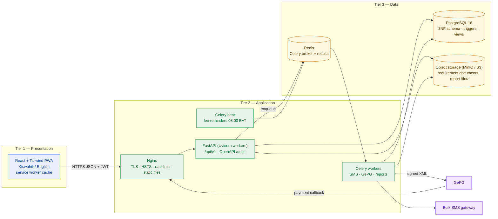
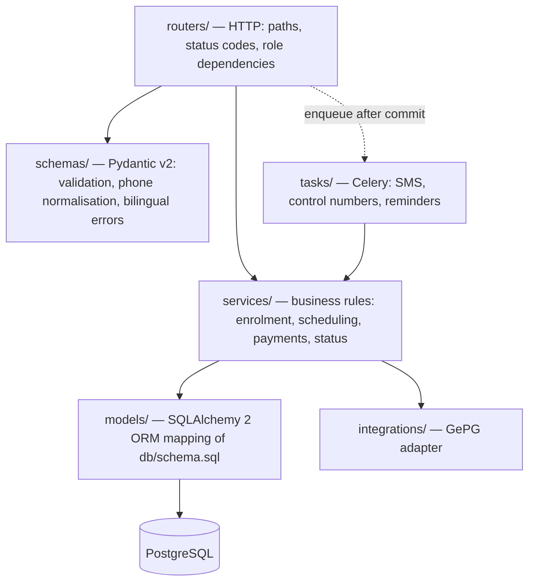
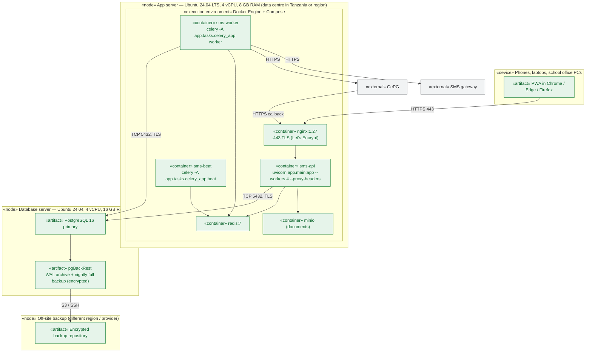

# 10. System Architecture

## 10.1 Three-tier architecture



| Tier | Responsibility | Technology |
|---|---|---|
| Presentation | Screens, input validation for usability, offline cache of read-only data (timetable, results, invoices), language switch | React 18, Tailwind CSS, React Query, i18next, Workbox PWA |
| Application | Authentication, role checks, business rules (services), REST API, background jobs | Python 3.12, FastAPI, Pydantic v2, SQLAlchemy 2, Celery |
| Data | Integrity rules (constraints, triggers), audit, derived views, files | PostgreSQL 16, Redis 7, MinIO/S3 |

**Why this split.** Every hard rule is enforced twice: once by the service, for a friendly bilingual message, and once by PostgreSQL (EXCLUDE, CHECK, FK, triggers). Data therefore stays correct even with concurrent users or a future second client, such as a mobile app. Slow or unreliable work (SMS, GePG, PDF generation) runs in Celery, so API responses stay fast on school internet connections.

## 10.2 Backend layering



Routers stay thin: they check roles, call one service function, commit, then enqueue notifications. The commit comes first so an SMS is never sent for a change that was rolled back. Source: [backend/app/](../backend/app/).

## 10.3 Deployment diagram



A small school can run everything on one server: drop the separate database node and keep the off-site backup. A large school or a district can scale the API and worker containers horizontally behind Nginx, because the API is stateless (JWT) and all state lives in PostgreSQL, Redis and object storage.

## 10.4 Example `docker-compose.yml`

A starting point for staging. It has not been run as part of this design, so review the values before use.

```yaml
# File: deploy/docker-compose.yml
services:
  api:
    build: ../backend
    command: uvicorn app.main:app --host 0.0.0.0 --port 8000 --workers 4 --proxy-headers --forwarded-allow-ips="*"
    env_file: ../backend/.env
    depends_on: [redis]
    restart: unless-stopped
  worker:
    build: ../backend
    command: celery -A app.tasks.celery_app worker --loglevel=INFO --concurrency=4
    env_file: ../backend/.env
    depends_on: [redis]
    restart: unless-stopped
  beat:
    build: ../backend
    command: celery -A app.tasks.celery_app beat --loglevel=INFO
    env_file: ../backend/.env
    depends_on: [redis]
    restart: unless-stopped
  redis:
    image: redis:7.4-alpine
    restart: unless-stopped
  minio:
    image: minio/minio:RELEASE.2024-12-18T13-15-44Z
    command: server /data
    environment:
      MINIO_ROOT_USER: ${MINIO_ROOT_USER}
      MINIO_ROOT_PASSWORD: ${MINIO_ROOT_PASSWORD}
    volumes: [minio-data:/data]
    restart: unless-stopped
  nginx:
    image: nginx:1.27-alpine
    ports: ["80:80", "443:443"]
    volumes:
      - ./nginx.conf:/etc/nginx/conf.d/default.conf:ro
      - ../frontend/dist:/usr/share/nginx/html:ro
      - /etc/letsencrypt:/etc/letsencrypt:ro
    depends_on: [api]
    restart: unless-stopped
volumes:
  minio-data:
```

## 10.5 Operational concerns

| Concern | Decision |
|---|---|
| Configuration | Environment variables with the `SMS_` prefix ([backend/.env.example](../backend/.env.example)); the app refuses to start in production with the default JWT secret |
| Migrations | `alembic upgrade head` on deploy; the baseline runs `db/schema.sql`. `alembic check` in CI fails if ORM models drift from the database |
| Logs | JSON logs to stdout, collected by the host. Each log line and the `X-Request-ID` header carry the same id as `audit_logs.request_id` |
| Monitoring | `/health` uptime check every minute; PostgreSQL slow-query log (> 500 ms); Celery queue length alert (> 500) |
| Backups | pgBackRest: WAL archiving (RPO ≤ 15 min) and a nightly full backup, AES-256 encrypted, with an off-site copy; quarterly restore drill |
| Time | Servers in UTC; UI and SMS in EAT (UTC+3, no daylight saving) |
| Low bandwidth | Gzip/Brotli at Nginx, paged lists (25 rows), PWA caches timetable, results and invoices for offline reading |
