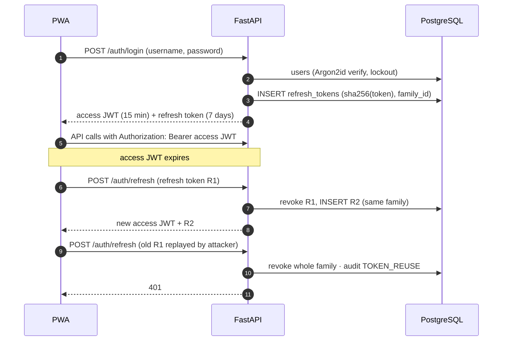

# 12. Security Design

## 12.1 Authentication (JWT)

| Item | Design (implemented in [core/security.py](../backend/app/core/security.py), [services/auth.py](../backend/app/services/auth.py)) |
|---|---|
| Access token | JWT HS256, claims `sub` (user id), `role`, `typ=access`, `iat`, `exp` (15 min), `jti`. Kept in memory by the PWA, never in `localStorage` |
| Refresh token | 64-character random opaque string. Only its SHA-256 is stored. Rotated on every use; reuse revokes the whole family (theft detection). Stored by the PWA in an `HttpOnly; Secure; SameSite=Strict` cookie when served from the same domain |
| Secret | `SMS_JWT_SECRET` ≥ 64 random characters, from the environment or a secret store; the app refuses to start in production with the default. Rotate yearly. Move to RS256 if other services need to verify tokens |
| Lockout | 5 consecutive failures → locked 15 min (`423`); counter resets on success |
| Enumeration | Unknown user, wrong password and inactive account return the same `401` body. Unknown users are checked against a dummy hash, so response time is the same |
| Logout | Revokes the refresh-token family; the short access-token lifetime limits exposure |
| Password policy | ≥ 10 characters with letters and digits. Temporary passwords are random and sent by SMS; users are asked to change them at first login |

## 12.2 Password hashing

- **Argon2id** through `pwdlib` with its recommended parameters (memory 64 MiB, time cost 3, parallelism 4). The stored PHC string looks like `$argon2id$v=19$m=65536,t=3,p=4$…`.
- `verify_and_update` re-hashes transparently when the parameters are raised later.
- No plaintext or reversible password exists anywhere: the baseline's `stud_pass`/`ins_pass` columns are removed. `fn_audit_row` strips `password_hash` before writing audit rows, and a test asserts no audit row contains it.

## 12.3 Role-based access control

Roles live in `users.role`. Every endpoint declares its roles with `require_roles(...)`. Ownership rules (student = self, parent = linked children) are checked in the service and return **404, not 403**, so the existence of other students' records is not revealed.

| Resource / action | ADMIN | REGISTRAR | BURSAR | INSTRUCTOR | STUDENT | PARENT |
|---|:-:|:-:|:-:|:-:|:-:|:-:|
| Register / edit students | ✔ | ✔ | — | — | — | — |
| View student list | ✔ | ✔ | ✔ | ✔ | — | — |
| View one student | ✔ | ✔ | ✔ | ✔ | self | own children |
| Change student status | ✔ (incl. re-admission) | ✔ | — | — | — | — |
| Courses, subjects, offerings | ✔ | read | read | read | read | read |
| Instructors & designations | ✔ | read | read | read | — | — |
| Create schedules / generate timetable | ✔ | — | — | — | — | — |
| View timetables | ✔ | ✔ | ✔ | own | own class | children's |
| Apply for enrolment | on behalf | on behalf | — | — | self | — |
| Validate requirement documents | ✔ | — | — | ✔ | — | — |
| Confirm enrolment | ✔ | ✔ | — | — | — | — |
| Cancel enrolment | ✔ | ✔ | — | — | self | — |
| Record payments | ✔ | — | ✔ | — | — | — |
| Reverse a transaction | ✔ | — | — | — | — | — |
| Statements / invoices | ✔ | ✔ | ✔ | — | self | own children |
| Enter results / attendance | ✔ | — | — | own sessions | — | — |
| Publish results | ✔ (Academic Master) | — | — | — | — | — |
| Reports | all | students, enrolment, status | transactions | own classes | own report card | children's report cards |
| Audit log | read | — | — | — | — | — |

An optional second layer is PostgreSQL **Row-Level Security** on `students`, `invoices` and `transactions`, keyed on `current_setting('app.user_id')`, for defence in depth if a future endpoint forgets an ownership check.

## 12.4 Audit trail

| What | How | Where |
|---|---|---|
| Every INSERT / UPDATE / DELETE on 14 key tables (users, students, instructors, designations, courses, subjects, offerings, schedules, enrolments, documents, results, fees, invoices, transactions) | AFTER trigger `fn_audit_row` with full old/new row as JSONB, minus `password_hash` | `audit_logs` |
| Who / from where | API runs `SET LOCAL app.user_id, app.user_role, app.client_ip, app.request_id` at the start of each transaction ([db.py](../backend/app/db.py)); the trigger reads them | `actor_user_id`, `actor_role`, `ip_address`, `request_id` |
| Security events | LOGIN, LOGIN_FAILED, LOGOUT, TOKEN_REFRESH, TOKEN_REUSE, PASSWORD_CHANGE, EXPORT, VIEW_SENSITIVE written by the API | `audit_logs` |
| Status history | Business-level history with reason and effective date | `student_status_history` |
| Money history | Ledger is append-only (trigger); corrections are REVERSAL rows linked to the original | `transactions` |
| Tamper resistance | Statement trigger blocks UPDATE/DELETE/TRUNCATE on `audit_logs`; app role has no UPDATE/DELETE grant; nightly export of the day's audit rows with a SHA-256 hash chained to the previous day's hash, copied off-site | DB + backup |
| Retention | Audit and transactions kept ≥ 10 years (financial records); `audit_logs` partitioned by year when it exceeds ~10 M rows | — |

Because the trigger runs inside the same transaction as the change, an audited change cannot commit without its audit row. This also covers changes made directly in `psql` (the actor is NULL, which is itself suspicious and shows up in the audit report).

## 12.5 Other controls

| Threat | Control |
|---|---|
| SQL injection | SQLAlchemy bound parameters only; the one dynamic SQL (`nextval`) uses a fixed whitelist |
| Mass assignment / bad input | Pydantic v2 schemas with explicit fields, lengths, regexes (phone, NIDA, stream), ranges (amount > 0, score 0–100) |
| Malicious uploads | Type decided by magic bytes (PDF/PNG/JPEG only); 5 MB limit read with a cap; random storage key, never the user's file name; SHA-256 stored; files served via short-lived signed URLs with `Content-Disposition: attachment`; ClamAV scan in the Celery pipeline (recommended) |
| Payment callback forgery | GePG messages verified with GePG's public certificate over the exact signed bytes; idempotent insert on `(payment_method, reference_no)`; callback endpoint IP-allow-listed at Nginx |
| Brute force / abuse | Account lockout, plus Nginx `limit_req` (e.g. 10 r/min per IP on `/auth/login`, 10 r/s elsewhere) |
| XSS / CSRF | React escapes output; strict CSP header at Nginx; bearer tokens are not sent automatically by browsers; refresh cookie is `SameSite=Strict` |
| Transport | TLS 1.2+ only, HSTS 1 year, database connections over TLS |
| Least privilege | `sms_app` DB role without DELETE on ledger/audit, `sms_reporting` read-only without access to `users` / `refresh_tokens` (see end of [schema.sql](../db/schema.sql)) |
| Secrets | `.env` not in git; production secrets in the host's secret store; GePG private key file readable only by the API user |
| Dependencies | `pip-audit` and `npm audit` in CI; Dependabot/Renovate weekly |

## 12.6 Personal Data Protection Act, 2022 (Tanzania)

- **Registration.** The school registers with the Personal Data Protection Commission as a data controller/processor.
- **Purpose and minimisation.** Collect only what enrolment, teaching, examinations and fees need. NIDA numbers are optional and only for guardians.
- **Children's data.** Consent and notices go through the guardian at registration.
- **Access control.** The ownership rules in 12.3 apply, and every personal-data export is audited (`EXPORT`).
- **Data subject rights.** A guardian can request a copy of the student record (report "Student profile" PDF) and corrections, and each request is logged.
- **Location and transfer.** Prefer hosting in Tanzania. If data is hosted abroad, document the cross-border transfer safeguards.
- **Breach response.** Detect through audit alerts (TOKEN_REUSE spikes, mass exports), contain, notify the Commission and affected guardians within the period the regulations require, and record a post-mortem.
- **Retention.** Defined per table (e.g. rejected applications' documents deleted after 1 year; academic and financial records kept long-term).
