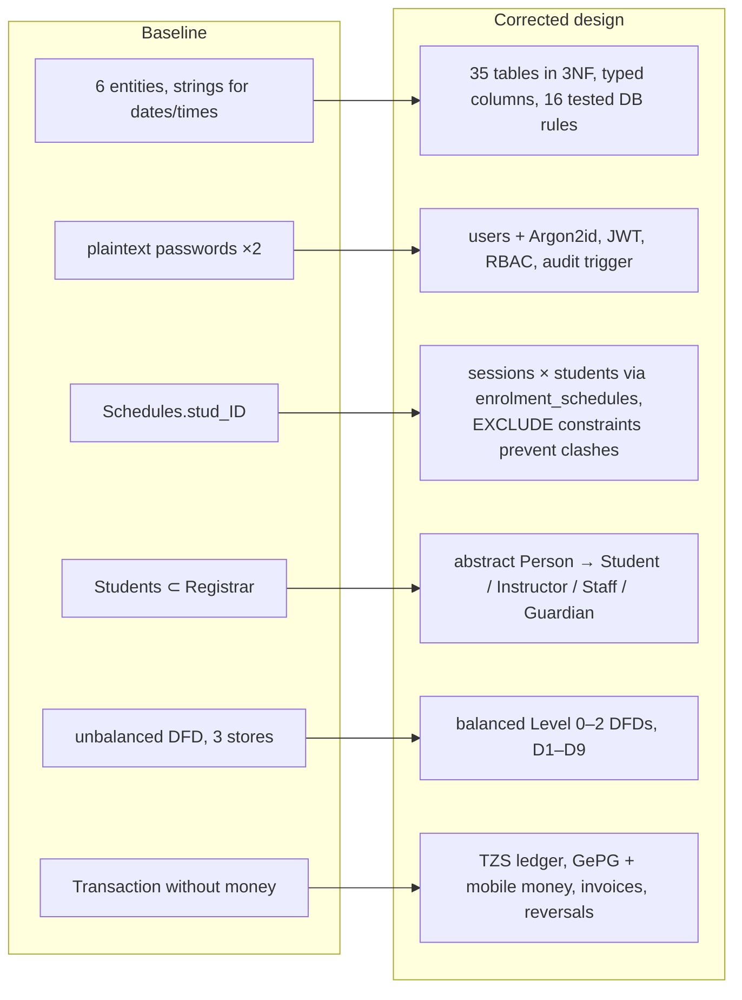

# 16. Summary of Corrections to the Baseline Model

## 16.1 The eleven required corrections

| # | Baseline | Problem | Correction | Where |
|---|---|---|---|---|
| 1 | `Instructors` and `Students` inherit from `Registrar` | A student or teacher "is a" registrar and inherits `add()`/`update()` rights and password fields: wrong semantics and a security hole | Abstract `Person` (id, names, gender, date_of_birth, phone, email, username, password_hash, role) with subclasses `Student`, `Instructor`, `Staff` (Admin/Registrar/Bursar) and `Guardian`; in the database, one `users` table plus one subtype table each | §9.2, `users`, `students`, `instructors`, `staff`, `guardians` |
| 2 | `age` attribute (int / string) | Wrong one year later; cannot be verified | `date_of_birth DATE`; age computed (`User.age()`, report SQL `age()`) | `users.date_of_birth`, §13.2 |
| 3 | `stud_pass`, `ins_pass` in two tables | Plaintext passwords, duplicated logins | One `users` table with `password_hash` (Argon2id) and `role`; hash removed from audit JSON | §12.2, `users` |
| 4 | `Schedules.stud_ID` | One schedule row per student per session: duplication, update anomalies, impossible clash rules | A schedule is a class session (offering, stream, term, subject, instructor, room, day, time). Students join sessions through `enrolments → enrolment_schedules` (M:N) | `schedules`, `enrolment_schedules` |
| 5 | Level 1 DFD entity "Customer" | Not an actor of a school system | Renamed **Student** | §6.1, §6.3 |
| 6 | `Transaction(trans_name, stud_ID, trans_date)` | No amount, method, reference, status or recorder, so not a usable financial record | `amount_tzs NUMERIC(14,2)`, `payment_method` (CASH, BANK, MPESA, TIGO_PESA, AIRTEL_MONEY, GEPG), `reference_no` (unique per method), `status`, `recorded_by`, `trans_type`, `source`, link to invoice; append-only with REVERSAL entries | `transactions`, §3.3 |
| 7 | `time_start string`, `date string`, `school_yr string` | No validation, sorting or range arithmetic | `DATE`, `TIME`, `TIMESTAMPTZ`, a `timerange` type for clash checks, `NUMERIC` for money | all tables |
| 8 | `Subjects.instructor` and `Subjects.schedule` strings | Breaks 1NF/3NF, no integrity | Foreign keys: `instructor_subjects` (qualification), `schedules.subject_id/instructor_id`, `course_subjects` (M:N course ↔ subject per level) | §3.4 |
| 9 | Typos "Trasactions", "Informtion", "iins_email", "ChecksStudent", "Inqure", "Succesfully" | Unprofessional; propagates into code | Spelling fixed everywhere (Transactions, Information, `email`, Check Student, Inquire, Successfully) | all sections |
| 10 | Missing entities | Not enough for a real school | Added: results (`results` + NECTA `grading_scales`, `division_scales`, `exam_scales`); `attendance`; fees (`fee_structures`, `invoices`, `invoice_items`); `rooms`; `academic_years`, `terms`, `class_levels` (Forms/Standards); `enrolment_requirements`, `enrolment_documents`; `guardians`, `student_guardians`; `audit_logs`; plus `departments`, `designations`, `instructor_designations`, `course_offerings`, `student_status_history`, `refresh_tokens` | §3.2 (35 tables) |
| 11 | Unbalanced DFDs | Level 0 flows (Scheduling Classes, Subject Field, List of Students) had no Level 1 process; Level 1 flows were missing at Level 0; entities wrote directly to data stores | Balanced Level 0 ↔ Level 1 with a full balancing table; Level 2 for processes 2.0, 5.0, 6.0 checked against their Level 1 parents; every flow passes through a process; data stores D1–D9 added | §6 |

## 16.2 Further corrections found during the design

| Area | Baseline | Correction |
|---|---|---|
| ERD | `Courses.school_yr` | A course exists once; it is opened per year and level as a `course_offering` (D2 Course Offers) with capacity |
| ERD | Subject belongs to one course (`Subjects.course_ID`) | Many-to-many `course_subjects` per level (Mathematics is in many combinations) |
| ERD | No streams, levels in free text | `class_levels` (F1–F6, STD1–STD7, bilingual names) and `stream` |
| Use case | Only Admin and Students actors; no include/extend | Added Instructor, Parent, Bursar, Payment Gateway; Login, Check Clashes, Upload Documents, Audit, SMS, Invoice as «include»; Cancel Enrolment, Print Report, Reverse Transaction, Auto-generate, Change Status as «extend» |
| DFD | Level 1 processes numbered 1.1–1.4 | Level 1 = 1.0–9.0; Level 2 = n.1, n.2 … |
| Sequence | Lifelines "Student Information" and "Successfully Enrolled" are data/states | Replaced by real participants (PWA, FastAPI, EnrolmentService, PostgreSQL, Object Storage, Celery) |
| Sequence | All lifelines destroyed at the end, including the server | Long-lived participants are not destroyed; only the user's interaction ends |
| Sequence | "No" branch does not return to course choice; no capacity or duplicate check; no faculty validation step | Loop until a course is accepted; 409 for full / already enrolled; validation step from UC-07; confirmation links sessions, activates the student and raises the invoice in one transaction |
| Activity | Files saved before any check; all-or-nothing validity; endless loop | Type/size/checksum check first; per-document VALID/INVALID with remarks; re-upload only invalid files; deadline cancels |
| Class | `schedulingAlgo()` on `Subjects` | Moved to a `Scheduler` service; explained and implemented (§9.3) with three layers of clash protection |
| Class | `Course ◆ Enrollment 1..1`, `Students 1..1 ◇ Enrollment 1..1`, invalid multiplicity `*..1` | Student 1 → 0..* Enrolment (one per year), Offering 1 → 0..* Enrolment, valid UML multiplicities throughout |
| Class | Instructors "Process" transactions | Bursar (Staff) records transactions; instructors have no finance rights |
| Security | No audit, no roles beyond Admin | RBAC matrix, JWT with refresh rotation, account lockout, DB-trigger audit trail, append-only ledger and audit log (§12) |
| Localisation | US-style "year level", no currency or language | Forms/Standards, NECTA grading, TZS, GePG control numbers and mobile money, `255XXXXXXXXX` phones, Kiswahili + English on every screen, SMS and report |

## 16.3 Before → after at a glance

